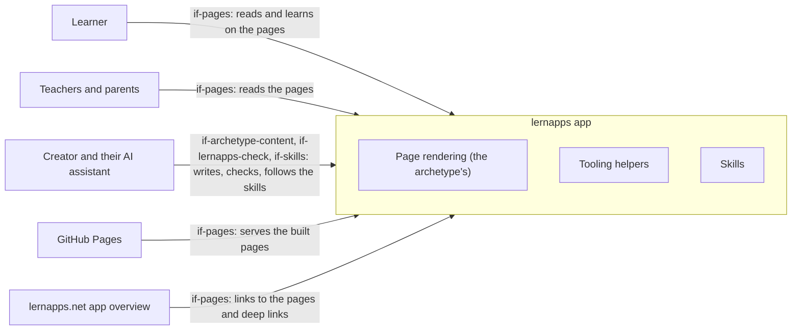

# System Scope and Context

The system is one lernapps app of any archetype, built into static pages. Outside it are the people who use or write
the app, the host that serves it and the app overview that links to it. Where an archetype has the optional tutor,
its extension adds the learner's own assistant. Each actor requires an interface of chapter 5.

## Context diagram

The creator's assistant writes the archetype's content and follows the skills. Every other actor meets the built
pages.

```arc42
:::diagram
id: system-context
view: context
notation: mermaid
:::
```



## Learner

Adults and students, often in German schools. They learn in the browser with any input device and without an
account.

```arc42
:::actor
id: actor-learner
title: Learner
type: person
description: Reads the pages and learns on them in the browser, without an account
requires: if-pages
:::
```

## Teachers and parents

They read the pages and the app's entry. They want to know what the app teaches and whether it may be used.

```arc42
:::actor
id: actor-teacher-parent
title: Teachers and parents
type: person
description: Read the pages to see what the app teaches and what it does not offer
requires: if-pages
:::
```

## Creator and their AI assistant

The assistant writes what the archetype allows, runs the checks and follows the skills. The creator decides and lists
the app.

OPEN: No interface is modelled for `vp build` and `vp dev`, which the assistant also runs; should there be one?

```arc42
:::actor
id: actor-creator-assistant
title: Creator and their AI assistant
type: system
description: Writes the archetype's content, runs lernapps check and follows the skills
requires: if-archetype-content, if-lernapps-check, if-skills
:::
```

## GitHub Pages

Serves the app's static files at `lernapps.net/<repo>/`. Pull requests get a preview (chapter 7).

```arc42
:::actor
id: actor-github-pages
title: GitHub Pages
type: system
description: Serves the built pages and bundle of the app at lernapps.net/<repo>/
requires: if-pages
:::
```

## lernapps.net app overview

The app connects to the platform only through its entry in the app overview. The entry links to the app's pages and
deep links. `lernapps check` verifies that these links resolve.

```arc42
:::actor
id: actor-app-overview
title: lernapps.net app overview
type: system
description: Lists the app with one entry whose URL and topic links point to its pages and deep links
requires: if-pages
:::
```
