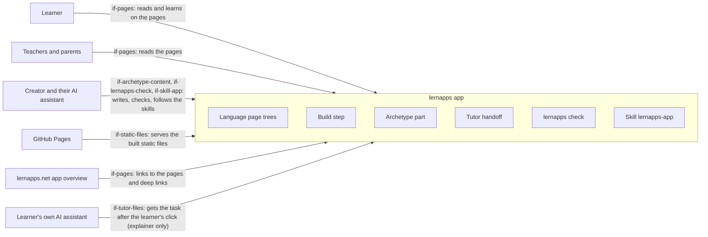

# System Scope and Context

The system is one lernapps app of any archetype: the frame runtime, the tooling helpers and the archetype part,
built into static pages. Outside it are the people who use or write the app and the few systems it meets: the host
that serves it, the app overview that links to it and, for the optional tutor, the learner's own assistant. Each
actor requires an interface of chapter 5: the pages, the built static files, the tutor files or, for the creator's
assistant, what the archetype lets it write, the check command and the skills.

## Context diagram

The creator's assistant writes the archetype's content and follows the skills; every other actor meets the built
pages at the boundary.

```arc42
:::diagram
id: system-context
view: context
notation: mermaid
:::
```



## Learner

Adults and students, often in German schools, who learn in the browser, with keys and pointer, without an account;
what the app remembers stays on their device.

```arc42
:::actor
id: actor-learner
title: Learner
type: person
description: Reads the pages and learns on them in the browser, without an account
requires: if-pages
:::
```

## Teachers and parents

They read the pages and the app's entry to see what the app teaches and whether it may be used; they need the pages
in German.

```arc42
:::actor
id: actor-teacher-parent
title: Teachers and parents
type: person
description: Read the pages to see what the app teaches and what it does not offer
requires: if-pages
:::
```

## Creator and their AI assistant

The creator's AI assistant writes what the archetype lets it write, runs the checks and follows the skill
`lernapps-app` and its archetype's skill (each extension names it); the creator decides and lists the app.

OPEN: No interface is modelled for `vp build` and `vp dev`, which the assistant also runs; should there be one?

```arc42
:::actor
id: actor-creator-assistant
title: Creator and their AI assistant
type: system
description: Writes the archetype's content, runs lernapps check and follows the skills
requires: if-archetype-content, if-lernapps-check, if-skill-app
:::
```

## GitHub Pages

The app is static files published from its repo's `gh-pages` branch to `lernapps.net/<repo>/`; there is no server of
the app's own, and pull requests get a preview.

```arc42
:::actor
id: actor-github-pages
title: GitHub Pages
type: system
description: Serves the built static files of the app at lernapps.net/<repo>/
requires: if-static-files
:::
```

## lernapps.net app overview

The app connects to the platform only through its entry in the app overview, which links to the app's pages and,
through its topics, to its deep links; `entry-links-resolve` checks that these links answer. The entry's fact sheet
also states the app's size (not built yet).

```arc42
:::actor
id: actor-app-overview
title: lernapps.net app overview
type: system
description: Lists the app with one entry whose URL and topic links point to its pages and deep links
requires: if-pages
:::
```

## Learner's own AI assistant

The optional tutor is this assistant, which the learner brings and controls; no model runs in the browser. After the
learner's click, the app hands it the current task through the tutor prompt and the static tutor files. Built for
the explainer, not built for the quiz and interactive apps.

```arc42
:::actor
id: actor-learner-assistant
title: Learner's own AI assistant
type: system
description: Receives the task through the tutor prompt and the tutor files after the learner's click
requires: if-tutor-files
:::
```
