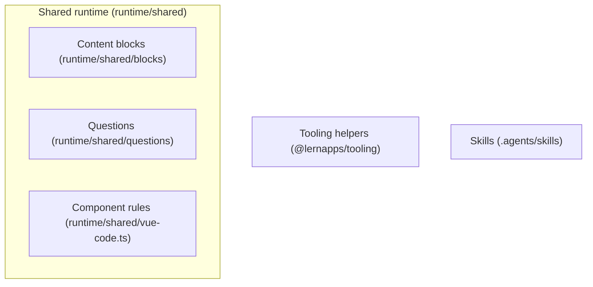

# Building Blocks

The generic part has three roots that every app shares: the shared runtime of `@lernapps/app-templates`, the tooling
helpers of `@lernapps/tooling` and the skills the app commits.

Each archetype's extension adds the rest of level 1. It defines the runtime `bb-archetype-runtime` with the parts
`bb-build`, `bb-validation`, `bb-render`, `bb-shell`, `bb-e2e` and `bb-runtime-texts`, under exactly these ids. It
also defines the parts the creator writes; one of them provides `if-archetype-content`. Parts that only some
archetypes have are in their extensions. A loading indicator (`dec-no-size-limit`) and a settings dialog
(`dec-no-settings`) are not part of the frame.

Paths are relative to the root of `lernapps/app-templates`. In an app's copy, a template folder's paths lose the
folder prefix. An app's architecture is this part followed by its extension, so the level-1 view of a whole app is in
its extension.

## Level 1: the generic roots

```arc42
:::diagram
id: building-blocks-generic
view: building-block
notation: mermaid
:::
```



## Shared runtime

Built. The code the archetypes' runtimes share. It provides:

- the page trees in every declared language, with the language switch and the 404 page;
- learner texts by language;
- reading content from YAML and reporting its problems by file and line;
- restricted Markdown and formulas;
- the frame of every page, with header, footer, and light and dark colours;
- the examples check, which runs an exercise's examples through the same checker as the page;
- Vue at build, for archetypes with components;
- the content blocks, the questions and the component rules (below).

The app never edits it.

```arc42
:::building-block
id: bb-runtime
title: Shared runtime
path: runtime/shared
technology: TypeScript
implements: concept-languages, concept-readable-without-js
:::
```

### Shared runtime modules

The archetype's runtime uses them at build and in its tests.

```arc42
:::interface
id: if-shared-runtime
title: Page trees, languages, examples check, Vue at build
provider: bb-runtime
protocol: TypeScript imports (runtime/shared)
path: runtime/shared
:::
```

### Content blocks

Built, for every archetype that shows content. The blocks are prose, a formula, a figure, a labelled figure, a table,
a quotation and program code, with the credit of an image or quotation. Images come from the app's `src/images/`.
This block owns their schema, their checks, their rendering and their look. The quiz shows them as material of a
question, the explainer as blocks of a page.

```arc42
:::building-block
id: bb-blocks
title: Content blocks
parent: bb-runtime
path: runtime/shared/blocks
technology: TypeScript
:::
```

#### Content blocks interface

Validation and rendering of an archetype use their types, checks and renderer.

```arc42
:::interface
id: if-blocks
title: The content blocks (checkMaterial, renderMaterial, materialIn)
provider: bb-blocks
protocol: TypeScript imports (runtime/shared/blocks), @lernapps/app-templates/blocks
path: runtime/shared/blocks
:::
```

### Questions

Built, for every archetype that has questions. It holds the six question types and decides what counts as a right
answer. The same decision holds at build, in the browser and in the tests. The quiz asks the questions; the explainer
uses them in its exercises. Neither archetype imports the other.

```arc42
:::building-block
id: bb-questions
title: Questions
parent: bb-runtime
path: runtime/shared/questions
technology: TypeScript
:::
```

#### Questions interface

Validation, rendering, browser code and tests of an archetype use the question types and their checker.

```arc42
:::interface
id: if-questions
title: The question types, rendering, engine and checker
provider: bb-questions
protocol: TypeScript imports (runtime/shared/questions), @lernapps/app-templates/questions
path: runtime/shared/questions
:::
```

### Component rules

Built, for every archetype that has Vue components. It checks a component and the app's modules it imports against
the concept "Component rules" (chapter 8). Each archetype sets which modules count as the app's own.

```arc42
:::building-block
id: bb-component-rules
title: Component rules
parent: bb-runtime
path: runtime/shared/vue-code.ts
technology: TypeScript, Vue SFC compiler
implements: concept-component-rules
:::
```

#### Component rules interface

An archetype's validation runs these checks on its components.

```arc42
:::interface
id: if-component-rules
title: The code checks of a component (codeProblems, with the archetype's scope)
provider: bb-component-rules
protocol: TypeScript imports (runtime/shared/vue-code.ts)
path: runtime/shared/vue-code.ts
:::
```

## Tooling helpers

Built. The parts of `@lernapps/tooling` that every app uses. Rules, helpers and guidance reach the app through
updates, without edits. The block provides:

- the build preset: lint with the lernapps rules, type check, format, unit tests and git hooks;
- lint rules for the platform's rules;
- `lernapps check`, which tests the built app;
- the test browser setup at desktop width and 360 px;
- small device storage, accessibility helpers and translation.

The skills are a block of their own. Large storage (IndexedDB) is left out (`dec-small-storage`).

```arc42
:::ignore H014 @lernapps/tooling is installed in node_modules (node_modules/@lernapps/tooling), which git does not track, and the validator resolves paths only among tracked files (E011)
:::
:::building-block
id: bb-tooling
title: Tooling helpers
technology: TypeScript, vite-plus, Playwright (@lernapps/tooling, an optional peer of this package)
implements: concept-accessibility, concept-component-rules, concept-device-storage, concept-languages, concept-readable-without-js
:::
```

### Preset interface

The app's build configuration uses the preset with its archetype's plugin.

```arc42
:::ignore H014 the interface is in @lernapps/tooling, installed in the untracked node_modules (archetypes/shared/preset.ts)
:::
:::interface
id: if-preset
title: lernapps() preset
provider: bb-tooling
protocol: TypeScript import, @lernapps/tooling/preset
:::
```

### Check command

The creator's assistant, the pre-push hook and CI run `lernapps check`. Its report names each rule that failed.

```arc42
:::ignore H014 the interface is in @lernapps/tooling, installed in the untracked node_modules (check/)
:::
:::interface
id: if-lernapps-check
title: lernapps check command
provider: bb-tooling
protocol: CLI, validation report
:::
```

### Device storage interface

Loads, saves and removes values under the app's prefix. The app keeps working when storage is blocked or full.

```arc42
:::ignore H014 the interface is in @lernapps/tooling, installed in the untracked node_modules (archetypes/shared/storage.ts)
:::
:::interface
id: if-device-storage
title: createStorage(app)
provider: bb-tooling
protocol: TypeScript import, @lernapps/tooling/storage
:::
```

### Accessibility helpers interface

Announces changes to screen readers, moves the focus and tells whether the learner wants less motion.

```arc42
:::ignore H014 the interface is in @lernapps/tooling, installed in the untracked node_modules (archetypes/shared/a11y.ts)
:::
:::interface
id: if-a11y
title: announce, moveFocus, prefersReducedMotion
provider: bb-tooling
protocol: TypeScript import, @lernapps/tooling/a11y
:::
```

### Translator interface

Code gets learner texts from the translator, never as strings in code.

```arc42
:::ignore H014 the interface is in @lernapps/tooling, installed in the untracked node_modules (archetypes/shared/i18n.ts)
:::
:::interface
id: if-translator
title: translator(messages)
provider: bb-tooling
protocol: TypeScript import, @lernapps/tooling/i18n
:::
```

## Skills

Built in the tooling. An app commits its skills under `.agents/skills/`: one for every app, one for its archetype,
some for content and listing, and the app's own content guide. `lernapps update` replaces the platform's skills and
leaves the app's own alone. The skills hold the guidance that no check can give (`dec-skill-interface`).

```arc42
:::ignore H014 the skills are committed in each app under .agents/skills; this repository has none
:::
:::building-block
id: bb-skills
title: Skills
technology: Markdown skills (SKILL.md), from the skills/ folder of @lernapps/tooling
implements: concept-low-stimulation
:::
```

### Skills interface

The creator's assistant loads the skills before it works on the app.

```arc42
:::ignore H014 the skills are committed in each app under .agents/skills; this repository has none
:::
:::interface
id: if-skills
title: Skill texts (lernapps-app, the archetype's skill, the content skills, app-content)
provider: bb-skills
protocol: Markdown (SKILL.md) loaded by the assistant
:::
```
