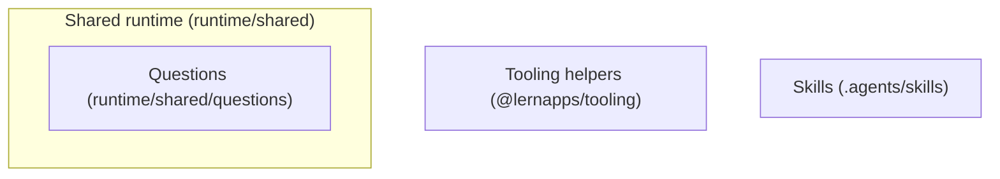

# Building Blocks

The generic part has three roots that every app shares, whatever its archetype: the shared runtime of
`@lernapps/app-templates`, the tooling helpers of `@lernapps/tooling` and the skills the app commits. Each archetype's extension adds the rest of
level 1 (`quiz/docs/arc42/`, `explainer/docs/arc42/`, `interactive/docs/arc42/`): its runtime `bb-archetype-runtime`
with the parts `bb-build`, `bb-validation`, `bb-render`, `bb-shell`, `bb-e2e` and `bb-runtime-texts`, which every
extension defines under these ids, and the parts the creator writes, one of which provides `if-archetype-content`.
Parts that only some archetypes have (component rules, question types, tutor handoff, task numbers, exercise contract)
are in the extensions that use them. Not built and not in the frame now: a loading indicator (`dec-no-size-limit`) and
a settings dialog (`dec-no-settings`).

Paths are relative to the root of `lernapps/app-templates`. The parts in a template folder carry their path with the
folder as prefix (`interactive/src/core`); an app that gets this architecture as a copy has them without it
(`src/core`). An app's architecture is this part followed by its archetype's extension, chapter by chapter; so the
level-1 view of a whole app is in its extension.

## Level 1: the generic roots

```arc42
:::diagram
id: building-blocks-generic
view: building-block
notation: mermaid
:::
```



## Shared runtime

Built. The code the archetypes' runtimes share: the page trees, German at the root and every other language below
`/<language>/`, with alternates, a language switch of plain links and the 404 page, which leads every address the
app does not have to its start page (`pages.ts`); learner texts by language (`languages.ts`); the examples check,
which runs an exercise's accepted and rejected examples through the check the page uses, for the quiz and the
explainer (`examples.ts`); the content as YAML, with its problems placed at file, line and path, the errors of a schema
as problems and the checks of the texts (`content.ts`); restricted Markdown and formulas (`text/`); the checks of the
code of Vue components (`vue-code.ts`); HTML escaping (`html.ts`); the questions, their six types with checker, schema, validation, rendering, engine, end-to-end
helpers and texts, which the quiz and the explainer's exercises both use (`questions/`); Vue at build for the archetypes with components (`vue.ts`); and the app's name, the prefix
of what it stores (`appname.ts`). The app never edits it.

```arc42
:::building-block
id: bb-runtime
title: Shared runtime
path: runtime/shared
technology: TypeScript
implements: concept-languages, concept-readable-without-js
:::
```

### Shared runtime modules

The archetype's runtime imports them at build and in its tests.

```arc42
:::interface
id: if-shared-runtime
title: Page trees, languages, examples check, Vue at build
provider: bb-runtime
protocol: TypeScript imports (runtime/shared)
path: runtime/shared
:::
```

### Questions

Built in the shared runtime, for every archetype that has questions: the six question types and what counts as a right
answer, at build, in the browser and in the tests alike, with their schema, validation, rendering, engine, end-to-end
helpers and texts. The quiz asks them; the explainer's quiz-type exercises and the answers of its generated exercises
use the same. Neither archetype imports the other.

```arc42
:::building-block
id: bb-questions
title: Questions
parent: bb-runtime
path: runtime/shared/questions
technology: TypeScript
:::
```

#### Questions interface

The validation, the rendering, the client module and the tests of an archetype with questions use their types,
rendering, engine and checker.

```arc42
:::interface
id: if-questions
title: The question types, rendering, engine and checker
provider: bb-questions
protocol: TypeScript imports (runtime/shared/questions), @lernapps/app-templates/questions
path: runtime/shared/questions
:::
```

## Tooling helpers

Built. The parts of `@lernapps/tooling` every app uses, so that rules, helpers and guidance reach the app through
updates without edits: the preset (`archetypes/shared/preset.ts`: lint with the lernapps rules, type check, format,
unit tests, the pre-commit staged files, a build with relative URLs); the lint rules (`lint/rules`: learner texts
German, no request before a click, storage through the wrapper, the Vue component rules); `lernapps check` (`check/`:
accessible, usable at 360 px, no request before a click, no tracking, links and entry links resolve, and the
end-to-end tests before a push); the Playwright configuration (`archetypes/shared/playwright.ts`: Chromium at desktop
width and 360 px on a free port); the small storage (`archetypes/shared/storage.ts`); the announcer and focus helpers
(`archetypes/shared/a11y.ts`); and i18n (`archetypes/shared/i18n.ts`). The skills are a block of their own
(`bb-skills`), which the tooling's `skills/` folder is the source of. A large storage (IndexedDB) is left out (`dec-small-storage`).

```arc42
:::ignore H014 @lernapps/tooling is installed in node_modules (node_modules/@lernapps/tooling), which git does not track, and the validator resolves paths only among tracked files (E011)
:::
:::building-block
id: bb-tooling
title: Tooling helpers
technology: TypeScript, vite-plus, Playwright (@lernapps/tooling, an optional peer of this package)
implements: concept-accessibility, concept-component-rules, concept-device-storage, concept-languages, concept-readable-without-js
:::
```

### Preset interface

The app's vite.config.ts calls `lernapps({ plugins: [<archetype>()] })`; the archetype's runtime uses the preset for
its own Vite servers.

```arc42
:::ignore H014 the interface is in @lernapps/tooling, installed in the untracked node_modules (archetypes/shared/preset.ts)
:::
:::interface
id: if-preset
title: lernapps() preset
provider: bb-tooling
protocol: TypeScript import, @lernapps/tooling/preset
:::
```

### Check command

The creator's assistant, the pre-push hook and CI run `lernapps check`; its report names each rule that failed.
`arc42 validate` in the check is decided, not built.

```arc42
:::ignore H014 the interface is in @lernapps/tooling, installed in the untracked node_modules (check/)
:::
:::interface
id: if-lernapps-check
title: lernapps check command
provider: bb-tooling
protocol: CLI, validation report
:::
```

### Device storage interface

Load, save and remove JSON values through `createStorage`, under the app's prefix in `localStorage`; every access is
wrapped, so the app keeps working when storage is blocked or full. The decided quota of 100 kB per app is not built.

```arc42
:::ignore H014 the interface is in @lernapps/tooling, installed in the untracked node_modules (archetypes/shared/storage.ts)
:::
:::interface
id: if-device-storage
title: createStorage(app)
provider: bb-tooling
protocol: TypeScript import, @lernapps/tooling/storage
:::
```

### Accessibility helpers interface

Announcements through the polite live region, focus moves and the reduced-motion query; the end-to-end tests read the
same live region.

```arc42
:::ignore H014 the interface is in @lernapps/tooling, installed in the untracked node_modules (archetypes/shared/a11y.ts)
:::
:::interface
id: if-a11y
title: announce, moveFocus, prefersReducedMotion
provider: bb-tooling
protocol: TypeScript import, @lernapps/tooling/a11y
:::
```

### Translator interface

Code that shows learner texts gets them through `translator(messages)`, never as strings in code.

```arc42
:::ignore H014 the interface is in @lernapps/tooling, installed in the untracked node_modules (archetypes/shared/i18n.ts)
:::
:::interface
id: if-translator
title: translator(messages)
provider: bb-tooling
protocol: TypeScript import, @lernapps/tooling/i18n
:::
```

## Skills

Built in the tooling, one folder per skill. An app commits its skills under `.agents/skills/`: `lernapps-app` for
every app; the archetype's skill (`lernapps-quiz`, `lernapps-explainer` or `lernapps-interactive`); the content
skills (`lernapps-content-research`, `lernapps-exercise-patterns`, `lernapps-content-growth`); `lernapps-listing`;
and the app's own content guide `app-content`. `lernapps update` installs and replaces the `lernapps-*` skills from
the tooling's `skills/` folder and leaves the app's own alone. They hold the guidance no check can make
(`dec-skill-interface`).

```arc42
:::ignore H014 the skills are committed in each app under .agents/skills; this repository has none
:::
:::building-block
id: bb-skills
title: Skills
technology: Markdown skills (SKILL.md), from the skills/ folder of @lernapps/tooling
implements: concept-low-stimulation
:::
```

### Skills interface

The creator's assistant loads `lernapps-app` when it starts work on an app, and its archetype's skill and the content
skills before it writes what the archetype lets it write.

```arc42
:::ignore H014 the skills are committed in each app under .agents/skills; this repository has none
:::
:::interface
id: if-skills
title: Skill texts (lernapps-app, the archetype's skill, the content skills, app-content)
provider: bb-skills
protocol: Markdown (SKILL.md) loaded by the assistant
:::
```
