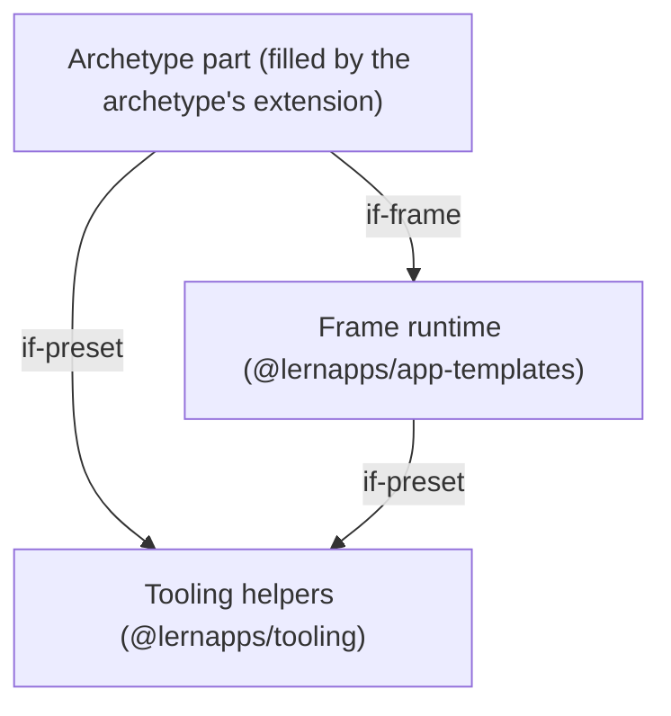
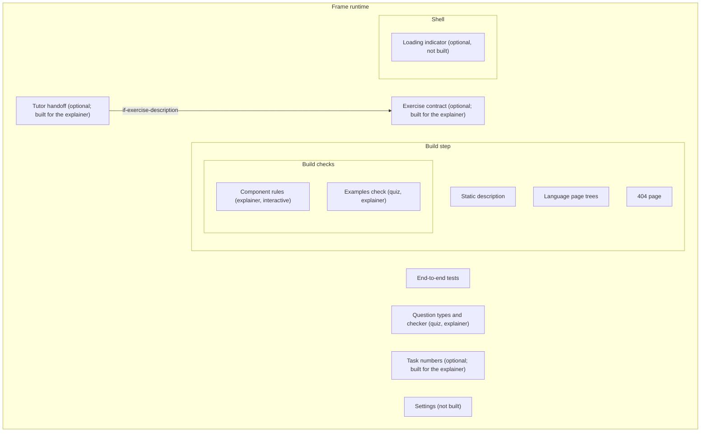
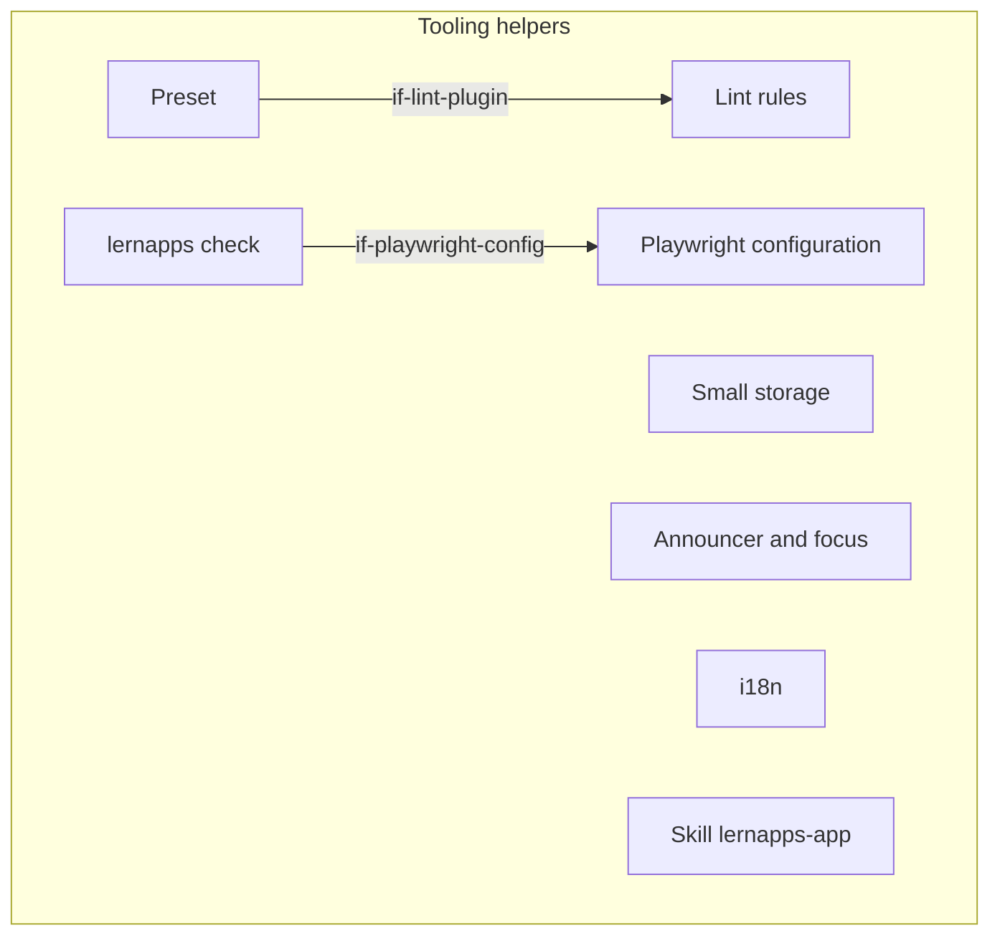

# Building Blocks

The generic architecture of every lernapps app has three parts at level 1: the frame runtime of
`@lernapps/app-templates`, which the app does not change; the tooling helpers, which every app shares; and the
archetype part, an abstract block that each archetype's extension fills (`quiz/docs/arc42/`,
`explainer/docs/arc42/`, `interactive/docs/arc42/`). An extension places its blocks below the generic ones with
`parent` and defines none of them again. Each generic block says whether it is built, optional or not built yet, and
which archetypes realise it.

## Level 1

```arc42
:::diagram
id: building-blocks-level-1
view: building-block
notation: mermaid
:::
```



## Level 2: the frame runtime

```arc42
:::diagram
id: building-blocks-level-2-runtime
view: building-block
notation: mermaid
roots: bb-runtime
:::
```



## Level 2: the tooling helpers

```arc42
:::diagram
id: building-blocks-level-2-tooling
view: building-block
notation: mermaid
roots: bb-tooling
:::
```



## Frame runtime

Built. The shared code of `@lernapps/app-templates` around every archetype part: the build step with its pages and
checks, the shell that starts the archetype's code in the browser, the end-to-end tests, and the optional tutor
handoff, task numbers and exercise contract. The app never edits it.

```arc42
:::building-block
id: bb-runtime
title: Frame runtime
technology: TypeScript, Vite plugins (@lernapps/app-templates, runtime/)
requires: if-preset
:::
```

### Frame interface

The app depends on `@lernapps/app-templates` and imports its archetype's build plugin, start function, style and
end-to-end tests from it.

```arc42
:::interface
id: if-frame
title: Exports of @lernapps/app-templates
provider: bb-runtime
protocol: TypeScript imports (package.json exports)
:::
```

### Build step

Built. The archetype's Vite plugin (`quiz()`, `explainer()` or `interactive()`) reads what the creator wrote, runs
the build checks and writes every page into the built index.html shell; `vp dev` serves the same pages.

```arc42
:::building-block
id: bb-build
title: Build step
parent: bb-runtime
technology: Vite plugin (runtime/<archetype>/plugin.ts)
:::
```

#### Build plugin interface

The app's vite.config.ts adds its archetype's plugin to the tooling preset; that is the only way it enters the build.

```arc42
:::interface
id: if-build-plugin
title: The archetype's Vite plugin
provider: bb-build
protocol: TypeScript import, @lernapps/app-templates/<archetype>/plugin
:::
```

#### Built static files

The build writes the app as static files (pages, 404 page, bundle, and the tutor files where the tutor is built) with
relative URLs, which GitHub Pages serves as they are.

```arc42
:::interface
id: if-static-files
title: Built static files (dist)
provider: bb-build
protocol: Static files over HTTPS (GitHub Pages)
:::
```

#### Static description

Built. The static pages rendered at build that describe the app and carry its content; what each archetype renders,
and how much of it reads without JavaScript, is in its extension (the quiz's worksheet, the explainer's pages, the
interactive start page and app page).

```arc42
:::building-block
id: bb-static-description
title: Static description
parent: bb-build
technology: TypeScript (runtime/<archetype>/render.ts)
requires: if-archetype-content
implements: concept-readable-without-js, concept-accessibility
:::
```

#### Language page trees

Built, every archetype. Every page exists once per declared language, German at the root and every other language
below `/<language>/`, with alternates and a switch of plain links; an app may declare only the languages its runtime
has texts for.

```arc42
:::building-block
id: bb-page-tree
title: Language page trees
parent: bb-build
technology: TypeScript (runtime/shared/pages.ts, languages.ts)
implements: concept-languages, concept-readable-without-js
:::
```

##### Pages interface

Learners, teachers and parents read the app at `lernapps.net/<repo>/` (and `/<language>/`), and the catalog entry and
its topics link there; each extension names its deep links.

```arc42
:::interface
id: if-pages
title: Pages at lernapps.net/<repo>/
provider: bb-page-tree
protocol: HTML pages over HTTPS
:::
```

#### 404 page

Built, every archetype. A 404.html leads every address the app does not have to its start page, because the app is
served statically under any path.

```arc42
:::ignore W002 the 404 page is reached through the static files for any unknown address and calls no interface
:::
:::building-block
id: bb-not-found-page
title: 404 page
parent: bb-build
technology: TypeScript (runtime/shared/pages.ts)
:::
```

#### Build checks

Built. Before anything is written, the build fails with one line per problem, so that a broken app never reaches the
browser. Each extension adds its archetype's checks here. The app's size is not limited; it goes into the catalog
entry (the fact sheet).

```arc42
:::building-block
id: bb-build-checks
title: Build checks
parent: bb-build
technology: TypeScript (runtime/<archetype>/)
requires: if-archetype-content
:::
```

##### Component rules

Built for the explainer and interactive archetypes (the quiz has no components). Code checks on the SFC compiler's
output of the app's Vue components: no network, no `eval`, `innerHTML` or `v-html`, imports only from Vue, the
runtime, the storage, i18n and a11y helpers and the app's own files, browser globals only once mounted.

```arc42
:::building-block
id: bb-component-rules
title: Component rules
parent: bb-build-checks
technology: TypeScript, Vue SFC compiler (runtime/explainer/components.ts)
requires: if-archetype-content
implements: concept-component-rules
:::
```

##### Examples check

Built for the quiz and the explainer, not for interactive apps (their playthroughs take this role). An exercise's
`examples` (accepted and rejected answers, never shown) run through the same check the page uses; one judged
otherwise fails the build.

```arc42
:::building-block
id: bb-examples-check
title: Examples check
parent: bb-build-checks
technology: TypeScript (runtime/shared/examples.ts)
requires: if-archetype-content
:::
```

### Shell

Built. The runtime's code in the browser that the app's `src/main.ts` starts: the quiz engine, the explainer's client
module and islands, or the interactive shell, each in its extension. Every page is usable before it runs, or says
with a `<noscript>` note what needs JavaScript.

```arc42
:::building-block
id: bb-shell
title: Shell
parent: bb-runtime
technology: TypeScript (runtime/<archetype>/)
:::
```

#### Start interface

The app's `src/main.ts` imports the archetype's style and calls its start function (`startQuiz`, `startExplainer`,
`startInteractive`).

```arc42
:::interface
id: if-start
title: The archetype's start function
provider: bb-shell
protocol: TypeScript import, @lernapps/app-templates/<archetype>
:::
```

#### Loading indicator

Optional, not built: a progress bar while a page loads at start, so that a large app shows that it is coming; the
size of an app is not limited.

```arc42
:::ignore W002 not built; it would only show the loading of a page and needs no interface
:::
:::building-block
id: bb-loading-indicator
title: Loading indicator
parent: bb-shell
:::
```

### End-to-end tests

Built. The archetype's tests derive what to check from what the creator wrote, so an app writes no test code for the
pages; they check what the archetype shows without JavaScript in every language and the live pages at desktop width
and 360 px.

```arc42
:::building-block
id: bb-e2e
title: End-to-end tests
parent: bb-runtime
technology: Playwright (runtime/<archetype>/e2e.ts)
requires: if-archetype-content, if-a11y
implements: concept-readable-without-js
:::
```

#### Tests interface

The app's `e2e/<archetype>.e2e.ts` only calls the archetype's test function (`quizTests`, `explainerTests`,
`interactiveTests`).

```arc42
:::interface
id: if-e2e-tests
title: The archetype's test function
provider: bb-e2e
protocol: TypeScript import, @lernapps/app-templates/<archetype>/e2e
:::
```

### Question types and checker

Built in the quiz's runtime and used by the quiz and the explainer (as its quiz-type exercises), not by interactive
apps: the six question types and what counts as a right answer, at build, in the browser and in the tests alike.

```arc42
:::building-block
id: bb-question-types
title: Question types and checker
parent: bb-runtime
technology: TypeScript (runtime/quiz/quiz.ts, question.ts)
:::
```

#### Question exports

One question's schema, validation, rendering, checker and messages, and `startQuestion` in the browser.

```arc42
:::interface
id: if-question-exports
title: One question (renderQuestion, validateQuestion, checker, startQuestion)
provider: bb-question-types
protocol: TypeScript import, @lernapps/app-templates/quiz/question
:::
```

### Tutor handoff

Optional. Built for the explainer, not built for the quiz and interactive apps. No model runs in the browser: after
the learner's click the app hands the current task to the learner's own assistant with a prompt, a provider choice
and a clipboard fallback, and "Zurück zum Tutor" leads back.

```arc42
:::building-block
id: bb-tutor-handoff
title: Tutor handoff
parent: bb-runtime
technology: TypeScript (runtime/explainer/tutor.ts, tutorpage.ts, prompt.ts)
requires: if-archetype-content, if-exercise-description
implements: concept-tutor
:::
```

#### Tutor prompt and tutor files

The prompt names the task on the learner's screen and links the static `tutor.md` files and `llms.txt`, which give
the assistant the tasks and their solutions; a chat assistant reads them without running JavaScript.

```arc42
:::interface
id: if-tutor-files
title: Tutor prompt, tutor.md and llms.txt
provider: bb-tutor-handoff
protocol: Prompt text (clipboard or provider link), static Markdown files over HTTPS
:::
```

### Task numbers

Optional. Built for the explainer, not built for the quiz and interactive apps: the distinct tasks of a seeded
exercise numbered 1 to N, the one identifier learner, tutor and address (`?<id>=<n>`) share.

```arc42
:::building-block
id: bb-task-numbers
title: Task numbers
parent: bb-runtime
technology: TypeScript (runtime/explainer/tasks.ts)
requires: if-archetype-content
implements: concept-determinism
:::
```

### Exercise contract

Optional. Built for the explainer, not built for the quiz and interactive apps: what an exercise says about itself.
It gives the task and its solution as text in each language (`describe`) and what the exercise is for a tutor
(`about`); the build tests the logic over fixed seeds and reads these texts for the tutor files and the text without
JavaScript.

```arc42
:::building-block
id: bb-exercise-contract
title: Exercise contract
parent: bb-runtime
technology: TypeScript (runtime/explainer/components.ts, generated.ts)
requires: if-archetype-content
:::
```

#### Exercise description

The task and solution texts per task number and language, and the exercise's `about`, as the tutor handoff reads them.

```arc42
:::interface
id: if-exercise-description
title: describe and about of an exercise
provider: bb-exercise-contract
protocol: TypeScript values at build time
:::
```

### Settings

Not built and not in scope now (owner): a settings dialog, e.g. time limit off, less motion, sound or pause. Noted so
that an app that needs one later adds it here rather than on its own.

```arc42
:::ignore W002 not built and not in scope; noted so that a later settings dialog goes into the frame
:::
:::building-block
id: bb-settings
title: Settings
parent: bb-runtime
:::
```

## Tooling helpers

Built. The parts of `@lernapps/tooling` every app uses, whatever its archetype, so that rules, helpers and guidance
reach the app through updates without edits. Each extension adds its archetype's skill here.

```arc42
:::building-block
id: bb-tooling
title: Tooling helpers
technology: TypeScript (@lernapps/tooling)
:::
```

### Preset interface

The app's vite.config.ts calls `lernapps({ plugins: [<archetype>()] })`; the runtime's plugins use the preset for their
own Vite servers.

```arc42
:::interface
id: if-preset
title: lernapps() preset
provider: bb-tooling
protocol: TypeScript import, @lernapps/tooling/preset
:::
```

### Preset

Built. The vite-plus configuration the app extends and never edits: lint with the lernapps rules, type check, format,
unit tests, pre-commit staged files and a build with relative URLs.

```arc42
:::building-block
id: bb-preset
title: Preset
parent: bb-tooling
technology: vite-plus (archetypes/shared/preset.ts)
requires: if-lint-plugin
:::
```

### Lint rules

Built. The lernapps lint rules (learner texts German, no request before a click, storage through the wrapper, the Vue
component rules, suppression reasons), set by the preset.

```arc42
:::building-block
id: bb-lint-rules
title: Lint rules
parent: bb-tooling
technology: lint plugin (lint/rules)
implements: concept-component-rules
:::
```

#### Lint plugin

The preset turns the rules on; an app never lowers them.

```arc42
:::interface
id: if-lint-plugin
title: lernapps lint plugin
provider: bb-lint-rules
protocol: lint plugin configuration
:::
```

### lernapps check

Built. `lernapps check` verifies the built app (accessible, usable at 360 px, no request before a click, no tracking,
links and entry links resolve; for the explainer also its pages without JavaScript) and runs the e2e tests before a
push. `arc42 validate` in the check is planned, not built yet.

```arc42
:::building-block
id: bb-lernapps-check
title: lernapps check
parent: bb-tooling
technology: TypeScript CLI (check/)
requires: if-playwright-config
implements: concept-accessibility, concept-readable-without-js
:::
```

#### Check command

The creator's assistant, the pre-push hook and CI run `lernapps check`; its report names each rule that failed.

```arc42
:::interface
id: if-lernapps-check
title: lernapps check command
provider: bb-lernapps-check
protocol: CLI, validation report
:::
```

### Playwright configuration

Built. Runs the e2e tests against the built app on a free port, in Chromium at desktop width and 360 px.

```arc42
:::building-block
id: bb-playwright-config
title: Playwright configuration
parent: bb-tooling
technology: Playwright (archetypes/shared/playwright.ts)
:::
```

#### Playwright configuration interface

Each app's playwright.config.ts takes it as generated.

```arc42
:::interface
id: if-playwright-config
title: Shared Playwright configuration
provider: bb-playwright-config
protocol: TypeScript import, @lernapps/tooling/playwright
:::
```

### Small storage

Built: the only storage, `localStorage` under the app's prefix, every access wrapped so the app keeps working when
storage is blocked or full. Each extension says what its archetype keeps there. The decided quota of 100 kB per app
is not built yet.

```arc42
:::building-block
id: bb-small-storage
title: Small storage
parent: bb-tooling
technology: localStorage (archetypes/shared/storage.ts)
implements: concept-device-storage
:::
```

#### Device storage interface

Load, save and remove JSON values through `createStorage`.

```arc42
:::interface
id: if-device-storage
title: createStorage(app)
provider: bb-small-storage
protocol: TypeScript import, @lernapps/tooling/storage
:::
```

### Announcer and focus

Built. Live-region announcements, focus moves and the reduced-motion query, so that feedback reaches screen readers
and keyboard users.

```arc42
:::building-block
id: bb-a11y
title: Announcer and focus
parent: bb-tooling
technology: DOM, ARIA live regions (archetypes/shared/a11y.ts)
implements: concept-accessibility
:::
```

#### Accessibility helpers interface

The archetype's code in the browser announces and moves the focus through it; the end-to-end tests read its polite
live region.

```arc42
:::interface
id: if-a11y
title: announce, moveFocus, prefersReducedMotion
provider: bb-a11y
protocol: TypeScript import, @lernapps/tooling/a11y
:::
```

### i18n

Built. A translator over message files, so learner texts never sit as strings in code.

```arc42
:::building-block
id: bb-i18n
title: i18n
parent: bb-tooling
technology: TypeScript, Intl (archetypes/shared/i18n.ts)
implements: concept-languages
:::
```

#### Translator interface

Code that shows learner texts gets them through `translator(messages)`.

```arc42
:::interface
id: if-translator
title: translator(messages)
provider: bb-i18n
protocol: TypeScript import, @lernapps/tooling/i18n
:::
```

### Skill lernapps-app

Built: the rules every app keeps, whatever its archetype, each with its id, used together with the archetype's
skill, which its extension names.

```arc42
:::building-block
id: bb-skill-app
title: Skill lernapps-app
parent: bb-tooling
technology: Markdown skill (skills/lernapps-app)
:::
```

#### Skill text of lernapps-app

The creator's assistant loads it when it starts work on an app.

```arc42
:::interface
id: if-skill-app
title: Skill text of lernapps-app
provider: bb-skill-app
protocol: Markdown (SKILL.md) loaded by the assistant
:::
```

## Archetype part

Abstract: the part of the app its archetype defines, filled by the extension (the quiz's engine and question bank,
the explainer's pages, exercises, islands and content, the interactive app's core, UI, data and playthroughs). Thin
root files (vite.config.ts, `e2e/<archetype>.e2e.ts`, `src/main.ts`) bind it to the frame and the tooling. An
interactive app adds its own part below its extension's blocks.

```arc42
:::building-block
id: bb-archetype
title: Archetype part
requires: if-frame, if-preset
implements: concept-archetype-extension
:::
```

### Archetype content

What the creator writes, in the archetype's notation: the question bank, the explainer's content, or the interactive
app's description, code and playthroughs. Each extension names its concrete interface.

```arc42
:::interface
id: if-archetype-content
title: What the creator writes (the archetype's notation)
provider: bb-archetype
protocol: JSON, YAML or TypeScript under a JSON Schema or contract
:::
```
