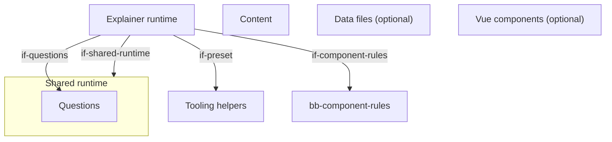

# Building Blocks

The explainer's extension of the generic architecture (`docs/arc42/` at the root of `lernapps/app-templates`): an
explainer of chapters of pages with an exercise on every page, whose build step, rendering, validation, client module,
islands, generated exercises, tutor handoff, task numbers and tests the runtime `runtime/explainer/` ships, and whose
creator writes the content as YAML, data files and, only where no block fits, Vue components under the component
contract (`explainer-only-content`, `prefer-built-in-block`); `src/main.ts` stays as generated. It reuses the quiz's
question types for its quiz-type exercises. Every page is complete without JavaScript
(`qg-explainer-readable-without-js`). The creator's assistant follows the skill `lernapps-explainer` (`if-skills`). An
explainer app writes no architecture of its own: the content schema fixes its structure.

## Level 1 (explainer)

```arc42
:::diagram
id: building-blocks-explainer-level-1
view: building-block
notation: mermaid
:::
```



## Level 2: the explainer runtime

```arc42
:::diagram
id: building-blocks-explainer-runtime
view: building-block
notation: mermaid
:::
```



```mermaid
flowchart TB
    subgraph bb-archetype-runtime["Explainer runtime"]
        bb-build["Build step"]
        bb-validation["Content validation"]
        bb-render["Page rendering"]
        bb-shell["Client module"]
        bb-islands["Component islands"]
        bb-generated-exercises["Generated exercises"]
        bb-tutor-handoff["Tutor handoff"]
        bb-task-numbers["Task numbers"]
        bb-e2e["End-to-end tests"]
        bb-runtime-texts["Runtime texts"]
    end
    bb-explainer-content["Content"]
    bb-explainer-data["Data files"]
    bb-explainer-components["Vue components"]
    bb-tooling["Tooling helpers"]
    bb-build -->|"if-archetype-content"| bb-explainer-content
    bb-build -->|"if-exercise-logic"| bb-explainer-components
    bb-build -->|"if-tutor-files"| bb-tutor-handoff
    bb-validation -->|"if-archetype-content"| bb-explainer-content
    bb-validation -->|"if-data-files"| bb-explainer-data
    bb-render -->|"if-archetype-content"| bb-explainer-content
    bb-render -->|"if-vue-component"| bb-explainer-components
    bb-render -->|"if-runtime-texts"| bb-runtime-texts
    bb-shell -->|"if-task-numbers"| bb-task-numbers
    bb-shell -->|"if-tutor-files"| bb-tutor-handoff
    bb-shell -->|"if-runtime-texts"| bb-runtime-texts
    bb-shell -->|"if-device-storage"| bb-tooling
    bb-shell -->|"if-a11y"| bb-tooling
    bb-islands -->|"if-vue-component"| bb-explainer-components
    bb-islands -->|"if-task-numbers"| bb-task-numbers
    bb-generated-exercises -->|"if-archetype-content"| bb-explainer-content
    bb-generated-exercises -->|"if-data-files"| bb-explainer-data
    bb-tutor-handoff -->|"if-archetype-content"| bb-explainer-content
    bb-tutor-handoff -->|"if-exercise-logic"| bb-explainer-components
    bb-tutor-handoff -->|"if-task-numbers"| bb-task-numbers
    bb-e2e -->|"if-archetype-content"| bb-explainer-content
    bb-e2e -->|"if-runtime-texts"| bb-runtime-texts
```

## Explainer runtime

Built. The runtime of every explainer, which the app does not change: it validates and renders the content into
static pages, writes the tutor files, makes the exercises live in the browser and brings the end-to-end tests.

```arc42
:::building-block
id: bb-archetype-runtime
title: Explainer runtime
path: runtime/explainer
technology: TypeScript, Vite plugin, Vue
requires: if-shared-runtime, if-preset, if-questions, if-component-rules
implements: concept-archetype-extension
:::
```

### Build step

Built. The plugin `explainer()` reads and validates the content, runs the component rules and the property test of
each generated exercise and exercise component over fixed seeds, and only then writes every page in each language,
the tutor files where the tutor is on, and the 404 page; `vp dev` serves the same pages.

```arc42
:::building-block
id: bb-build
title: Build step
parent: bb-archetype-runtime
path: runtime/explainer/plugin.ts
technology: Vite plugin
requires: if-archetype-content, if-component-rules, if-exercise-logic, if-tutor-files
:::
```

#### Build plugin interface

The app's vite.config.ts adds `explainer()` to the tooling preset.

```arc42
:::interface
id: if-build-plugin
title: explainer() Vite plugin
provider: bb-build
protocol: TypeScript import, @lernapps/app-templates/explainer/plugin
path: runtime/explainer/plugin.ts
:::
```

### Content validation

Built. Validates every content file against its part of the schema, then what a schema cannot say (complete order
lists, depth, unique ids, complete languages, restricted Markdown, formulas in the command list, sources and
licences, links to pages and sections, an exercise on every page, components and their props), one line per problem
with file and line.

```arc42
:::building-block
id: bb-validation
title: Content validation
parent: bb-archetype-runtime
path: runtime/explainer/load.ts
technology: Ajv, JSON Schema, YAML
requires: if-archetype-content, if-data-files, if-component-rules, if-questions
:::
```

### Page rendering

Built. Renders every YAML page to static HTML in each language: text in restricted Markdown, formulas as MathML,
figures as SVG, tables, timelines, code, the exercises with their solution folded (a generated one with three worked
tasks), the navigation and the glossary, and each Vue component's island as the server renderer drew it, with its
`nojs` text. Without JavaScript every page is complete.

```arc42
:::building-block
id: bb-render
title: Page rendering
parent: bb-archetype-runtime
path: runtime/explainer/render.ts
technology: TypeScript, Temml, highlight.js, Vue server renderer
requires: if-archetype-content, if-vue-component, if-runtime-texts, if-questions
implements: concept-readable-without-js, concept-accessibility
:::
```

#### Pages interface

Learners, teachers and parents read the explainer at `lernapps.net/<repo>/` (and `/<language>/`): the start page, a
page per chapter, the content pages at `<chapter>/<page>/` and the glossary, with `?<id>=<n>` for the task number of
an exercise; the catalog entry and its topics link there.

```arc42
:::interface
id: if-pages
title: Explainer pages at lernapps.net/<repo>/
provider: bb-render
protocol: HTML pages over HTTPS
path: runtime/explainer/routes.ts
:::
```

### Client module

Built. Makes a page's exercises live: answered before the solution shows, the reason of a wrong answer, "Neue
Aufgabe", the task numbers in the address; and the tutor button. It keeps only the learner's chosen way to the tutor
on the device.

```arc42
:::building-block
id: bb-shell
title: Client module
parent: bb-archetype-runtime
path: runtime/explainer/explainer.ts
technology: TypeScript, DOM
requires: if-questions, if-task-numbers, if-tutor-files, if-runtime-texts, if-device-storage, if-a11y
implements: concept-accessibility, concept-determinism
:::
```

#### Start interface

The app's `src/main.ts` imports the explainer's style and calls `startExplainer()`.

```arc42
:::interface
id: if-start
title: startExplainer()
provider: bb-shell
protocol: TypeScript import, @lernapps/app-templates/explainer
path: runtime/explainer/explainer.ts
:::
```

### Component islands

Built. Only on a page with a component: loads Vue, hydrates each component's island with the props of the page's
language, gives an exercise component the seed of its task number, and shows its feedback.

```arc42
:::building-block
id: bb-islands
title: Component islands
parent: bb-archetype-runtime
path: runtime/explainer/islands.ts
technology: Vue hydration
requires: if-vue-component, if-task-numbers
:::
```

### Generated exercises

Built. Exercises drawn from a seed (`generated`), the explainer's own notation: the same code gives three worked tasks
at build, runs the property test over fixed seeds and draws a live task in the browser, so both agree; their answers
are checked through the question types' checker.
The texts of a quiz-type exercise are plain text in which `$…$` is a formula, rendered as MathML at build and checked
like every formula.

```arc42
:::building-block
id: bb-generated-exercises
title: Generated exercises
parent: bb-archetype-runtime
path: runtime/explainer/generated
technology: TypeScript, exact fractions
requires: if-archetype-content, if-data-files, if-questions
implements: concept-determinism
:::
```

### Tutor handoff

Built, optional per app. No model runs in the browser: after the learner's click the app hands the current task to the
learner's own assistant with a prompt, a provider choice and a clipboard fallback, and "Zurück zum Tutor" leads back.
The build writes a `tutor.md` per page (each exercise's tasks by number with their solutions, from the exercise's
`describe` and `about` for a component) and `llms.txt`.

```arc42
:::building-block
id: bb-tutor-handoff
title: Tutor handoff
parent: bb-archetype-runtime
path: runtime/explainer/tutor.ts
technology: TypeScript, static Markdown
requires: if-archetype-content, if-exercise-logic, if-task-numbers
implements: concept-tutor
:::
```

#### Tutor prompt and tutor files

The prompt names the task on the learner's screen and links the static `tutor.md` files and `llms.txt`, which give
the assistant the tasks and their solutions; a chat assistant reads them without running JavaScript.

```arc42
:::interface
id: if-tutor-files
title: Tutor prompt, tutor.md and llms.txt
provider: bb-tutor-handoff
protocol: Prompt text (clipboard or provider link), static Markdown files over HTTPS
path: runtime/explainer/prompt.ts
:::
```

### Task numbers

Built: the distinct tasks of a seeded exercise numbered 1 to N, the one identifier learner, tutor and address
(`?<id>=<n>`) share.

```arc42
:::building-block
id: bb-task-numbers
title: Task numbers
parent: bb-archetype-runtime
path: runtime/explainer/tasks.ts
technology: TypeScript
implements: concept-determinism
:::
```

#### Task numbers interface

The client module, the islands and the tutor handoff turn a task number into its seed and back.

```arc42
:::interface
id: if-task-numbers
title: Task numbers and their seeds
provider: bb-task-numbers
protocol: TypeScript import
path: runtime/explainer/tasks.ts
:::
```

### End-to-end tests

Built. `explainerTests()` derives from the content what every page must show, checks it without JavaScript in every
language, and with JavaScript one exercise per type and page and every component.

```arc42
:::building-block
id: bb-e2e
title: End-to-end tests
parent: bb-archetype-runtime
path: runtime/explainer/e2e.ts
technology: Playwright
requires: if-archetype-content, if-runtime-texts, if-questions
:::
```

#### Tests interface

The app's `e2e/explainer.e2e.ts` only calls `explainerTests()`.

```arc42
:::interface
id: if-e2e-tests
title: explainerTests()
provider: bb-e2e
protocol: TypeScript import, @lernapps/app-templates/explainer/e2e
path: runtime/explainer/e2e.ts
:::
```

### Runtime texts

Built. The explainer's own learner texts in German and English; an app may declare only these languages.

```arc42
:::building-block
id: bb-runtime-texts
title: Runtime texts
parent: bb-archetype-runtime
path: runtime/explainer/messages.ts
technology: JSON per language
implements: concept-languages
:::
```

#### Runtime texts interface

The rendering, the client module and the tests take the explainer's texts by key and language.

```arc42
:::interface
id: if-runtime-texts
title: Explainer texts by language
provider: bb-runtime-texts
protocol: TypeScript import, JSON
path: runtime/explainer/messages
:::
```

## Content

Built in the template, written by the creator: `src/app.yaml` and a folder per chapter with `chapter.yaml` and its
pages of blocks, each page with an exercise.

```arc42
:::building-block
id: bb-explainer-content
title: Content
technology: YAML, restricted Markdown, LaTeX subset
implements: concept-languages
path: explainer/src/app.yaml
:::
```

### Content interface

The explainer's content: build, validation, rendering, generated exercises, tutor files and tests read it only through
its schema.

```arc42
:::interface
id: if-archetype-content
title: Content YAML (explainer.v1 schema)
provider: bb-explainer-content
protocol: YAML, JSON Schema
path: runtime/explainer/explainer.v1.schema.json
:::
```

## Data files

Optional, not in the template: `src/data/<name>.yaml`, lists of records a timeline or a generated exercise draws
from, so each fact is written once.

```arc42
:::ignore H014 optional and not in the template; an app that adds it sets its path in its own architecture
:::
:::building-block
id: bb-explainer-data
title: Data files
technology: YAML
:::
```

### Data files interface

A block names a data file by its name (`data: ereignisse`, `from: { data: elemente }`).

```arc42
:::ignore H014 optional and not in the template; an app that adds it sets its path in its own architecture
:::
:::interface
id: if-data-files
title: Data files src/data/<name>.yaml
provider: bb-explainer-data
protocol: YAML records
:::
```

## Vue components

Optional, not in the template: `src/components/<Name>.vue` with its test, for what no block can express, under the
component rules and within a fixed size each (`dec-explainer-component-size`); an exercise component adds its logic
module.

```arc42
:::ignore H014 optional and not in the template; an app that adds it sets its path in its own architecture
:::
:::building-block
id: bb-explainer-components
title: Vue components
technology: Vue single-file components, TypeScript
implements: concept-component-rules
:::
```

### Component contract

A `vue-component` block names the component with its typed props and a `nojs` text; an exercise component emits
`answered { correct, reason? }` and takes the prop `seed`.

```arc42
:::ignore H014 optional and not in the template; an app that adds it sets its path in its own architecture
:::
:::interface
id: if-vue-component
title: Component contract (props, nojs, answered)
provider: bb-explainer-components
protocol: Vue props and events, YAML block
:::
```

### Exercise logic module

An exercise component's `<Name>.ts` exports `generate`, `check`, `solution`, `wrong`, `describe` and `about`: the
exercise contract, which the build tests over fixed seeds and the tutor files read (the task and its solution as text
in each language, and what the exercise is for a tutor).

```arc42
:::ignore H014 optional and not in the template; an app that adds it sets its path in its own architecture
:::
:::interface
id: if-exercise-logic
title: Exercise logic module (exercise contract)
provider: bb-explainer-components
protocol: TypeScript module exports
:::
```
