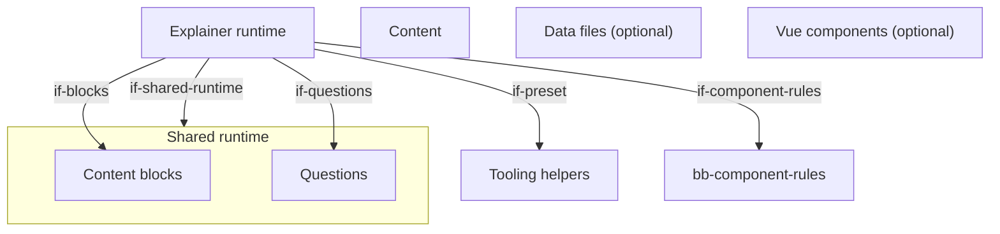

# Building Blocks

The explainer's extension of the generic architecture (`docs/arc42/` at the root of `lernapps/app-templates`). An
explainer is chapters of pages, with an exercise on every page. The runtime brings everything but the content. The
creator writes YAML, data files and, only where no block fits, Vue components (`explainer-only-content`,
`prefer-built-in-block`); `src/main.ts` stays as generated. Quiz-type exercises reuse the quiz's question types. Every
page is complete without JavaScript (`qg-explainer-readable-without-js`). The creator's assistant follows the skill
`lernapps-explainer` (`if-skills`). An explainer app writes no architecture of its own.

## Level 1 (explainer)

```arc42
:::diagram
id: building-blocks-explainer-level-1
view: building-block
notation: mermaid
:::
```



## Level 2: the explainer runtime

```arc42
:::diagram
id: building-blocks-explainer-runtime
view: building-block
notation: mermaid
:::
```



```mermaid
flowchart TB
    subgraph bb-archetype-runtime["Explainer runtime"]
        bb-build["Build step"]
        bb-validation["Content validation"]
        bb-render["Page rendering"]
        bb-shell["Client module"]
        bb-islands["Component islands"]
        bb-generated-exercises["Generated exercises"]
        bb-open-tasks["Open tasks"]
        bb-language-tasks["Language tasks"]
        bb-speaking-tasks["Speaking tasks"]
        bb-audio-player["Audio player"]
        bb-media["Audio files and media overview"]
        bb-scope["Scope"]
        bb-tutor-handoff["Tutor handoff"]
        bb-task-numbers["Task numbers"]
        bb-video["Video block"]
        bb-feedback-mode["Feedback mode"]
        bb-diff-mode["Diff mode"]
        bb-self-assessment["Self-assessment"]
        bb-e2e["End-to-end tests"]
        bb-runtime-texts["Runtime texts"]
    end
    bb-explainer-content["Content"]
    bb-explainer-data["Data files"]
    bb-explainer-components["Vue components"]
    bb-tooling["Tooling helpers"]
    bb-build -->|"if-archetype-content"| bb-explainer-content
    bb-build -->|"if-exercise-logic"| bb-explainer-components
    bb-build -->|"if-tutor-files"| bb-tutor-handoff
    bb-validation -->|"if-archetype-content"| bb-explainer-content
    bb-validation -->|"if-data-files"| bb-explainer-data
    bb-render -->|"if-archetype-content"| bb-explainer-content
    bb-render -->|"if-vue-component"| bb-explainer-components
    bb-render -->|"if-runtime-texts"| bb-runtime-texts
    bb-shell -->|"if-task-numbers"| bb-task-numbers
    bb-shell -->|"if-tutor-files"| bb-tutor-handoff
    bb-shell -->|"if-runtime-texts"| bb-runtime-texts
    bb-shell -->|"if-device-storage"| bb-tooling
    bb-shell -->|"if-a11y"| bb-tooling
    bb-islands -->|"if-vue-component"| bb-explainer-components
    bb-islands -->|"if-task-numbers"| bb-task-numbers
    bb-generated-exercises -->|"if-archetype-content"| bb-explainer-content
    bb-open-tasks -->|"if-archetype-content"| bb-explainer-content
    bb-language-tasks -->|"if-archetype-content"| bb-explainer-content
    bb-speaking-tasks -->|"if-archetype-content"| bb-explainer-content
    bb-audio-player -->|"if-archetype-content"| bb-explainer-content
    bb-media -->|"if-archetype-content"| bb-explainer-content
    bb-scope -->|"if-archetype-content"| bb-explainer-content
    bb-generated-exercises -->|"if-data-files"| bb-explainer-data
    bb-tutor-handoff -->|"if-archetype-content"| bb-explainer-content
    bb-tutor-handoff -->|"if-exercise-logic"| bb-explainer-components
    bb-tutor-handoff -->|"if-task-numbers"| bb-task-numbers
    bb-video -->|"if-runtime-texts"| bb-runtime-texts
    bb-video -->|"if-device-storage"| bb-tooling
    bb-shell -->|"if-feedback-mode"| bb-feedback-mode
    bb-build -->|"if-diff-mode"| bb-diff-mode
    bb-render -->|"if-diff-mode"| bb-diff-mode
    bb-shell -->|"if-diff-mode"| bb-diff-mode
    bb-diff-mode -->|"if-archetype-content"| bb-explainer-content
    bb-diff-mode -->|"if-runtime-texts"| bb-runtime-texts
    bb-feedback-mode -->|"if-runtime-texts"| bb-runtime-texts
    bb-feedback-mode -->|"if-device-storage"| bb-tooling
    bb-build -->|"if-self-assessment"| bb-self-assessment
    bb-shell -->|"if-self-assessment"| bb-self-assessment
    bb-self-assessment -->|"if-archetype-content"| bb-explainer-content
    bb-self-assessment -->|"if-tutor-files"| bb-tutor-handoff
    bb-self-assessment -->|"if-task-numbers"| bb-task-numbers
    bb-self-assessment -->|"if-runtime-texts"| bb-runtime-texts
    bb-self-assessment -->|"if-device-storage"| bb-tooling
    bb-e2e -->|"if-archetype-content"| bb-explainer-content
    bb-e2e -->|"if-runtime-texts"| bb-runtime-texts
```

## Explainer runtime

Built. The runtime of every explainer, which the app does not change: it validates and renders the content into
static pages, writes the tutor pages, makes the exercises live in the browser and brings the end-to-end tests.

```arc42
:::building-block
id: bb-archetype-runtime
title: Explainer runtime
path: runtime/explainer
technology: TypeScript, Vite plugin, Vue
requires: if-shared-runtime, if-preset, if-questions, if-blocks, if-component-rules
implements: concept-archetype-extension
:::
```

### Build step

Built. Reads and validates the content and tests every generated exercise and exercise component. Only then it writes
every page in each language, the tutor pages and, for format 2, the page list for the catalog. The dev server serves the
same pages.

```arc42
:::building-block
id: bb-build
title: Build step
parent: bb-archetype-runtime
path: runtime/explainer/plugin.ts
technology: Vite plugin
requires: if-archetype-content, if-component-rules, if-exercise-logic, if-tutor-files, if-self-assessment, if-diff-mode
:::
```

#### Page list for the catalog

The app's place on the learning map: its strand, or the subject of a unit app, and its pages with their competencies.
The catalog places the app with it and checks the ids. Only format 2 apps have one.

```arc42
:::interface
id: if-page-list
title: Page list lernapps-pages.json (format 2)
provider: bb-build
protocol: JSON file over HTTPS, beside index.html
path: runtime/explainer/page-list.ts
:::
```

#### Build plugin interface

The app's vite.config.ts adds `explainer()` to the tooling preset.

```arc42
:::interface
id: if-build-plugin
title: explainer() Vite plugin
provider: bb-build
protocol: TypeScript import, @lernapps/app-templates/explainer/plugin
path: runtime/explainer/plugin.ts
:::
```

### Content validation

Built. Checks every content file against the schema of its format, then what a schema cannot say: complete languages,
unique ids, links, sources and licences, formulas, components and their props, and more. It reports one line per
problem, with file and line.

```arc42
:::building-block
id: bb-validation
title: Content validation
parent: bb-archetype-runtime
path: runtime/explainer/load.ts
technology: Ajv, JSON Schema, YAML
requires: if-archetype-content, if-data-files, if-component-rules, if-questions
:::
```

### Page rendering

Built. Renders every page to static HTML in each language: text, formulas, figures, tables, timelines, code, videos,
vocabulary, the exercises with their solution folded, the navigation and the glossary. A Vue component is rendered at
build, with its `nojs` text. Without JavaScript every page is complete.

```arc42
:::building-block
id: bb-render
title: Page rendering
parent: bb-archetype-runtime
path: runtime/explainer/render.ts
technology: TypeScript, Temml, highlight.js, Vue server renderer
requires: if-archetype-content, if-vue-component, if-runtime-texts, if-questions, if-diff-mode
implements: concept-readable-without-js, concept-accessibility
:::
```

#### Pages interface

Learners, teachers and parents read the explainer at `lernapps.net/<repo>/` (and `/<language>/`): the start page, a
page per chapter, the content pages at `<chapter>/<page>/` and the glossary. `?<id>=<n>` names the task number of an
exercise. The catalog links there.

```arc42
:::interface
id: if-pages
title: Explainer pages at lernapps.net/<repo>/
provider: bb-render
protocol: HTML pages over HTTPS
path: runtime/explainer/routes.ts
:::
```

### Client module

Built. Makes a page's exercises live: checking, the reason of a wrong answer, a new task, the task number in the
address. It starts the tutor buttons, the videos, the feedback mode and the self-assessment. On the device it keeps
only the learner's choices: the assistant, the needs and loading videos directly.

```arc42
:::building-block
id: bb-shell
title: Client module
parent: bb-archetype-runtime
path: runtime/explainer/explainer.ts
technology: TypeScript, DOM
requires: if-questions, if-task-numbers, if-tutor-files, if-runtime-texts, if-device-storage, if-a11y, if-self-assessment, if-feedback-mode, if-diff-mode
implements: concept-accessibility, concept-determinism
:::
```

#### Start interface

The app's `src/main.ts` imports the explainer's style and calls `startExplainer()`.

```arc42
:::interface
id: if-start
title: startExplainer()
provider: bb-shell
protocol: TypeScript import, @lernapps/app-templates/explainer
path: runtime/explainer/explainer.ts
:::
```

### Component islands

Built. Only on a page with a component: makes each component live in the browser, in the page's language. It gives an
exercise component its task, takes its answer, checks it on "Prüfen" with the logic module and shows the feedback
(`dec-explainer-checks`). In a self-assessment it judges the answer silently (`dec-self-assessment`).

```arc42
:::building-block
id: bb-islands
title: Component islands
parent: bb-archetype-runtime
path: runtime/explainer/islands.ts
technology: Vue hydration
requires: if-vue-component, if-task-numbers
:::
```

### Generated exercises

Built. Exercises drawn from a seed (`generated`). The same code gives the worked tasks at build, tests the exercise and
draws a live task in the browser, so both agree. The question types' checker checks the answers.

```arc42
:::building-block
id: bb-generated-exercises
title: Generated exercises
parent: bb-archetype-runtime
path: runtime/explainer/generated
technology: TypeScript, exact fractions
requires: if-archetype-content, if-data-files, if-questions
implements: concept-determinism
:::
```

### Open tasks

Built. An open task (`open-task`) is answered in the learner's own words, then compared with the points of a good
answer (`dec-open-task`). The build checks each point's source like every link. The same part runs on a content page and
in a self-assessment.

```arc42
:::building-block
id: bb-open-tasks
title: Open tasks
parent: bb-archetype-runtime
path: runtime/explainer/open-task.ts
technology: TypeScript, DOM
requires: if-archetype-content
:::
```

### Language tasks

Built. A language task (`language-task`) is written by the learner and checked against the answers it lists
(`dec-language-task`). The check is the same in the build and in the browser.

```arc42
:::building-block
id: bb-language-tasks
title: Language tasks
parent: bb-archetype-runtime
path: runtime/explainer/language.ts
technology: TypeScript, DOM
requires: if-archetype-content
:::
```

### Audio files and the media overview

Built. An app may hold MP3 files in `src/audio/`, each with its marking (`dec-audio-marking`). The build reads the
marking, stops when it is incomplete, and publishes the files with the pages. It also writes the page "Medienübersicht",
which lists every medium of the app (`dec-media-overview`).

```arc42
:::building-block
id: bb-media
title: Audio files and media overview
parent: bb-archetype-runtime
path: runtime/explainer/media.ts
technology: TypeScript, ID3
requires: if-archetype-content
:::
```

### Audio player

Built. A task that starts from audio shows the browser's own player, labelled "KI" for a synthetic voice. Where the
player has no tempo menu, it adds tempo buttons (`dec-audio-player`).

```arc42
:::building-block
id: bb-audio-player
title: Audio player
parent: bb-archetype-runtime
path: runtime/explainer/audio-client.ts
technology: TypeScript, DOM
requires: if-archetype-content
:::
```

### Speaking tasks

Built. A speaking task (`speaking-task`) lets the learner hear a model, record themself, compare and rate the
pronunciation (`dec-speaking-task`). The recording stays in the browser's memory.

```arc42
:::building-block
id: bb-speaking-tasks
title: Speaking tasks
parent: bb-archetype-runtime
path: runtime/explainer/speaking-task.ts
technology: TypeScript, DOM, MediaRecorder
requires: if-archetype-content
:::
```

### Scope

Built, optional per app, required by lernapps/practice. The scope is the whole learning path for a tutor, written in
the content of the app, its chapters and pages (`dec-scope`). The build writes it per page, per chapter and for the app,
in each language, for no menu and no search engine. Every tutor page links its page's scope.

```arc42
:::building-block
id: bb-scope
title: Scope
parent: bb-archetype-runtime
path: runtime/explainer/scope.ts
technology: TypeScript, Markdown
requires: if-archetype-content
:::
```

### Tutor handoff

Built, optional per app. No model runs in the browser. After the learner's click the app hands over to the learner's
own assistant (`dec-tutor-assistant`). Both ways name the page's tutor page, with where the learner is in its query
(`dec-tutor-page`). Way A asks for help with the page. Way B, "Hilfe" in an exercise, adds the task, the input and the
app's message. "Zurück zum Tutor" brings the results back to the running chat. The tutor page is the one source of what
the tutor gets: a short guide, the page's content, its exercises with a table of tasks (`dec-component-table`), and a
short section for each need (`dec-tutor-needs`).

```arc42
:::building-block
id: bb-tutor-handoff
title: Tutor handoff
parent: bb-archetype-runtime
path: runtime/explainer/tutor.ts
technology: TypeScript, static Markdown
requires: if-archetype-content, if-exercise-logic, if-task-numbers
implements: concept-tutor
:::
```

#### Tutor pages and the learner's lines

The start prompt of way A, the lines of way B and the result line name the page's tutor page absolutely, with the
page's task numbers. Way B adds `uebung` and `abschnitt`, a new chat adds the needs in `bedarf`, and the lines add the
task, the input and the app's message. A chat assistant reads the tutor page without JavaScript; its Markdown lies
beside it for copying. The page and exercise ids, the query parameters, the ids of the needs, the tutor page's
structure and the lines are a contract with every tutor.

```arc42
:::interface
id: if-tutor-files
title: Tutor pages, start prompt and the learner's lines
provider: bb-tutor-handoff
protocol: Prompt text (provider link or clipboard), result line and the lines of way B (clipboard), static HTML and Markdown over HTTPS
path: runtime/explainer/tutorpage.ts
:::
```

### Task numbers

Built: the distinct tasks of a seeded exercise numbered 1 to N, the one identifier learner, tutor and address
(`?<id>=<n>`) share.

```arc42
:::building-block
id: bb-task-numbers
title: Task numbers
parent: bb-archetype-runtime
path: runtime/explainer/tasks.ts
technology: TypeScript
implements: concept-determinism
:::
```

#### Task numbers interface

The client module, the islands and the tutor handoff turn a task number into its task and back.

```arc42
:::interface
id: if-task-numbers
title: Task numbers and their seeds
provider: bb-task-numbers
protocol: TypeScript import
path: runtime/explainer/tasks.ts
:::
```

### Video block

Built. A YouTube video behind a click (`dec-explainer-video-two-click`). The page shows the video as a link with its
channel and a privacy note, and loads nothing from another host. A click loads the player; a standing choice to load
videos directly stays on the device. The tutor page names the video by its title and channel.

```arc42
:::building-block
id: bb-video
title: Video block
parent: bb-archetype-runtime
path: runtime/explainer/video.ts
technology: TypeScript, DOM, iframe
requires: if-runtime-texts, if-device-storage
implements: concept-readable-without-js
:::
```

#### Video player request

The one request to another host an explainer makes on its own: the player of a video at youtube-nocookie.com, with only
the app's origin as referrer. It is sent after the learner's click, or on opening the page once they chose to load
videos directly.

```arc42
:::interface
id: if-video-player
title: Video player request to youtube-nocookie.com
provider: bb-video
protocol: HTML iframe over HTTPS, after a click
path: runtime/explainer/video.ts
:::
```

### Feedback mode

Built. Lets teachers and parents note what to improve at the block it concerns. They hand the notes over as one new
issue in the app's repository (`dec-explainer-feedback-issue`). The notes stay on the device until then. Without
JavaScript there is no mode, and the pages stay complete.

```arc42
:::building-block
id: bb-feedback-mode
title: Feedback mode
parent: bb-archetype-runtime
path: runtime/explainer/feedback.ts
technology: TypeScript, DOM
requires: if-runtime-texts, if-device-storage
implements: concept-readable-without-js
:::
```

#### Feedback mode interface

The client module starts the feedback mode on every page.

```arc42
:::interface
id: if-feedback-mode
title: Start of the feedback mode
provider: bb-feedback-mode
protocol: TypeScript import
path: runtime/explainer/feedback-client.ts
:::
```

### Diff mode

Built. Lets a reviewer see in the running app what a version changes against a base (`dec-explainer-diff-mode`). The
build gets the base as a folder (`EXPLAINER_BASE`), compares block by block and marks added, changed, moved and removed
blocks in the pages. It also writes an overview of all changes. Without a base nothing changes. The preview of a pull
request builds the example explainers this way.

```arc42
:::building-block
id: bb-diff-mode
title: Diff mode
parent: bb-archetype-runtime
path: runtime/explainer/diff.ts
technology: TypeScript, DOM
requires: if-archetype-content, if-runtime-texts
implements: concept-readable-without-js, concept-accessibility
:::
```

#### Diff mode interface

The build step, the page rendering and the client module use it: the difference of two versions, its marks, and its
controls in the browser.

```arc42
:::interface
id: if-diff-mode
title: Difference of two versions
provider: bb-diff-mode
protocol: TypeScript import
path: runtime/explainer/diff-render.ts
:::
```

### Self-assessment

Built. An optional self-assessment per chapter, and one of the app over all chapters (`dec-self-assessment`). A chapter
lists the exercises it asks, by page. The validation checks each reference. The build writes its page, the offer on the
start or chapter page, and its tutor page, which makes the tutor a guide (`dec-self-assessment-tutor`). In the browser a
run draws new tasks, checks all at the end and says per content page where to start. The last result stays on the
device (`dec-self-assessment-result`).

```arc42
:::building-block
id: bb-self-assessment
title: Self-assessment
parent: bb-archetype-runtime
path: runtime/explainer/assessment.ts
technology: TypeScript, DOM, static HTML and Markdown
requires: if-archetype-content, if-tutor-files, if-task-numbers, if-questions, if-runtime-texts, if-device-storage
implements: concept-tutor
:::
```

#### Self-assessment interface

The build writes the self-assessment's pages; the client module starts it. Its addresses, the query of its tutor page
(each exercise with its task number, its result and its mistake or missed points), its lines and the result kept on the
device are a contract with every tutor and with older results on a device.

```arc42
:::interface
id: if-self-assessment
title: Self-assessment page, its tutor page and the result kept on the device
provider: bb-self-assessment
protocol: Static HTML and Markdown over HTTPS, prompt text (provider link or clipboard), JSON in localStorage
path: runtime/explainer/assessment.ts
:::
```

### End-to-end tests

Built, in two parts. `explainerTests()` checks the app's content: what every page must show, without JavaScript in
every language, and with it the app's own components. `explainerRuntimeTests()` checks the runtime, the same in every
app. Only this repo runs the second part, on the template and its fixtures.

```arc42
:::building-block
id: bb-e2e
title: End-to-end tests
parent: bb-archetype-runtime
path: runtime/explainer/e2e.ts
technology: Playwright
requires: if-archetype-content, if-runtime-texts, if-questions
:::
```

#### Tests interface

The app's `e2e/explainer.e2e.ts`, part of the scaffold, only calls `explainerTests()`.

```arc42
:::interface
id: if-e2e-tests
title: explainerTests()
provider: bb-e2e
protocol: TypeScript import, @lernapps/app-templates/explainer/e2e
path: runtime/explainer/e2e.ts
:::
```

### Runtime texts

Built. The explainer's own learner texts in German and English; an app may declare only these languages.

```arc42
:::building-block
id: bb-runtime-texts
title: Runtime texts
parent: bb-archetype-runtime
path: runtime/explainer/messages.ts
technology: JSON per language
implements: concept-languages
:::
```

#### Runtime texts interface

The rendering, the client module and the tests take the explainer's texts by key and language.

```arc42
:::interface
id: if-runtime-texts
title: Explainer texts by language
provider: bb-runtime-texts
protocol: TypeScript import, JSON
path: runtime/explainer/messages
:::
```

## Content

Built in the template, written by the creator: `src/app.yaml` and a folder per chapter with `chapter.yaml` and its
pages of blocks, each page with an exercise, and optionally the scope (`bb-scope`).

```arc42
:::building-block
id: bb-explainer-content
title: Content
technology: YAML, restricted Markdown, LaTeX subset
implements: concept-languages
path: explainer/src/app.yaml
:::
```

### Content interface

The runtime reads the content only through its schema. Format 2 is for the template and new apps; it adds the app's
place on the learning map. Format 1 stays valid (`dec-explainer-format-2`).

```arc42
:::interface
id: if-archetype-content
title: Content YAML (explainer.v1 and v2 schemas)
provider: bb-explainer-content
protocol: YAML, JSON Schema
path: runtime/explainer/explainer.v2.schema.json
:::
```

## Data files

Optional, not in the template: `src/data/<name>.yaml`, lists of records a timeline or a generated exercise draws
from, so each fact is written once.

```arc42
:::ignore H014 optional and not in the template; an app that adds it sets its path in its own architecture
:::
:::building-block
id: bb-explainer-data
title: Data files
technology: YAML
:::
```

### Data files interface

A block names a data file by its name (`data: ereignisse`, `from: { data: elemente }`).

```arc42
:::ignore H014 optional and not in the template; an app that adds it sets its path in its own architecture
:::
:::interface
id: if-data-files
title: Data files src/data/<name>.yaml
provider: bb-explainer-data
protocol: YAML records
:::
```

## Vue components

Optional: `src/components/<Name>.vue` with its test, for what no block can express. Each follows the component rules
and stays within a fixed size (`dec-explainer-component-size`). An exercise component adds its logic module. The
template has one example, `ProzentFeld`, which declares its table of tasks for the tutor (`dec-component-table`).

```arc42
:::building-block
id: bb-explainer-components
title: Vue components
path: explainer/src/components
technology: Vue single-file components, TypeScript
implements: concept-component-rules
:::
```

### Component contract

A `vue-component` block names the component with its typed props and a `nojs` text. An exercise component is only
the input of its task (`dec-explainer-checks`). It takes the prop `seed`, emits `answer` whenever the answer changes,
and may take the prop `checked`. The explainer draws "Prüfen" for it.

```arc42
:::interface
id: if-vue-component
title: Component contract (props, nojs, answer)
provider: bb-explainer-components
path: explainer/src/components/ProzentFeld.vue
protocol: Vue props and events, YAML block
:::
```

### Exercise logic module

An exercise component's `<Name>.ts` is the exercise contract. It exports:
`generate`, the task of a seed;
`check`, whether an answer is right;
`solution`, the right answer;
`wrong`, a wrong answer that `check` must reject;
`reason`, the app's message for a wrong answer;
`describe`, the task and its solution as text;
`about`, what the exercise is, for a tutor.
For its table of tasks it adds `template`, `params`, `mistakes` and `show`, all four or none (`dec-component-table`).
The build tests the module, the islands use it on "Prüfen", and the tutor pages read it.

```arc42
:::interface
id: if-exercise-logic
title: Exercise logic module (exercise contract)
provider: bb-explainer-components
path: explainer/src/components/ProzentFeld.ts
protocol: TypeScript module exports
:::
```
