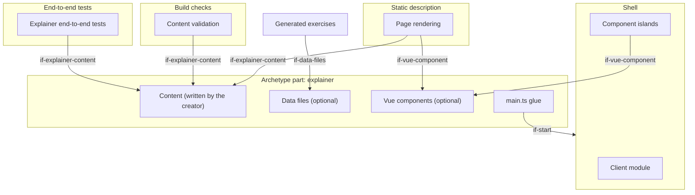

# Building Blocks

The explainer's extension of the generic architecture (`docs/arc42/` at the root of `lernapps/app-templates`): an
explainer of chapters of pages with an exercise on every page, whose rendering, validation, client, islands and tests
the runtime `explainer/` ships, and whose creator writes the content as YAML, data files and, only where no block
fits, Vue components under the component contract (`explainer-only-content`, `prefer-built-in-block`). Of the
optional generic blocks the explainer realises all that exist: the tutor handoff, the task numbers, the exercise
contract, the component rules, the examples check and the question types (for its quiz-type exercises). Every page is
complete without JavaScript (`qg-explainer-readable-without-js`). An explainer app writes no architecture of its own:
the content schema fixes its structure.

```arc42
:::diagram
id: building-blocks-explainer
view: building-block
notation: mermaid
:::
```



### Page rendering

Built. The plugin `explainer()` renders every YAML page to static HTML in each language: text in restricted
Markdown, formulas as MathML, figures as SVG, tables, timelines, code, the exercises with their solution folded (a
generated one with three worked tasks), the navigation and the glossary, and each Vue component's island as the
server renderer drew it, with its `nojs` text. Without JavaScript every page is complete.

```arc42
:::ignore W026 the parent is a block of the generic architecture, documented in its own file
:::
:::building-block
id: bb-explainer-rendering
title: Page rendering
parent: bb-static-description
technology: TypeScript, Temml, highlight.js, Vue server renderer (runtime/explainer/plugin.ts, render.ts, exercises.ts, routes.ts)
requires: if-explainer-content, if-data-files, if-question-exports, if-vue-component
implements: concept-readable-without-js, concept-accessibility
:::
```

### Content validation

Built. Validates every content file against its part of the schema, then what a schema cannot say (complete order
lists, depth, unique ids, complete languages, restricted Markdown, formulas in the command list, sources and
licences, links to pages and sections, an exercise on every page, components and their props), one line per problem
with file and line.

```arc42
:::ignore W026 the parent is a block of the generic architecture, documented in its own file
:::
:::building-block
id: bb-explainer-validation
title: Content validation
parent: bb-build-checks
technology: Ajv, JSON Schema (runtime/explainer/load.ts, explainer.v1.schema.json)
requires: if-explainer-content, if-data-files, if-question-exports
:::
```

### Generated exercises

Built. Exercises drawn from a seed (`generated`), the explainer's own notation: the same code gives three worked tasks
at build, runs the property test over fixed seeds and draws a live task in the browser, so both agree; their answers
are checked through the question types' checker.

```arc42
:::ignore W026 the parent is a block of the generic architecture, documented in its own file
:::
:::building-block
id: bb-generated-exercises
title: Generated exercises
parent: bb-runtime
technology: TypeScript, exact fractions (runtime/explainer/generated.ts, expression.ts, fraction.ts)
requires: if-explainer-content, if-data-files, if-question-exports
implements: concept-determinism
:::
```

### Client module

Built. Makes a page's exercises live: answered before the solution shows, the reason of a wrong answer, "Neue
Aufgabe", the task numbers in the address; and the tutor button. It keeps only the learner's chosen way to the tutor
on the device.

```arc42
:::ignore W026 the parent is a block of the generic architecture, documented in its own file
:::
:::building-block
id: bb-explainer-client
title: Client module
parent: bb-shell
technology: TypeScript, DOM (runtime/explainer/explainer.ts; startExplainer)
requires: if-question-exports, if-device-storage, if-a11y, if-tutor-files
implements: concept-accessibility
:::
```

### Component islands

Built. Only on a page with a component: loads Vue, hydrates each component's island with the props of the page's
language, gives an exercise component the seed of its task number, and shows its feedback.

```arc42
:::ignore W026 the parent is a block of the generic architecture, documented in its own file
:::
:::building-block
id: bb-islands
title: Component islands
parent: bb-shell
technology: Vue hydration (runtime/explainer/islands.ts)
requires: if-vue-component, if-a11y
:::
```

### Explainer end-to-end tests

Built. `explainerTests()` derives from the content what every page must show, checks it without JavaScript in every
language, and with JavaScript one exercise per type and page and every component.

```arc42
:::ignore W026 the parent is a block of the generic architecture, documented in its own file
:::
:::building-block
id: bb-explainer-tests
title: Explainer end-to-end tests
parent: bb-e2e
technology: Playwright (runtime/explainer/e2e.ts, outline.ts)
requires: if-explainer-content
:::
```

### Content

Built in the template, written by the creator: `src/app.yaml` and a folder per chapter with `chapter.yaml` and its
pages of blocks, each page with an exercise.

```arc42
:::ignore W026 the parent is a block of the generic architecture, documented in its own file
:::
:::building-block
id: bb-explainer-content
title: Content
parent: bb-archetype
path: src/app.yaml
technology: YAML, restricted Markdown, LaTeX subset
implements: concept-languages
:::
```

#### Content interface

The explainer's archetype content (`if-archetype-content`): rendering, validation, tests and tutor files read the
content only through its schema.

```arc42
:::interface
id: if-explainer-content
title: Content YAML (explainer.v1 schema)
provider: bb-explainer-content
protocol: YAML, JSON Schema
:::
```

### Data files

Optional, not in the template: `src/data/<name>.yaml`, lists of records a timeline or a generated exercise draws
from, so each fact is written once.

```arc42
:::ignore W026 the parent is a block of the generic architecture, documented in its own file
:::
:::building-block
id: bb-explainer-data
title: Data files
parent: bb-archetype
technology: YAML
:::
```

#### Data files interface

A block names a data file by its name (`data: ereignisse`, `from: { data: elemente }`).

```arc42
:::interface
id: if-data-files
title: Data files src/data/<name>.yaml
provider: bb-explainer-data
protocol: YAML records
:::
```

### Vue components

Optional, not in the template: `src/components/<Name>.vue` with its test, for what no block can express, under the
component rules and within 20 kB gzip each; an exercise component adds its logic module, which realises the
exercise contract.

```arc42
:::ignore W026 the parent is a block of the generic architecture, documented in its own file
:::
:::building-block
id: bb-explainer-components
title: Vue components
parent: bb-archetype
technology: Vue single-file components, TypeScript
implements: concept-component-rules
:::
```

#### Component contract

A `vue-component` block names the component with its typed props and a `nojs` text; an exercise component emits
`answered { correct, reason? }` and takes the prop `seed`.

```arc42
:::interface
id: if-vue-component
title: Component contract (props, nojs, answered)
provider: bb-explainer-components
protocol: Vue props and events, YAML block
:::
```

#### Exercise logic module

An exercise component's `<Name>.ts` exports `generate`, `check`, `solution`, `wrong`, `describe` and `about`; the
exercise contract and the task numbers read it.

```arc42
:::interface
id: if-exercise-logic
title: Exercise logic module
provider: bb-explainer-components
protocol: TypeScript module exports
:::
```

### Explainer main.ts glue

Built in the template, kept as generated: imports the explainer's style and calls `startExplainer()`.

```arc42
:::ignore W026 the parent is a block of the generic architecture, documented in its own file
:::
:::building-block
id: bb-explainer-main
title: Explainer main.ts glue
parent: bb-archetype
path: src/main.ts
technology: TypeScript
requires: if-start
:::
```

### Skill lernapps-explainer

Built: how the explainer works and what the assistant writes, with its blocks, exercises, components and the rules the
build checks.

```arc42
:::ignore W026 the parent is a block of the generic architecture, documented in its own file
:::
:::building-block
id: bb-skill-explainer
title: Skill lernapps-explainer
parent: bb-tooling
technology: Markdown skill (skills/lernapps-explainer)
:::
```

#### Skill text of lernapps-explainer

The creator's assistant loads it before it writes content.

```arc42
:::interface
id: if-skill-explainer
title: Skill text of lernapps-explainer
provider: bb-skill-explainer
protocol: Markdown (SKILL.md) loaded by the assistant
:::
```
