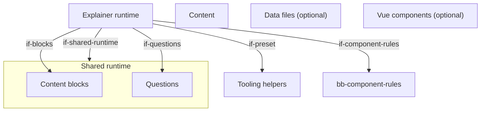

# Building Blocks

The explainer's extension of the generic architecture (`docs/arc42/` at the root of `lernapps/app-templates`): an
explainer of chapters of pages with an exercise on every page, whose build step, rendering, validation, client module,
islands, generated exercises, tutor handoff, task numbers and tests the runtime `runtime/explainer/` ships, and whose
creator writes the content as YAML, data files and, only where no block fits, Vue components under the component
contract (`explainer-only-content`, `prefer-built-in-block`); `src/main.ts` stays as generated. It reuses the quiz's
question types for its quiz-type exercises. Every page is complete without JavaScript
(`qg-explainer-readable-without-js`). The creator's assistant follows the skill `lernapps-explainer` (`if-skills`). An
explainer app writes no architecture of its own: the content schema fixes its structure.

## Level 1 (explainer)

```arc42
:::diagram
id: building-blocks-explainer-level-1
view: building-block
notation: mermaid
:::
```



## Level 2: the explainer runtime

```arc42
:::diagram
id: building-blocks-explainer-runtime
view: building-block
notation: mermaid
:::
```



```mermaid
flowchart TB
    subgraph bb-archetype-runtime["Explainer runtime"]
        bb-build["Build step"]
        bb-validation["Content validation"]
        bb-render["Page rendering"]
        bb-shell["Client module"]
        bb-islands["Component islands"]
        bb-generated-exercises["Generated exercises"]
        bb-open-tasks["Open tasks"]
        bb-scope["Scope"]
        bb-tutor-handoff["Tutor handoff"]
        bb-task-numbers["Task numbers"]
        bb-video["Video block"]
        bb-self-assessment["Self-assessment"]
        bb-e2e["End-to-end tests"]
        bb-runtime-texts["Runtime texts"]
    end
    bb-explainer-content["Content"]
    bb-explainer-data["Data files"]
    bb-explainer-components["Vue components"]
    bb-tooling["Tooling helpers"]
    bb-build -->|"if-archetype-content"| bb-explainer-content
    bb-build -->|"if-exercise-logic"| bb-explainer-components
    bb-build -->|"if-tutor-files"| bb-tutor-handoff
    bb-validation -->|"if-archetype-content"| bb-explainer-content
    bb-validation -->|"if-data-files"| bb-explainer-data
    bb-render -->|"if-archetype-content"| bb-explainer-content
    bb-render -->|"if-vue-component"| bb-explainer-components
    bb-render -->|"if-runtime-texts"| bb-runtime-texts
    bb-shell -->|"if-task-numbers"| bb-task-numbers
    bb-shell -->|"if-tutor-files"| bb-tutor-handoff
    bb-shell -->|"if-runtime-texts"| bb-runtime-texts
    bb-shell -->|"if-device-storage"| bb-tooling
    bb-shell -->|"if-a11y"| bb-tooling
    bb-islands -->|"if-vue-component"| bb-explainer-components
    bb-islands -->|"if-task-numbers"| bb-task-numbers
    bb-generated-exercises -->|"if-archetype-content"| bb-explainer-content
    bb-open-tasks -->|"if-archetype-content"| bb-explainer-content
    bb-scope -->|"if-archetype-content"| bb-explainer-content
    bb-generated-exercises -->|"if-data-files"| bb-explainer-data
    bb-tutor-handoff -->|"if-archetype-content"| bb-explainer-content
    bb-tutor-handoff -->|"if-exercise-logic"| bb-explainer-components
    bb-tutor-handoff -->|"if-task-numbers"| bb-task-numbers
    bb-video -->|"if-runtime-texts"| bb-runtime-texts
    bb-video -->|"if-device-storage"| bb-tooling
    bb-build -->|"if-self-assessment"| bb-self-assessment
    bb-shell -->|"if-self-assessment"| bb-self-assessment
    bb-self-assessment -->|"if-archetype-content"| bb-explainer-content
    bb-self-assessment -->|"if-tutor-files"| bb-tutor-handoff
    bb-self-assessment -->|"if-task-numbers"| bb-task-numbers
    bb-self-assessment -->|"if-runtime-texts"| bb-runtime-texts
    bb-self-assessment -->|"if-device-storage"| bb-tooling
    bb-e2e -->|"if-archetype-content"| bb-explainer-content
    bb-e2e -->|"if-runtime-texts"| bb-runtime-texts
```

## Explainer runtime

Built. The runtime of every explainer, which the app does not change: it validates and renders the content into
static pages, writes the tutor pages, makes the exercises live in the browser and brings the end-to-end tests.

```arc42
:::building-block
id: bb-archetype-runtime
title: Explainer runtime
path: runtime/explainer
technology: TypeScript, Vite plugin, Vue
requires: if-shared-runtime, if-preset, if-questions, if-blocks, if-component-rules
implements: concept-archetype-extension
:::
```

### Build step

Built. The plugin `explainer()` reads and validates the content, runs the component rules and the property test of
each generated exercise and exercise component over fixed seeds, and only then writes every page in each language,
the tutor pages where the tutor is on, and the 404 page; `vp dev` serves the same pages.

```arc42
:::building-block
id: bb-build
title: Build step
parent: bb-archetype-runtime
path: runtime/explainer/plugin.ts
technology: Vite plugin
requires: if-archetype-content, if-component-rules, if-exercise-logic, if-tutor-files, if-self-assessment
:::
```

#### Build plugin interface

The app's vite.config.ts adds `explainer()` to the tooling preset.

```arc42
:::interface
id: if-build-plugin
title: explainer() Vite plugin
provider: bb-build
protocol: TypeScript import, @lernapps/app-templates/explainer/plugin
path: runtime/explainer/plugin.ts
:::
```

### Content validation

Built. Validates every content file against its part of the schema, then what a schema cannot say (complete order
lists, depth, unique ids, complete languages, restricted Markdown, formulas in the command list, sources and
licences, links to pages and sections, an exercise on every page, components and their props), one line per problem
with file and line.

```arc42
:::building-block
id: bb-validation
title: Content validation
parent: bb-archetype-runtime
path: runtime/explainer/load.ts
technology: Ajv, JSON Schema, YAML
requires: if-archetype-content, if-data-files, if-component-rules, if-questions
:::
```

### Page rendering

Built. Renders every YAML page to static HTML in each language: text in restricted Markdown, formulas as MathML,
figures as SVG, tables, timelines, code, videos as links (`bb-video`), the exercises with their solution folded (a generated one with three worked
tasks), the navigation and the glossary, and each Vue component's island as the server renderer drew it, with its
`nojs` text. Without JavaScript every page is complete.

```arc42
:::building-block
id: bb-render
title: Page rendering
parent: bb-archetype-runtime
path: runtime/explainer/render.ts
technology: TypeScript, Temml, highlight.js, Vue server renderer
requires: if-archetype-content, if-vue-component, if-runtime-texts, if-questions
implements: concept-readable-without-js, concept-accessibility
:::
```

#### Pages interface

Learners, teachers and parents read the explainer at `lernapps.net/<repo>/` (and `/<language>/`): the start page, a
page per chapter, the content pages at `<chapter>/<page>/` and the glossary, with `?<id>=<n>` for the task number of
an exercise; the catalog entry and its topics link there.

```arc42
:::interface
id: if-pages
title: Explainer pages at lernapps.net/<repo>/
provider: bb-render
protocol: HTML pages over HTTPS
path: runtime/explainer/routes.ts
:::
```

### Client module

Built. Makes a page's exercises live: answered before the solution shows, the reason of a wrong answer, "Neue
Aufgabe", the task numbers in the address; the tutor button; and starts the videos (`bb-video`). It keeps only the
learner's chosen way to the tutor and their choice to load videos directly on the device; the last result of a
self-assessment is kept by `bb-self-assessment`, which it starts.

```arc42
:::building-block
id: bb-shell
title: Client module
parent: bb-archetype-runtime
path: runtime/explainer/explainer.ts
technology: TypeScript, DOM
requires: if-questions, if-task-numbers, if-tutor-files, if-runtime-texts, if-device-storage, if-a11y, if-self-assessment
implements: concept-accessibility, concept-determinism
:::
```

#### Start interface

The app's `src/main.ts` imports the explainer's style and calls `startExplainer()`.

```arc42
:::interface
id: if-start
title: startExplainer()
provider: bb-shell
protocol: TypeScript import, @lernapps/app-templates/explainer
path: runtime/explainer/explainer.ts
:::
```

### Component islands

Built. Only on a page with a component: loads Vue, hydrates each component's island with the props of the page's
language, gives an exercise component the seed of its task number, takes the answer it emits, checks it on "Prüfen"
with its logic module, and shows the feedback (`dec-explainer-checks`). On a self-assessment's page it hydrates the
components once the self-assessment put them into the page, shows the task the run draws, and judges each answer
silently, without "Prüfen", for "Auswerten" (`dec-self-assessment`).

```arc42
:::building-block
id: bb-islands
title: Component islands
parent: bb-archetype-runtime
path: runtime/explainer/islands.ts
technology: Vue hydration
requires: if-vue-component, if-task-numbers
:::
```

### Generated exercises

Built. Exercises drawn from a seed (`generated`), the explainer's own notation: the same code gives three worked tasks
at build, runs the property test over fixed seeds and draws a live task in the browser, so both agree; their answers
are checked through the question types' checker.
The texts of a quiz-type exercise are plain text in which `$…$` is a formula, rendered as MathML at build and checked
like every formula.

```arc42
:::building-block
id: bb-generated-exercises
title: Generated exercises
parent: bb-archetype-runtime
path: runtime/explainer/generated
technology: TypeScript, exact fractions
requires: if-archetype-content, if-data-files, if-questions
implements: concept-determinism
:::
```

### Open tasks

Built. An open task (`open-task`) is answered in the learner's own words, typed or written on paper and photographed,
then compared with the points of a good answer, which the learner ticks: all right, some partly right (`teilweise`),
none wrong, the missed points named P1, P2 …; the model answer opens after the learner's own answer
(`dec-open-task`). Each content point names its source, a section of the app, which the build checks as it checks every
link. The same client part runs on a content page and in a self-assessment, where the ticks are the answer.

```arc42
:::building-block
id: bb-open-tasks
title: Open tasks
parent: bb-archetype-runtime
path: runtime/explainer/open-task.ts
technology: TypeScript, DOM
requires: if-archetype-content
:::
```

### Scope

Built, optional per app, required by lernapps/practice. `src/scope.md` is the whole learning path for a tutor, written
by the creator's assistant in its own words from the material: one part per chapter and per content page, each naming
its page by its path, then what belongs to the scope and what does not (`dec-scope`). The build checks that each part
names a chapter or page and each content page has its part, and writes a scope per content page
(`<chapter>/<page>/scope/`: its part and the closing parts), per chapter (`<chapter>/scope/`: all its pages) and for the
whole app (`scope/`), each linking one level up, as Markdown and a page for no menu and no search engine; every tutor
page links its page's scope.

```arc42
:::building-block
id: bb-scope
title: Scope
parent: bb-archetype-runtime
path: runtime/explainer/scope.ts
technology: TypeScript, Markdown
requires: if-archetype-content
:::
```

### Tutor handoff

Built, optional per app. No model runs in the browser: after the learner's click the app hands over to the learner's
own assistant on one of two ways (`dec-tutor-page`), once the learner has switched an assistant on, on the start page
or beside the title of a content page, kept on the device (`dec-tutor-assistant`). Both ways name one address, the
page's tutor page `<chapter>/<page>/tutor/`, with where the learner is in its query: the page's task numbers as its
own address has them (`?<id>=<n>`); way B adds the exercise (`uebung`) and its section (`abschnitt`). Way A, a bar
beside the title of each content page, "Mit <name> lernen", opens the assistant with one sentence that asks for help
with the page, and the tutor page tells the tutor to lead through the page first. Way B, "Hilfe" ("Warum?" after a wrong answer) in the row of "Prüfen" and "Lösung" of every exercise, adds the
task, the input with its tries and the app's message word for word; without a chat it opens the assistant with them
(B1), on a page a tutor opened it copies them for the running chat (B2). "Zurück zum Tutor", at the top and the end of a
page a tutor opened, leads back with the page's tutor page and the result of each task of the session on the
clipboard. A chat assistant fetches only addresses its user wrote into the conversation, so the one
address the tutor needs comes in the prompt or in a line the learner pastes. The tutor page is the one source of what
the tutor gets: a short visible guide, then the page's content and its exercises with every task number, a
`generated` one once as its template with a table of each number's inputs and outputs (the values, the solution, what
each typical mistake gives), an exercise component with its `about` and the same table from its exercise logic
(`dec-component-table`), or without one each number's task and solution from its `describe` as far as they fit into
64 kB; its Markdown lies beside it for copying. No prompt and no line
carries a rule for the tutor, and the app writes no `llms.txt`.

```arc42
:::building-block
id: bb-tutor-handoff
title: Tutor handoff
parent: bb-archetype-runtime
path: runtime/explainer/tutor.ts
technology: TypeScript, static Markdown
requires: if-archetype-content, if-exercise-logic, if-task-numbers
implements: concept-tutor
:::
```

#### Tutor pages and the learner's lines

The start prompt of way A, the lines of "Hilfe" (way B) and the result line of "Zurück zum Tutor" name the page's
tutor page with the page's task numbers, those of way B also with `uebung` and `abschnitt`, absolute; the lines of way B and the result line
add the task, the input, the app's message word for word and how far the learner got. A chat assistant reads the
tutor page without running JavaScript; its Markdown (`index.md`) is the text "Ein anderer: Text kopieren" copies. The
page ids, exercise ids, the query parameters, the tutor page's structure, the result line and the lines of way B are
a contract with every tutor.

```arc42
:::interface
id: if-tutor-files
title: Tutor pages, start prompt and the learner's lines
provider: bb-tutor-handoff
protocol: Prompt text (provider link or clipboard), result line and the lines of way B (clipboard), static HTML and Markdown over HTTPS
path: runtime/explainer/tutorpage.ts
:::
```

### Task numbers

Built: the distinct tasks of a seeded exercise numbered 1 to N, the one identifier learner, tutor and address
(`?<id>=<n>`) share.

```arc42
:::building-block
id: bb-task-numbers
title: Task numbers
parent: bb-archetype-runtime
path: runtime/explainer/tasks.ts
technology: TypeScript
implements: concept-determinism
:::
```

#### Task numbers interface

The client module, the islands and the tutor handoff turn a task number into its seed and back.

```arc42
:::interface
id: if-task-numbers
title: Task numbers and their seeds
provider: bb-task-numbers
protocol: TypeScript import
path: runtime/explainer/tasks.ts
:::
```

### Video block

Built. A YouTube video behind two clicks (`dec-explainer-video-two-click`): the page rendering writes the video as a
figure with its title as a link to youtube.com, its channel and a note that playing it sends data, among them the IP
address, to YouTube/Google; nothing loads from another host. The client module shows "Video abspielen", which puts
the player of youtube-nocookie.com into the figure, and "Videos immer direkt laden", a standing choice kept on the
device until the learner clears it. The tutor page names the video in its section as a link with its title and
channel, as it names a figure by its alt text.

```arc42
:::building-block
id: bb-video
title: Video block
parent: bb-archetype-runtime
path: runtime/explainer/video.ts
technology: TypeScript, DOM, iframe
requires: if-runtime-texts, if-device-storage
implements: concept-readable-without-js
:::
```

#### Video player request

The one request to another host an explainer makes on its own: the address of a video's player,
`https://www.youtube-nocookie.com/embed/<id>`, in an iframe named by the video's title, with the app's origin as its
only referrer; sent after the learner's click, or on opening the page once they chose to load videos directly.

```arc42
:::interface
id: if-video-player
title: Video player request to youtube-nocookie.com
provider: bb-video
protocol: HTML iframe over HTTPS, after a click
path: runtime/explainer/video.ts
:::
```

### Self-assessment

Built. An optional self-assessment (`dec-self-assessment`), declared per chapter: `selfAssessment` in its
`chapter.yaml`, its pages with the exercises it asks, each by `/<chapter>/<page>/#<exercise>` of the chapter (a
generated one, a question type or an exercise component). The app's is every chapter's in the order of the
chapters (`einschaetzung/`), a chapter's its own (`<chapter>/einschaetzung/`; in an app with one chapter, the app's is
the chapter's). The validation checks each reference, that it is of the chapter and that an exercise is listed once;
the build notes a page of it with fewer than two or more than five exercises. The page rendering writes its page and
the offer on the start page or the chapter's page, every part of them in a `<template>` until the client module puts it
into the page, and its tutor page `<assessment>/tutor/`, which makes the tutor a guide (`dec-self-assessment-tutor`).
In the browser a run draws a new task of each generated exercise and exercise component (the islands show a
component's task and judge its answer silently, `bb-islands`), shows the pages one by one without "Prüfen", checks
all exercises together at "Auswerten" and shows for each content page in its scope whether the learner probably knows
it, should look at it again or should read it; a page with no exercise in it is not asked. The last result stays on the
device, one per self-assessment (`dec-self-assessment-result`); a run a tutor opened keeps nothing and ends in "Zurück
zum Tutor".

```arc42
:::building-block
id: bb-self-assessment
title: Self-assessment
parent: bb-archetype-runtime
path: runtime/explainer/assessment.ts
technology: TypeScript, DOM, static HTML and Markdown
requires: if-archetype-content, if-tutor-files, if-task-numbers, if-questions, if-runtime-texts, if-device-storage
implements: concept-tutor
:::
```

#### Self-assessment interface

The build step writes the page, the offer and the tutor page of each self-assessment (`assessment-page.ts`); the client
module starts it (`assessment-client.ts`). Its addresses, the query of its tutor page (`?a1=17-falsch-F1&a2=richtig&a3=teilweise-P2`:
each exercise by its key in order, its task number, `richtig`, `teilweise`, `falsch` or `offen`, the typical mistake,
the points a partly right answer missed), the lines of
its prompt and of "Zurück zum Tutor", and the result kept under `self-assessment` or `self-assessment:<chapter>` are a
contract with every tutor and with the result kept on a device.

```arc42
:::interface
id: if-self-assessment
title: Self-assessment page, its tutor page and the result kept on the device
provider: bb-self-assessment
protocol: Static HTML and Markdown over HTTPS, prompt text (provider link or clipboard), JSON in localStorage
path: runtime/explainer/assessment.ts
:::
```

### End-to-end tests

Built. `explainerTests()` derives from the content what every page must show, checks it without JavaScript in every
language, and with JavaScript one exercise per type and page and every component.

```arc42
:::building-block
id: bb-e2e
title: End-to-end tests
parent: bb-archetype-runtime
path: runtime/explainer/e2e.ts
technology: Playwright
requires: if-archetype-content, if-runtime-texts, if-questions
:::
```

#### Tests interface

The app's `e2e/explainer.e2e.ts` only calls `explainerTests()`.

```arc42
:::interface
id: if-e2e-tests
title: explainerTests()
provider: bb-e2e
protocol: TypeScript import, @lernapps/app-templates/explainer/e2e
path: runtime/explainer/e2e.ts
:::
```

### Runtime texts

Built. The explainer's own learner texts in German and English; an app may declare only these languages.

```arc42
:::building-block
id: bb-runtime-texts
title: Runtime texts
parent: bb-archetype-runtime
path: runtime/explainer/messages.ts
technology: JSON per language
implements: concept-languages
:::
```

#### Runtime texts interface

The rendering, the client module and the tests take the explainer's texts by key and language.

```arc42
:::interface
id: if-runtime-texts
title: Explainer texts by language
provider: bb-runtime-texts
protocol: TypeScript import, JSON
path: runtime/explainer/messages
:::
```

## Content

Built in the template, written by the creator: `src/app.yaml` and a folder per chapter with `chapter.yaml` and its
pages of blocks, each page with an exercise; optionally `src/scope.md`, the scope for the tutor (`bb-scope`).

```arc42
:::building-block
id: bb-explainer-content
title: Content
technology: YAML, restricted Markdown, LaTeX subset
implements: concept-languages
path: explainer/src/app.yaml
:::
```

### Content interface

The explainer's content: build, validation, rendering, generated exercises, tutor pages and tests read it only through
its schema.

```arc42
:::interface
id: if-archetype-content
title: Content YAML (explainer.v1 schema)
provider: bb-explainer-content
protocol: YAML, JSON Schema
path: runtime/explainer/explainer.v1.schema.json
:::
```

## Data files

Optional, not in the template: `src/data/<name>.yaml`, lists of records a timeline or a generated exercise draws
from, so each fact is written once.

```arc42
:::ignore H014 optional and not in the template; an app that adds it sets its path in its own architecture
:::
:::building-block
id: bb-explainer-data
title: Data files
technology: YAML
:::
```

### Data files interface

A block names a data file by its name (`data: ereignisse`, `from: { data: elemente }`).

```arc42
:::ignore H014 optional and not in the template; an app that adds it sets its path in its own architecture
:::
:::interface
id: if-data-files
title: Data files src/data/<name>.yaml
provider: bb-explainer-data
protocol: YAML records
:::
```

## Vue components

Optional: `src/components/<Name>.vue` with its test, for what no block can express, under the component rules and
within a fixed size each (`dec-explainer-component-size`); an exercise component adds its logic module. The template
has one as an example, `ProzentFeld` on the page `prozent/prozentwert`: a field of G squares of which the learner
colours p %, with the exercise declared for the tutor (`dec-component-table`), so that a hand test shows how a tutor
deals with its typical mistakes.

```arc42
:::building-block
id: bb-explainer-components
title: Vue components
path: explainer/src/components
technology: Vue single-file components, TypeScript
implements: concept-component-rules
:::
```

### Component contract

A `vue-component` block names the component with its typed props and a `nojs` text; an exercise component is the
input of its task: it takes the prop `seed`, emits `answer` with the learner's answer each time it changes, may take
the prop `checked`, and draws no "Prüfen" of its own, which the explainer draws under it (`dec-explainer-checks`).

```arc42
:::interface
id: if-vue-component
title: Component contract (props, nojs, answer)
provider: bb-explainer-components
path: explainer/src/components/ProzentFeld.vue
protocol: Vue props and events, YAML block
:::
```

### Exercise logic module

An exercise component's `<Name>.ts` exports `generate`, `check`, `solution`, `wrong`, `reason`, `describe` and
`about`: the exercise contract, which the build tests over fixed seeds, the islands call on "Prüfen" and the tutor
pages read (the task and its solution as text
in each language, and what the exercise is for a tutor). For its table of tasks it adds `template`, `params`,
`mistakes` and `show`, all four or none (`dec-component-table`); the build checks them against `check` for every task
number and gives a hint for a component without them.

```arc42
:::interface
id: if-exercise-logic
title: Exercise logic module (exercise contract)
provider: bb-explainer-components
path: explainer/src/components/ProzentFeld.ts
protocol: TypeScript module exports
:::
```
