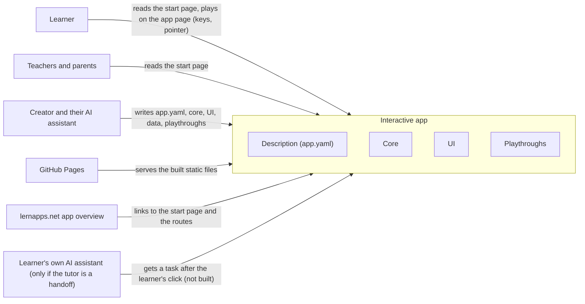

# System Scope and Context

The system is one interactive app: the interactive runtime, the tooling helpers and the app's own `src/`, built into
static pages. Outside it are the people who use or write the app and the few systems it meets: the host that serves
it, the app overview that links to it and, if the tutor is a handoff, the learner's own assistant. Chapter 5 defines
the app's interfaces only as code contracts inside the boundary; the pages and addresses that learners, teachers, the
host and the app overview use have no interface there yet, so those actors carry an `OPEN:` instead of a `requires`.

## Context diagram

The creator's assistant writes the four contracts of the app; every other actor meets the built pages at the
boundary.

```arc42
:::diagram
id: system-context
view: context
notation: mermaid
:::
```



## Learner

Adults and students, often in German schools, who open the start page and play on the app page in the browser, with
keys and pointer, without an account; what the app remembers stays on their device.

OPEN: Chapter 5 defines no interface for the pages and addresses a learner uses (start page, app page,
`app/?seed=<n>#<route>`, keys and pointer input). Should chapter 5 add one, e.g. for the built pages, provided by the
build step or the shell?

```arc42
:::actor
id: actor-learner
title: Learner
type: person
description: Reads the start page and plays the app page in the browser, with keys and pointer, without an account
:::
```

## Teachers and parents

They read the start page and the app's entry to see what the app teaches and whether it may be used; they need the
start page in German and without JavaScript.

OPEN: Same missing interface as the learner's: the start page has no interface in chapter 5.

```arc42
:::actor
id: actor-teacher-parent
title: Teachers and parents
type: person
description: Read the start page to see what the app teaches and what it does not offer
:::
```

## Creator and their AI assistant

The creator's AI assistant writes the app in the folders the template names, against the runtime's contracts: the
description, the core, the root component and the playthroughs; the creator decides and lists the app. These contracts
are what it depends on to extend the app without changing the runtime.

OPEN: Chapter 5 defines no interface for the commands the assistant runs on the app (`vp build`, `vp dev`,
`lernapps check`); should it, and on which block?

```arc42
:::actor
id: actor-creator-assistant
title: Creator and their AI assistant
type: system
description: Writes src/app.yaml, the core, the UI, the data and the playthroughs under the runtime's contracts
requires: if-app-description, if-core-contract, if-root-component, if-playthrough-format
:::
```

## GitHub Pages

The app is static files published from its repo's `gh-pages` branch to `lernapps.net/<repo>/`; there is no server of
the app's own, and pull requests get a preview.

OPEN: Chapter 5 defines no interface for the built static files GitHub Pages serves (the `dist` output of the build
step); should it?

```arc42
:::actor
id: actor-github-pages
title: GitHub Pages
type: system
description: Serves the built static files of the app at lernapps.net/<repo>/
:::
```

## lernapps.net app overview

The app connects to the platform only through its entry in the app overview, which links to the app's start page and,
through its topics, to the hash routes of modes and levels; `entry-links-resolve` checks that these links answer.

OPEN: Chapter 5 defines no interface for the app's addresses (start page URL, `#<route>` deep links) that the entry
links to; should it, e.g. provided by the hash router or the app page?

```arc42
:::actor
id: actor-app-overview
title: lernapps.net app overview
type: system
description: Lists the app with one entry whose URL and topic links point to the start page and the routes
:::
```

## Learner's own AI assistant

Only if the optional tutor is a handoff, as in the explainer: after the learner's click, the app hands a task to the
learner's own assistant (prompt, provider choice, clipboard fallback). Not built for interactive apps.

OPEN: Is the "client-side AI tutor" a handoff to the learner's own assistant (as in the explainer) or a model running
in the browser? If it is a model in the browser, this actor does not exist.

OPEN: Chapter 5 defines no interface for the tutor handoff (`bb-tutor-handoff` has none); which interface would this
actor require?

```arc42
:::actor
id: actor-learner-assistant
title: Learner's own AI assistant
type: system
description: Receives a task from the app after the learner's click, if the tutor is a handoff (not built)
:::
```
