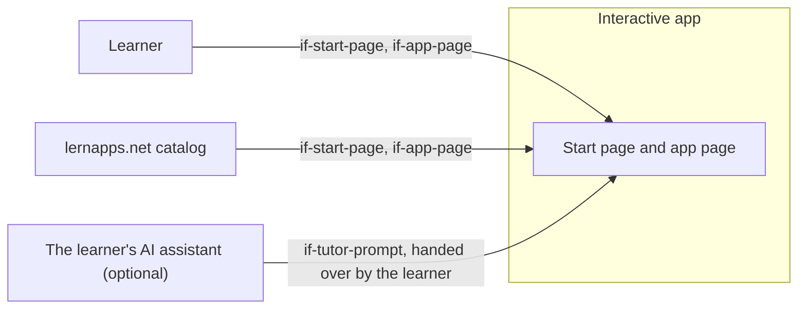

# System Scope and Context

The app talks to no system itself. The learner uses it, the catalog links to it, and the learner may hand the tutor
prompt to an assistant of their own.

```arc42
:::diagram
id: context-overview
view: context
notation: mermaid
:::
```



## Learner

Reads the start page, plays on the app page, with keyboard, mouse or touch.

```arc42
:::actor
id: actor-learner
title: Learner
type: person
requires: if-start-page, if-app-page
:::
```

## Catalog

The app overview of lernapps.net links to the start page and to the app page's routes as the entry's topics.

```arc42
:::actor
id: actor-catalog
title: lernapps.net catalog
type: system
requires: if-start-page, if-app-page
:::
```

## The learner's AI assistant

Optional. An assistant the learner chooses receives the tutor prompt after the learner's click; the app never calls
it itself.

```arc42
:::actor
id: actor-assistant
title: The learner's AI assistant
type: system
requires: if-tutor-prompt
:::
```
