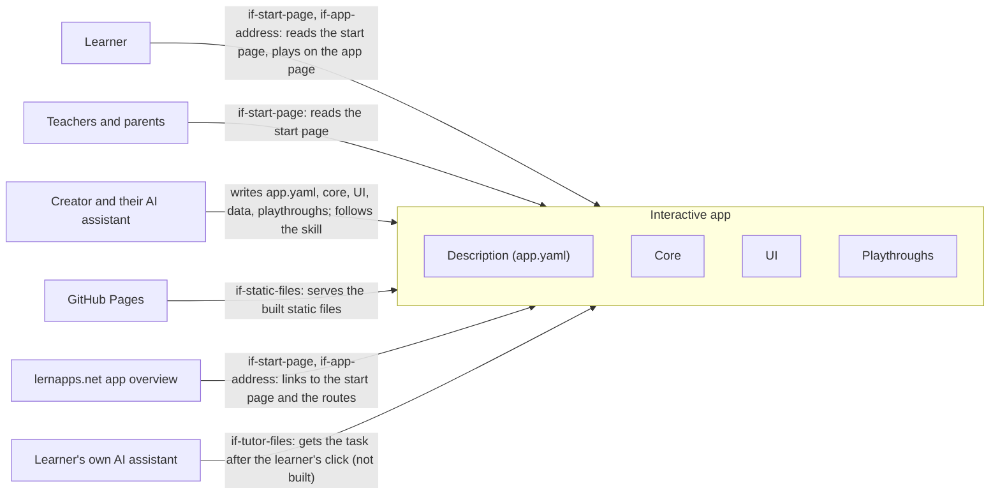

# System Scope and Context

The system is one interactive app: the interactive runtime, the tooling helpers and the app's own `src/`, built into
static pages. Outside it are the people who use or write the app and the few systems it meets: the host that serves
it, the app overview that links to it and, for the optional tutor, the learner's own assistant. Each actor requires an
interface of chapter 5: the start page, the app address, the built static files, the tutor files or, for the
creator's assistant, the app's contracts and the archetype's skill.

## Context diagram

The creator's assistant writes the four contracts of the app and follows the skill; every other actor meets the
built pages at the boundary.

```arc42
:::diagram
id: system-context
view: context
notation: mermaid
:::
```



## Learner

Adults and students, often in German schools, who open the start page and play on the app page in the browser, with
keys and pointer, without an account; what the app remembers stays on their device.

```arc42
:::actor
id: actor-learner
title: Learner
type: person
description: Reads the start page and plays the app page in the browser, with keys and pointer, without an account
requires: if-start-page, if-app-address
:::
```

## Teachers and parents

They read the start page and the app's entry to see what the app teaches and whether it may be used; they need the
start page in German and without JavaScript.

```arc42
:::actor
id: actor-teacher-parent
title: Teachers and parents
type: person
description: Read the start page to see what the app teaches and what it does not offer
requires: if-start-page
:::
```

## Creator and their AI assistant

The creator's AI assistant writes the app in the folders the template names, against the runtime's contracts: the
description, the core, the root component and the playthroughs; the creator decides and lists the app. It uses the
skill `lernapps-interactive` (not built yet) as its guidance, including the advice on low stimulation.

OPEN: Chapter 5 defines no interface for the commands the assistant runs on the app (`vp build`, `vp dev`,
`lernapps check`); should it, and on which block?

```arc42
:::actor
id: actor-creator-assistant
title: Creator and their AI assistant
type: system
description: Writes src/app.yaml, the core, the UI, the data and the playthroughs under the runtime's contracts
requires: if-app-description, if-core-contract, if-root-component, if-playthrough-format, if-skill-interactive
:::
```

## GitHub Pages

The app is static files published from its repo's `gh-pages` branch to `lernapps.net/<repo>/`; there is no server of
the app's own, and pull requests get a preview.

```arc42
:::actor
id: actor-github-pages
title: GitHub Pages
type: system
description: Serves the built static files of the app at lernapps.net/<repo>/
requires: if-static-files
:::
```

## lernapps.net app overview

The app connects to the platform only through its entry in the app overview, which links to the app's start page and,
through its topics, to the hash routes of modes and levels; `entry-links-resolve` checks that these links answer.
The entry's fact sheet also states the app's size (not built yet).

```arc42
:::actor
id: actor-app-overview
title: lernapps.net app overview
type: system
description: Lists the app with one entry whose URL and topic links point to the start page and the routes
requires: if-start-page, if-app-address
:::
```

## Learner's own AI assistant

The optional tutor is this assistant, which the learner brings and controls; no model runs in the browser. After the
learner's click, the app hands it the current task through the tutor prompt and the static tutor files, as the
explainer does; not built for interactive apps yet.

```arc42
:::actor
id: actor-learner-assistant
title: Learner's own AI assistant
type: system
description: Receives the task through the tutor prompt and the tutor files after the learner's click (not built)
requires: if-tutor-files
:::
```
