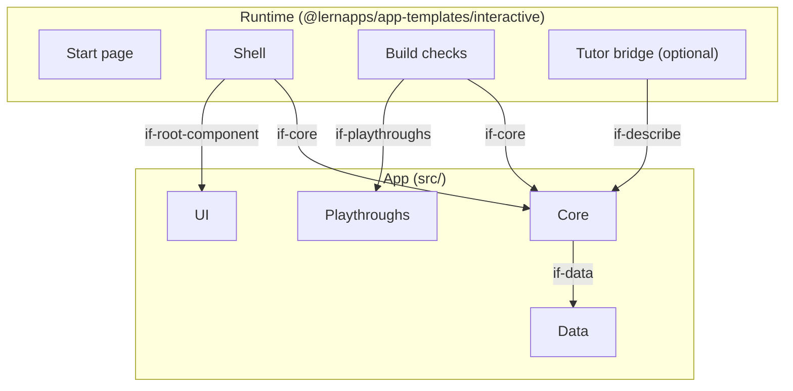

# Building Blocks

## Level 1

```arc42
:::diagram
id: building-blocks-level-1
view: building-block
notation: mermaid
:::
```



## Runtime

The part every app shares, from the package `@lernapps/app-templates`; the app never changes it.

```arc42
:::building-block
id: bb-runtime
title: Runtime
technology: Vue, Vite plugin
:::
```

### Start page

Builds the static description from `src/app.yaml`: what the app does, how to play, its competencies, background
sections. Readable without JavaScript, one page tree per language.

```arc42
:::building-block
id: bb-start-page
title: Start page
parent: bb-runtime
technology: Vite plugin, server-side rendering at build
:::
```

#### Start page

The static description, `index.html` per language.

```arc42
:::interface
id: if-start-page
title: Start page
provider: bb-start-page
protocol: static HTML
:::
```

### Shell

The app page: mounts the root component, holds the core's state, gives typed keys to `step`, calls `tick` every
20 ms, starts the core again on a new hash route, and offers storage, languages and announcements.

```arc42
:::building-block
id: bb-shell
title: Shell
parent: bb-runtime
technology: Vue
requires: if-core, if-root-component
implements: concept-state-in-runtime, concept-small-storage
:::
```

#### App page

`app/index.html`, with each route as an element id, so that `app/#<route>` resolves.

```arc42
:::interface
id: if-app-page
title: App page with hash routes
provider: bb-shell
protocol: HTML, app/#<route>
:::
```

### Build checks

Fail the build with one line per problem: `src/app.yaml` against its schema, the component rules, the core's exports,
every playthrough against the core, the size budget.

```arc42
:::building-block
id: bb-build-checks
title: Build checks
parent: bb-runtime
technology: Vite plugin
requires: if-core, if-playthroughs
implements: concept-deterministic-core
:::
```

### Tutor bridge

Optional, only when the core describes its tasks. Puts the app's static description and the current task into a
prompt and hands it to the learner's assistant after a click.

```arc42
:::building-block
id: bb-tutor-bridge
title: Tutor bridge
parent: bb-runtime
technology: Vue
requires: if-describe
implements: concept-no-request-before-click
:::
```

#### Tutor prompt

The text the learner hands to their assistant.

```arc42
:::interface
id: if-tutor-prompt
title: Tutor prompt
provider: bb-tutor-bridge
protocol: text, handed over by link or clipboard
:::
```

## App

What the app's creator writes. Its own blocks go below `bb-core` and `bb-ui`.

```arc42
:::building-block
id: bb-app
title: App
path: src
technology: TypeScript, Vue
:::
```

### Core

The app's logic, pure TypeScript without DOM, deterministic by its seed; its state is plain JSON data.

```arc42
:::building-block
id: bb-core
title: Core
parent: bb-app
path: src/core
technology: TypeScript
requires: if-data
implements: concept-deterministic-core
:::
```

#### Core contract

The exports of `src/core/index.ts` the shell and the build checks call.

```arc42
:::interface
id: if-core
title: start(seed, route), step(state, key), tick(state, dt)
provider: bb-core
path: src/core/index.ts
protocol: TypeScript module
:::
```

#### Task description

Optional: what the current state asks of the learner, and its solution, as text for the tutor.

```arc42
:::interface
id: if-describe
title: describe(state, lang), optional
provider: bb-core
path: src/core/index.ts
protocol: TypeScript module
:::
```

### UI

Vue components that show the state and turn pointer input into keys for `step`.

```arc42
:::building-block
id: bb-ui
title: UI
parent: bb-app
path: src/ui
technology: Vue
implements: concept-state-in-runtime
:::
```

#### Root component

The component the shell mounts: it gets the state and the language, and sends keys back.

```arc42
:::interface
id: if-root-component
title: Root component with props state and lang, event input
provider: bb-ui
path: src/ui/App.vue
protocol: Vue component
:::
```

### Data

The app's content as data, read by the core.

```arc42
:::building-block
id: bb-data
title: Data
parent: bb-app
path: src/data
technology: JSON, YAML
:::
```

#### Content files

The data files the core imports, with the app's own schema.

```arc42
:::interface
id: if-data
title: Content files
provider: bb-data
path: src/data
protocol: JSON or YAML, imported at build
:::
```

### Playthroughs

A seed, a route and keys with the state or announcement expected after them.

```arc42
:::building-block
id: bb-playthroughs
title: Playthroughs
parent: bb-app
path: src/playthroughs
technology: YAML
implements: concept-deterministic-core
:::
```

#### Playthrough files

The files the build checks play against the core.

```arc42
:::interface
id: if-playthroughs
title: Playthroughs
provider: bb-playthroughs
path: src/playthroughs
protocol: YAML files
:::
```
