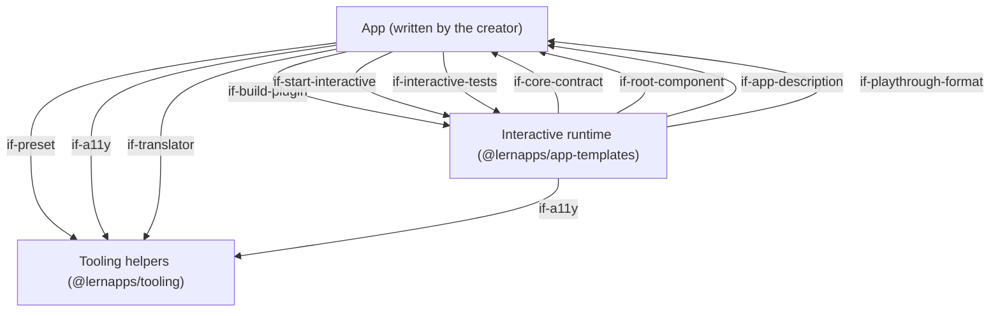
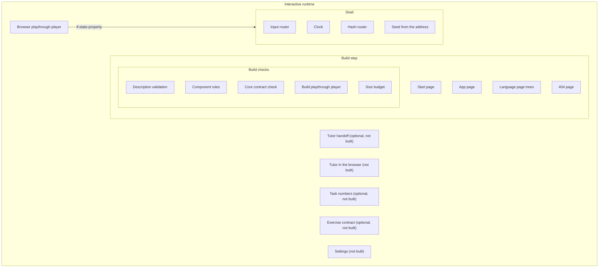
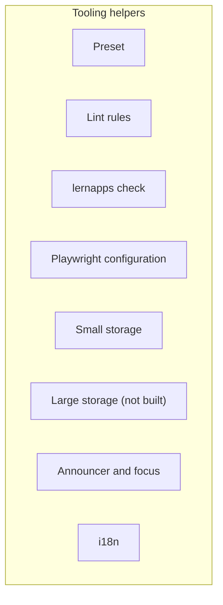
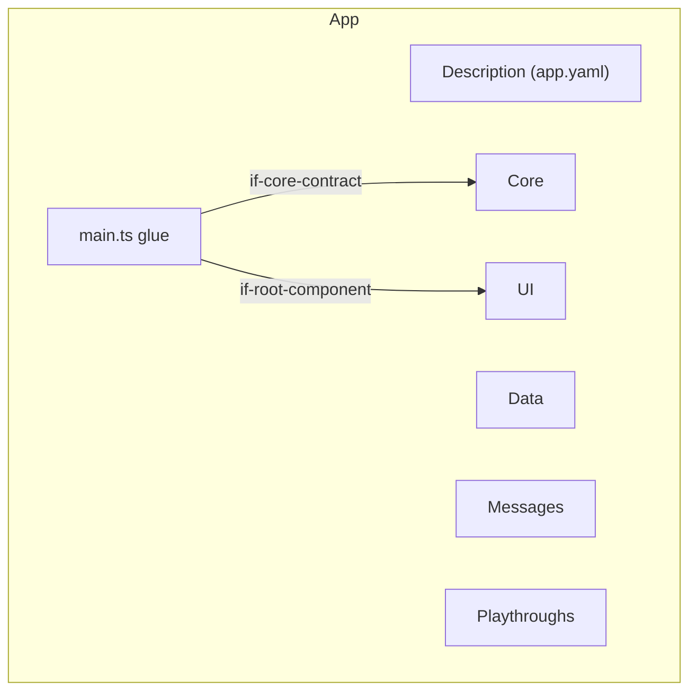

# Building Blocks

Every interactive app has three parts at level 1: the interactive runtime, which the app does not change; the tooling
helpers, which every lernapps app shares; and the app itself, which the creator writes in folders the template names.
Each block says whether it is built, optional or not built yet. An app adds its own blocks below `bb-core`, `bb-ui` and
`bb-data`.

## Level 1

```arc42
:::diagram
id: building-blocks-level-1
view: building-block
notation: mermaid
:::
```



## Level 2: the runtime

```arc42
:::diagram
id: building-blocks-level-2-runtime
view: building-block
notation: mermaid
roots: bb-runtime
:::
```



## Level 2: the tooling helpers

```arc42
:::diagram
id: building-blocks-level-2-tooling
view: building-block
notation: mermaid
roots: bb-tooling
:::
```



## Level 2: the app

```arc42
:::diagram
id: building-blocks-level-2-app
view: building-block
notation: mermaid
roots: bb-app
:::
```



## Interactive runtime

Built. The runtime `interactive/` of `@lernapps/app-templates`: it builds the pages, checks the app at build time and
runs it in the browser, so that every interactive app shares one frame and its rules stay checkable. The app never
edits it.

```arc42
:::building-block
id: bb-runtime
title: Interactive runtime
technology: TypeScript, Vue, Vite plugin (@lernapps/app-templates/interactive)
:::
```

## Build step

Built. The Vite plugin `interactive()` reads the app's description and playthroughs, runs the build checks and writes
every page into the built index.html shell. `vp dev` serves the same pages.

```arc42
:::building-block
id: bb-build
title: Build step
parent: bb-runtime
technology: Vite plugin (runtime/interactive/plugin.ts, load.ts, render.ts)
:::
```

### Build plugin interface

The app's vite.config.ts adds `interactive()` to the tooling preset; that is the only way the app enters the build.

```arc42
:::interface
id: if-build-plugin
title: interactive() Vite plugin
provider: bb-build
protocol: TypeScript import, @lernapps/app-templates/interactive/plugin
:::
```

## Start page

Built. Renders the static start page from `src/app.yaml` (what the app does, link into the app, routes, how to play,
competencies, background sections, imprint and privacy notice) with a `<noscript>` note and no script, so the app is
described and found without JavaScript.

```arc42
:::building-block
id: bb-start-page
title: Start page
parent: bb-build
technology: TypeScript (runtime/interactive/render.ts)
requires: if-app-description
implements: concept-readable-without-js, concept-accessibility
:::
```

## App page

Built. Renders the app page: title, `<noscript>` note with a link back, the routes as anchor links, and the element
the shell mounts into, carrying the route ids.

```arc42
:::building-block
id: bb-app-page
title: App page
parent: bb-build
technology: TypeScript (runtime/interactive/render.ts)
requires: if-app-description
implements: concept-hash-routes
:::
```

## Language page trees

Built. Every page exists once per declared language, German at the root and every other language below
`/<language>/`, with alternates and a switch of plain links; an app may declare only the languages the runtime has
texts for.

```arc42
:::building-block
id: bb-page-tree
title: Language page trees
parent: bb-build
technology: TypeScript (runtime/shared/pages.ts, languages.ts)
requires: if-app-description
implements: concept-languages, concept-readable-without-js
:::
```

## 404 page

Built. A 404.html leads every address the app does not have to its start page, because the app is served statically
under any path.

```arc42
:::building-block
id: bb-not-found-page
title: 404 page
parent: bb-build
technology: TypeScript (runtime/shared/pages.ts)
:::
```

## Build checks

Built. Before anything is written, the build fails with one line per problem, so that a broken app never reaches the
browser.

```arc42
:::building-block
id: bb-build-checks
title: Build checks
parent: bb-build
technology: TypeScript (runtime/interactive/plugin.ts, load.ts)
:::
```

## Description validation

Built. Validates `src/app.yaml` and every playthrough against their JSON schemas, then German first, complete
languages, unique ids, at least one playthrough and known routes.

```arc42
:::building-block
id: bb-app-validation
title: Description validation
parent: bb-build-checks
technology: Ajv, JSON Schema (interactive.v1, playthrough.v1)
requires: if-app-description, if-playthrough-format
:::
```

## Component rules

Built. The explainer's code checks on the SFC compiler's output of every component in `src/`: no network, no `eval`,
`innerHTML` or `v-html`, imports only from Vue, the runtime, the storage, i18n and a11y helpers and `src/`, browser
globals only once mounted.

```arc42
:::building-block
id: bb-component-rules
title: Component rules
parent: bb-build-checks
technology: TypeScript, Vue SFC compiler (runtime/explainer/components.ts)
implements: concept-component-rules
:::
```

## Core contract check

Built. Loads the core in a Vite server of its own and checks its exports and that every route starts.

```arc42
:::building-block
id: bb-core-check
title: Core contract check
parent: bb-build-checks
technology: TypeScript (runtime/interactive/plugin.ts)
requires: if-core-contract, if-app-description
implements: concept-determinism
:::
```

## Build playthrough player

Built. Plays every playthrough against the core twice, without ticks, and fails when the two plays differ or a state
differs from the expected one, so determinism and behaviour are tested without a browser.

```arc42
:::building-block
id: bb-build-playthroughs
title: Build playthrough player
parent: bb-build-checks
technology: TypeScript (runtime/interactive/plugin.ts)
requires: if-core-contract, if-playthrough-format
implements: concept-playthroughs, concept-determinism
:::
```

## Size budget

Built. The app's own code in `src/`, gzipped, must stay within 100 kB; Vue, the runtime and bundled libraries do not
count.

```arc42
:::building-block
id: bb-size-budget
title: Size budget
parent: bb-build-checks
technology: TypeScript, zlib (runtime/interactive/plugin.ts)
implements: concept-size-budget
:::
```

## Shell

Built. `startInteractive(core, root)` mounts the app's root component on the app page and holds the core's state, so
that the app's components only show it; on any other page it does nothing.

```arc42
:::building-block
id: bb-shell
title: Shell
parent: bb-runtime
technology: TypeScript, Vue (runtime/interactive/interactive.ts)
requires: if-core-contract, if-root-component
implements: concept-core-and-shell
:::
```

### Start interface

The app's `src/main.ts` calls `startInteractive` with its core and root component.

```arc42
:::interface
id: if-start-interactive
title: startInteractive(core, root)
provider: bb-shell
protocol: TypeScript import, @lernapps/app-templates/interactive
:::
```

### State property

The shell mirrors the state on the host element as `lernappsState`, which the browser playthrough player reads.

```arc42
:::interface
id: if-state-property
title: lernappsState on the app element
provider: bb-shell
protocol: DOM property
:::
```

## Input router

Built. Gives every key typed on the page to `step`, except keys on links, buttons and form fields or with Ctrl, Alt or
Meta, and steps every key the root component emits as `input` (pointer input as a button that stands for a key).

```arc42
:::building-block
id: bb-input-router
title: Input router
parent: bb-shell
technology: TypeScript, DOM keydown (runtime/interactive/interactive.ts)
requires: if-core-contract, if-root-component
:::
```

## Clock

Built. Calls `tick(state, 20)` every 20 ms when the core has `tick`, so real-time apps move without their own loop in
the core.

```arc42
:::building-block
id: bb-clock
title: Clock
parent: bb-shell
technology: TypeScript, setInterval (runtime/interactive/interactive.ts)
requires: if-core-contract
:::
```

## Hash router

Built. Starts the core with the route of the address (`#<id>`, else the first route) and again on every new route, so
that modes and levels have addresses an entry's topics can point to.

```arc42
:::building-block
id: bb-hash-router
title: Hash router
parent: bb-shell
technology: TypeScript, hashchange (runtime/interactive/interactive.ts)
requires: if-core-contract
implements: concept-hash-routes
:::
```

## Seed from the address

Built. Takes the seed from `?seed=<n>`, else a random one, so that a round can be replayed and tested at its address.

```arc42
:::building-block
id: bb-seed
title: Seed from the address
parent: bb-shell
technology: TypeScript (runtime/interactive/interactive.ts)
requires: if-core-contract
implements: concept-determinism
:::
```

## Browser playthrough player

Built. `interactiveTests()` checks the pages without JavaScript in every language and plays every playthrough's keys
in the browser, comparing the state and the announcement after each step; run at desktop width and 360 px.

```arc42
:::building-block
id: bb-browser-playthroughs
title: Browser playthrough player
parent: bb-runtime
technology: Playwright (runtime/interactive/e2e.ts)
requires: if-playthrough-format, if-app-description, if-state-property, if-a11y
implements: concept-playthroughs, concept-readable-without-js
:::
```

### Interactive tests interface

The app's `e2e/interactive.e2e.ts` only calls `interactiveTests()`.

```arc42
:::interface
id: if-interactive-tests
title: interactiveTests()
provider: bb-browser-playthroughs
protocol: TypeScript import, @lernapps/app-templates/interactive/e2e
:::
```

## Tutor handoff

Optional, not built for interactive apps (built for the explainer only): a handoff to the learner's own assistant with
a prompt, provider choice, clipboard fallback, static tutor.md and llms.txt files and "Zurück zum Tutor". Whether the
interactive tutor is this or a model in the browser is OPEN.

```arc42
:::building-block
id: bb-tutor-handoff
title: Tutor handoff
parent: bb-runtime
technology: TypeScript (explainer: runtime/explainer/tutor.ts, tutorpage.ts, prompt.ts)
implements: concept-tutor
:::
```

## Tutor in the browser

Optional, not built: a tutor model running in the learner's browser, the alternative to the handoff. OPEN: whether
the "client-side AI tutor" means this; nothing about its form is decided.

```arc42
:::building-block
id: bb-tutor-in-browser
title: Tutor in the browser
parent: bb-runtime
implements: concept-tutor
:::
```

## Task numbers

Optional, not built for interactive apps (built for the explainer only): numbered tasks in the address that learner,
tutor and address share; they come with the exercise contract.

```arc42
:::building-block
id: bb-task-numbers
title: Task numbers
parent: bb-runtime
technology: TypeScript (explainer: runtime/explainer/tasks.ts)
:::
```

## Exercise contract

Optional, not built for interactive apps (built for the explainer only): for apps with tasks, the core would also
give `describe`, `about` and `examples`, which bring task numbers and the tutor.

```arc42
:::building-block
id: bb-exercise-contract
title: Exercise contract
parent: bb-runtime
technology: TypeScript (explainer: runtime/explainer/components.ts, shared/examples.ts)
:::
```

## Settings

Not built and not in scope now (owner): a settings dialog, e.g. time limit off, less motion, sound or pause. Noted so
that an app that needs one later adds it here rather than on its own.

```arc42
:::building-block
id: bb-settings
title: Settings
parent: bb-runtime
:::
```

## Tooling helpers

Built. The parts of `@lernapps/tooling` an interactive app uses, shared with every lernapps app, so that rules and
helpers reach the app through updates without edits.

```arc42
:::building-block
id: bb-tooling
title: Tooling helpers
technology: TypeScript (@lernapps/tooling)
:::
```

## Preset

Built. The vite-plus configuration the app extends and never edits: lint with the lernapps rules, type check, format,
unit tests, pre-commit staged files and a build with relative URLs.

```arc42
:::building-block
id: bb-preset
title: Preset
parent: bb-tooling
technology: vite-plus (archetypes/shared/preset.ts)
:::
```

### Preset interface

The app's vite.config.ts calls `lernapps({ plugins: [interactive()] })`.

```arc42
:::interface
id: if-preset
title: lernapps() preset
provider: bb-preset
protocol: TypeScript import, @lernapps/tooling/preset
:::
```

## Lint rules

Built. The lernapps lint rules (learner texts German, no request before a click, storage through the wrapper, the Vue
component rules, suppression reasons), set by the preset.

```arc42
:::building-block
id: bb-lint-rules
title: Lint rules
parent: bb-tooling
technology: lint plugin (lint/rules)
implements: concept-component-rules
:::
```

## lernapps check

Built. `lernapps check` verifies the built app (accessible, usable at 360 px, no request before a click, no tracking,
links and entry links resolve) and runs the e2e tests before a push. `arc42 validate` in the check is planned, not
built yet.

```arc42
:::building-block
id: bb-lernapps-check
title: lernapps check
parent: bb-tooling
technology: TypeScript CLI (check/)
implements: concept-accessibility
:::
```

## Playwright configuration

Built. Runs the e2e tests against the built app on a free port, in Chromium at desktop width and 360 px.

```arc42
:::building-block
id: bb-playwright-config
title: Playwright configuration
parent: bb-tooling
technology: Playwright (archetypes/shared/playwright.ts)
:::
```

## Small storage

Built, optional for an app: the only storage, `localStorage` under the app's prefix, every access wrapped so the app
keeps working when storage is blocked or full. The decided quota of 100 kB per app is not built yet.

```arc42
:::building-block
id: bb-small-storage
title: Small storage
parent: bb-tooling
technology: localStorage (archetypes/shared/storage.ts)
implements: concept-device-storage
:::
```

### Device storage interface

An app's components may load, save and remove JSON values through `createStorage`; the template app does not use it.

```arc42
:::interface
id: if-device-storage
title: createStorage(app)
provider: bb-small-storage
protocol: TypeScript import, @lernapps/tooling/storage
:::
```

## Large storage

Not built: an IndexedDB wrapper, built and added here only when an app needs more than the small storage holds.

```arc42
:::building-block
id: bb-large-storage
title: Large storage
parent: bb-tooling
technology: IndexedDB
implements: concept-device-storage
:::
```

## Announcer and focus

Built. Live-region announcements, focus moves and the reduced-motion query, so that feedback reaches screen readers
and keyboard users.

```arc42
:::building-block
id: bb-a11y
title: Announcer and focus
parent: bb-tooling
technology: DOM, ARIA live regions (archetypes/shared/a11y.ts)
implements: concept-accessibility
:::
```

### Accessibility helpers interface

The UI announces every change through `announce`; the browser playthrough player reads its polite live region.

```arc42
:::interface
id: if-a11y
title: announce, moveFocus, prefersReducedMotion
provider: bb-a11y
protocol: TypeScript import, @lernapps/tooling/a11y
:::
```

## i18n

Built. A translator over the app's message files, so learner texts never sit as strings in code.

```arc42
:::building-block
id: bb-i18n
title: i18n
parent: bb-tooling
technology: TypeScript, Intl (archetypes/shared/i18n.ts)
implements: concept-languages
:::
```

### Translator interface

The UI gets its texts through `translator(messages)`.

```arc42
:::interface
id: if-translator
title: translator(messages)
provider: bb-i18n
protocol: TypeScript import, @lernapps/tooling/i18n
:::
```

## App

Built in the template, written by the creator for each app: the folders of `src/`, bound to the runtime and tooling by
thin root files (vite.config.ts, e2e/interactive.e2e.ts).

```arc42
:::building-block
id: bb-app
title: App
path: src
requires: if-build-plugin, if-preset, if-interactive-tests
:::
```

## Description

Built in the template. `src/app.yaml` says what the start page shows, the languages and the routes.

```arc42
:::building-block
id: bb-description
title: Description
parent: bb-app
path: src/app.yaml
technology: YAML
:::
```

### App description interface

The page builders, the validation and the tests read the app only through this schema.

```arc42
:::interface
id: if-app-description
title: app.yaml (interactive.v1 schema)
provider: bb-description
protocol: YAML, JSON Schema
path: src/app.yaml
:::
```

## main.ts glue

Built in the template. Imports the runtime's style, the core and the root component and calls `startInteractive`.

```arc42
:::building-block
id: bb-main
title: main.ts glue
parent: bb-app
path: src/main.ts
technology: TypeScript
requires: if-start-interactive, if-core-contract, if-root-component
:::
```

## Core

Built in the template. The app's logic, pure TypeScript without DOM, deterministic by its seed, its state plain JSON,
so that it can be played and tested in Node and in the browser alike; it reads the app's data.

```arc42
:::building-block
id: bb-core
title: Core
parent: bb-app
path: src/core
technology: TypeScript
implements: concept-core-and-shell, concept-determinism
:::
```

### Core contract

The core exports `start(seed, route)`, `step(state, key)` and, when the app moves on its own, `tick(state, dt)`.

```arc42
:::interface
id: if-core-contract
title: Core contract start, step, tick
provider: bb-core
protocol: TypeScript module exports
path: src/core/index.ts
:::
```

## UI

Built in the template. Vue components that show the state and turn pointer input into keys; free in how they render
(DOM, SVG, canvas).

```arc42
:::building-block
id: bb-ui
title: UI
parent: bb-app
path: src/ui
technology: Vue single-file components
requires: if-a11y, if-translator
implements: concept-component-rules, concept-accessibility
:::
```

### Root component

The root component takes the props `state` and `lang` and emits `input` with a key.

```arc42
:::interface
id: if-root-component
title: Root component (state, lang, input)
provider: bb-ui
protocol: Vue props and events
path: src/ui/App.vue
:::
```

## Data

Built in the template. The app's content as data in its own format (lessons, texts with their faulty versions).

```arc42
:::building-block
id: bb-data
title: Data
parent: bb-app
path: src/data
technology: JSON
:::
```

## Messages

Built in the template. The app's learner texts by language, read through the translator.

```arc42
:::building-block
id: bb-messages
title: Messages
parent: bb-app
path: src/messages
technology: JSON
implements: concept-languages
:::
```

## Playthroughs

Built in the template. Playthroughs as data: a seed, a route and steps of keys with the state or announcement
expected after them.

```arc42
:::building-block
id: bb-playthroughs
title: Playthroughs
parent: bb-app
path: src/playthroughs
technology: YAML
implements: concept-playthroughs
:::
```

### Playthrough format

Both playthrough players read playthroughs in this format.

```arc42
:::interface
id: if-playthrough-format
title: Playthrough (playthrough.v1 schema)
provider: bb-playthroughs
protocol: YAML, JSON Schema
path: src/playthroughs
:::
```
