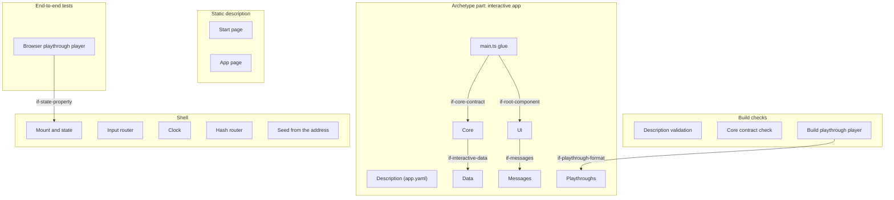

# Building Blocks

The interactive archetype's extension of the generic architecture (`docs/arc42/` at the root of
`lernapps/app-templates`): an app whose doing is the content, with a static start page, one app page on which the
shell runs the app's deterministic core and shows its state with the app's Vue components, and hash routes for modes
and levels. The runtime `interactive/` ships the pages, the shell and the playthrough players; the creator writes the
core, the UI, the data, the playthroughs, the messages and the description. Of the optional generic blocks it
realises the component rules; the tutor handoff, task numbers, exercise contract, settings and loading indicator are
not built for it, and it has no examples check (its playthroughs take that role). Only the start page reads without
JavaScript. An interactive app adds its own blocks below `bb-interactive-core`, `bb-interactive-ui` and
`bb-interactive-data`, in an architecture part of its own.

```arc42
:::diagram
id: building-blocks-interactive
view: building-block
notation: mermaid
:::
```



### Start page

Built. Renders the static start page from `src/app.yaml` (what the app does, link into the app, routes, how to play,
competencies, background sections) with a `<noscript>` note and no script, so the app is described and found without
JavaScript.

```arc42
:::ignore W026 the parent is a block of the generic architecture, documented in its own file
:::
:::building-block
id: bb-interactive-start-page
title: Start page
parent: bb-static-description
technology: TypeScript (runtime/interactive/render.ts)
requires: if-interactive-description
implements: concept-readable-without-js, concept-accessibility
:::
```

### App page

Built. Renders the app page: title, `<noscript>` note with a link back, the routes as anchor links, and the element
the shell mounts into, carrying the route ids. Without JavaScript it shows only the note.

```arc42
:::ignore W026 the parent is a block of the generic architecture, documented in its own file
:::
:::building-block
id: bb-interactive-app-page
title: App page
parent: bb-static-description
technology: TypeScript (runtime/interactive/render.ts)
requires: if-interactive-description
implements: concept-hash-routes
:::
```

#### App address

The app page's address `app/?seed=<n>#<route>` opens a mode or level, optionally with a fixed seed; learners play
there and the catalog entry's topics link to the routes.

```arc42
:::interface
id: if-app-address
title: App address app/?seed=<n>#<route>
provider: bb-interactive-app-page
protocol: URL over HTTPS (query and hash)
:::
```

### Description validation

Built. Validates `src/app.yaml` and every playthrough against their JSON schemas, then German first, complete
languages, unique ids, at least one playthrough and known routes.

```arc42
:::ignore W026 the parent is a block of the generic architecture, documented in its own file
:::
:::building-block
id: bb-interactive-validation
title: Description validation
parent: bb-build-checks
technology: Ajv, JSON Schema (runtime/interactive/load.ts, interactive.v1, playthrough.v1)
requires: if-interactive-description, if-playthrough-format
:::
```

### Core contract check

Built. Loads the core in a Vite server of its own and checks its exports and that every route starts.

```arc42
:::ignore W026 the parent is a block of the generic architecture, documented in its own file
:::
:::building-block
id: bb-core-check
title: Core contract check
parent: bb-build-checks
technology: TypeScript (runtime/interactive/plugin.ts, runtime/shared/vue.ts)
requires: if-core-contract, if-interactive-description
implements: concept-determinism
:::
```

### Build playthrough player

Built. Plays every playthrough against the core twice and fails when the two plays differ or a state differs from the
expected one. Time steps (a step that lets n ticks pass) are decided, not built yet; today the build never ticks.

```arc42
:::ignore W026 the parent is a block of the generic architecture, documented in its own file
:::
:::building-block
id: bb-build-playthroughs
title: Build playthrough player
parent: bb-build-checks
technology: TypeScript (runtime/interactive/plugin.ts)
requires: if-core-contract, if-playthrough-format
implements: concept-playthroughs, concept-determinism
:::
```

### Mount and state

Built. `startInteractive(core, root)` mounts the root component on the app page and holds the core's state, so that
the app's components only show it; on any other page it does nothing.

```arc42
:::ignore W026 the parent is a block of the generic architecture, documented in its own file
:::
:::building-block
id: bb-state-holder
title: Mount and state
parent: bb-shell
technology: TypeScript, Vue (runtime/interactive/interactive.ts)
requires: if-core-contract, if-root-component
implements: concept-core-and-shell
:::
```

#### State property

The shell mirrors the state on the host element as `lernappsState`, which the browser playthrough player reads.

```arc42
:::interface
id: if-state-property
title: lernappsState on the app element
provider: bb-state-holder
protocol: DOM property
:::
```

### Input router

Built. Gives every key typed on the page to `step`, except keys on links, buttons and form fields or with Ctrl, Alt or
Meta, and steps every key the root component emits as `input` (pointer input as a button that stands for a key).

```arc42
:::ignore W026 the parent is a block of the generic architecture, documented in its own file
:::
:::building-block
id: bb-input-router
title: Input router
parent: bb-shell
technology: TypeScript, DOM keydown (runtime/interactive/interactive.ts)
requires: if-core-contract, if-root-component
:::
```

### Clock

Built. Calls `tick(state, 20)` every 20 ms when the core has `tick`, so real-time apps move without their own loop in
the core.

```arc42
:::ignore W026 the parent is a block of the generic architecture, documented in its own file
:::
:::building-block
id: bb-clock
title: Clock
parent: bb-shell
technology: TypeScript, setInterval (runtime/interactive/interactive.ts)
requires: if-core-contract
:::
```

### Hash router

Built. Starts the core with the route of the address (`#<id>`, else the first route) and again on every new route, so
that modes and levels have addresses an entry's topics can point to.

```arc42
:::ignore W026 the parent is a block of the generic architecture, documented in its own file
:::
:::building-block
id: bb-hash-router
title: Hash router
parent: bb-shell
technology: TypeScript, hashchange (runtime/interactive/interactive.ts)
requires: if-core-contract
implements: concept-hash-routes
:::
```

### Seed from the address

Built. Takes the seed from `?seed=<n>`, else a random one, so that a round can be replayed and tested at its address.

```arc42
:::ignore W026 the parent is a block of the generic architecture, documented in its own file
:::
:::building-block
id: bb-seed
title: Seed from the address
parent: bb-shell
technology: TypeScript (runtime/interactive/interactive.ts)
requires: if-core-contract
implements: concept-determinism
:::
```

### Browser playthrough player

Built. `interactiveTests()` checks the start page and the app page without JavaScript in every language and plays
every playthrough's keys in the browser, comparing the state and the announcement after each step; run at desktop
width and 360 px. Time steps are decided, not built yet.

```arc42
:::ignore W026 the parent is a block of the generic architecture, documented in its own file
:::
:::building-block
id: bb-browser-playthroughs
title: Browser playthrough player
parent: bb-e2e
technology: Playwright (runtime/interactive/e2e.ts)
requires: if-playthrough-format, if-interactive-description, if-state-property, if-a11y
implements: concept-playthroughs
:::
```

### Description

Built in the template. `src/app.yaml` says what the start page shows, the languages and the routes.

```arc42
:::ignore W026 the parent is a block of the generic architecture, documented in its own file
:::
:::building-block
id: bb-interactive-description
title: Description
parent: bb-archetype
path: src/app.yaml
technology: YAML
:::
```

#### App description interface

Part of the archetype's content (`if-archetype-content`): the page builders, the validation and the tests read the
app only through this schema.

```arc42
:::interface
id: if-interactive-description
title: app.yaml (interactive.v1 schema)
provider: bb-interactive-description
protocol: YAML, JSON Schema
path: src/app.yaml
:::
```

### main.ts glue

Built in the template. Imports the runtime's style, the core and the root component and calls `startInteractive`.

```arc42
:::ignore W026 the parent is a block of the generic architecture, documented in its own file
:::
:::building-block
id: bb-interactive-main
title: main.ts glue
parent: bb-archetype
path: src/main.ts
technology: TypeScript
requires: if-start, if-core-contract, if-root-component
:::
```

### Core

Built in the template. The app's logic, pure TypeScript without DOM, deterministic by its seed, its state plain JSON,
so that it can be played and tested in Node and in the browser alike; it reads the app's data.

```arc42
:::ignore W026 the parent is a block of the generic architecture, documented in its own file
:::
:::building-block
id: bb-interactive-core
title: Core
parent: bb-archetype
path: src/core
technology: TypeScript
requires: if-interactive-data
implements: concept-core-and-shell, concept-determinism
:::
```

#### Core contract

The core exports `start(seed, route)`, `step(state, key)` and, when the app moves on its own, `tick(state, dt)`.

```arc42
:::interface
id: if-core-contract
title: Core contract start, step, tick
provider: bb-interactive-core
protocol: TypeScript module exports
path: src/core/index.ts
:::
```

### UI

Built in the template. Vue components that show the state and turn pointer input into keys; free in how they render
(DOM, SVG, canvas). They may remember something through the small storage; the template does not.

```arc42
:::ignore W026 the parent is a block of the generic architecture, documented in its own file
:::
:::building-block
id: bb-interactive-ui
title: UI
parent: bb-archetype
path: src/ui
technology: Vue single-file components
requires: if-a11y, if-translator, if-messages, if-device-storage
implements: concept-component-rules, concept-accessibility
:::
```

#### Root component

The root component takes the props `state` and `lang` and emits `input` with a key.

```arc42
:::interface
id: if-root-component
title: Root component (state, lang, input)
provider: bb-interactive-ui
protocol: Vue props and events
path: src/ui/App.vue
:::
```

### Data

Built in the template. The app's content as data in its own format (lessons, texts with their faulty versions).

```arc42
:::ignore W026 the parent is a block of the generic architecture, documented in its own file
:::
:::building-block
id: bb-interactive-data
title: Data
parent: bb-archetype
path: src/data
technology: JSON
:::
```

#### App data

The core imports the data files as JSON modules, so they are bundled and checked with the core.

```arc42
:::interface
id: if-interactive-data
title: Data files (JSON imports)
provider: bb-interactive-data
protocol: JSON module import
:::
```

### Messages

Built in the template. The app's learner texts by language, read through the translator.

```arc42
:::ignore W026 the parent is a block of the generic architecture, documented in its own file
:::
:::building-block
id: bb-interactive-messages
title: Messages
parent: bb-archetype
path: src/messages
technology: JSON
implements: concept-languages
:::
```

#### Message files

The UI imports one message file per language and hands it to the translator.

```arc42
:::interface
id: if-messages
title: Message files by language
provider: bb-interactive-messages
protocol: JSON module import
:::
```

### Playthroughs

Built in the template. Playthroughs as data: a seed, a route and steps of keys with the state or announcement
expected after them; steps that let time pass are decided, not built yet.

```arc42
:::ignore W026 the parent is a block of the generic architecture, documented in its own file
:::
:::building-block
id: bb-interactive-playthroughs
title: Playthroughs
parent: bb-archetype
path: src/playthroughs
technology: YAML
implements: concept-playthroughs
:::
```

#### Playthrough format

Both playthrough players read playthroughs in this format.

```arc42
:::interface
id: if-playthrough-format
title: Playthrough (playthrough.v1 schema)
provider: bb-interactive-playthroughs
protocol: YAML, JSON Schema
path: src/playthroughs
:::
```

### Skill lernapps-interactive

Not built yet: the guidance for an interactive app, including the advice on low stimulation and the kinds of apps as
recipes. The skill `lernapps-app` applies meanwhile.

```arc42
:::ignore W026 the parent is a block of the generic architecture, documented in its own file
:::
:::building-block
id: bb-skill-interactive
title: Skill lernapps-interactive
parent: bb-tooling
technology: Markdown skill (skills/lernapps-interactive, not built)
implements: concept-low-stimulation
:::
```

#### Skill text of lernapps-interactive

The creator's assistant will load it and follow it; it is advice and recipes, not a check.

```arc42
:::interface
id: if-skill-interactive
title: Skill text of lernapps-interactive
provider: bb-skill-interactive
protocol: Markdown (SKILL.md) loaded by the assistant
:::
```
