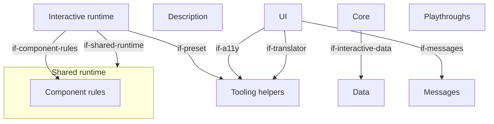
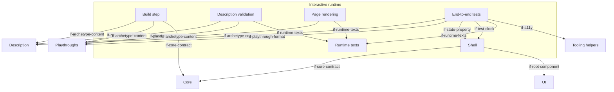

# Building Blocks

The interactive archetype's extension of the generic architecture (`docs/arc42/` at the root of
`lernapps/app-templates`). In an interactive app, doing is the content.
It has a static start page and one app page. On the app page the shell runs the app's deterministic core and shows its
state with the app's Vue components. Hash routes select modes and levels.

The runtime ships the build step, the pages, the shell and the end-to-end tests.
The creator writes the description, the core, the UI, the data, the messages and the playthroughs, and `src/main.ts`.
The archetype reuses the explainer's component rules. It has no tutor handoff, task numbers, exercise contract or
examples check; its playthroughs take the examples' role. Only the start page reads without JavaScript.

An app gets this architecture as a copy and adds its own blocks below the core, the UI and the data.
It writes its part between the markers `<!-- app: begin … -->` and `<!-- app: end … -->`.
The tooling keeps that part when it replaces the rest.
The creator's assistant follows the skill `lernapps-interactive` (`if-skills`).

## Level 1 (interactive app)

```arc42
:::diagram
id: building-blocks-interactive-level-1
view: building-block
notation: mermaid
:::
```



## Level 2: the interactive runtime

```arc42
:::diagram
id: building-blocks-interactive-runtime
view: building-block
notation: mermaid
:::
```



## Interactive runtime

Built. The runtime of every interactive app; the app does not change it.
It builds and checks the app, starts its core and UI in the browser and brings the end-to-end tests.

```arc42
:::building-block
id: bb-archetype-runtime
title: Interactive runtime
path: runtime/interactive
technology: TypeScript, Vite plugin, Vue
requires: if-shared-runtime, if-preset, if-component-rules
implements: concept-archetype-extension
:::
```

### Build step

Built. Reads the description and the playthroughs and runs the component rules on the UI.
It checks that the core has the contract's exports and that every route starts.
It plays every playthrough against the core twice. The build fails when the two plays differ or a state differs from
the expected one. Only then does it write the start page, the app page and the 404 page.
No time passes in a play except the ticks a step names. An app's code has no size limit (`dec-no-size-limit`).

```arc42
:::building-block
id: bb-build
title: Build step
parent: bb-archetype-runtime
path: runtime/interactive/plugin.ts
technology: Vite plugin
requires: if-archetype-content, if-playthrough-format, if-core-contract, if-component-rules
implements: concept-playthroughs, concept-determinism
:::
```

#### Build plugin interface

The app's Vite configuration adds the plugin to the tooling preset. That is the only way the app enters the build.

```arc42
:::interface
id: if-build-plugin
title: interactive() Vite plugin
provider: bb-build
protocol: TypeScript import, @lernapps/app-templates/interactive/plugin
path: runtime/interactive/plugin.ts
:::
```

### Description validation

Built. Checks the description and every playthrough against their schemas and what a schema cannot say, such as
complete languages, unique ids and known routes. It reports one line per problem with file and line.

```arc42
:::building-block
id: bb-validation
title: Description validation
parent: bb-archetype-runtime
path: runtime/interactive/load.ts
technology: Ajv, JSON Schema, YAML
requires: if-archetype-content, if-playthrough-format, if-runtime-texts
:::
```

### Page rendering

Built. Renders two pages in each language.
The start page says what the app does, how to play and what it trains, and links into the app and its routes.
It needs no script. The app page holds the title, the route links and the place where the app runs.
Without JavaScript it shows a note and a link back.

```arc42
:::building-block
id: bb-render
title: Page rendering
parent: bb-archetype-runtime
path: runtime/interactive/render.ts
technology: TypeScript, HTML
requires: if-archetype-content, if-runtime-texts
implements: concept-readable-without-js, concept-hash-routes, concept-accessibility
:::
```

#### Pages interface

Learners, teachers and parents read the start page at `lernapps.net/<repo>/` and play at `app/?seed=<n>#<route>`.
The catalog entry's topics link to the routes. Another app can link with more parameters in the address.
The core gets them as data (`dec-address-params`).

```arc42
:::interface
id: if-pages
title: Start page and app page app/?seed=<n>#<route>
provider: bb-render
protocol: HTML pages over HTTPS (query and hash)
path: runtime/interactive/render.ts
:::
```

### Shell

Built. Mounts the app's root component on the app page and holds the core's state.
It starts the core with the seed, the route and the other parameters of the address; without a seed it draws one.
A new route starts the core again with the same seed and parameters.
It passes the learner's inputs to the core (`dec-typed-input`) and lets time pass when the core moves on its own.
The language switch opens the same round in the other language (`dec-address-params`).

The page header holds only the language switch; an app with one language has none.
Beside the title an app may show one small control of its own, such as help or sound off.
An app can set the width of the page.

```arc42
:::building-block
id: bb-shell
title: Shell
parent: bb-archetype-runtime
path: runtime/interactive/interactive.ts
technology: TypeScript, Vue, DOM events
requires: if-core-contract, if-root-component
implements: concept-core-and-shell, concept-hash-routes, concept-determinism
:::
```

#### Start interface

The app's `src/main.ts` imports the runtime's style, the core and the root component and starts the app with them.

```arc42
:::interface
id: if-start
title: startInteractive(core, root, options?)
provider: bb-shell
protocol: TypeScript import, @lernapps/app-templates/interactive
path: runtime/interactive/interactive.ts
:::
```

#### Test clock

The end-to-end tests control time in the browser through this clock. Then no time passes except the ticks a
playthrough step names, as in the build. Only the tests use it.

```arc42
:::interface
id: if-test-clock
title: lernappsClock, the end-to-end tests' clock
provider: bb-shell
protocol: global object with tick(count)
path: runtime/interactive/contract.ts
:::
```

#### State property

The shell shows the core's state on the app's element, so that the end-to-end tests can read it.

```arc42
:::ignore H020 the state property, the test clock and the core contract are all defined in contract.ts, the runtime's one contract module
:::
:::interface
id: if-state-property
title: lernappsState on the app element
provider: bb-shell
protocol: DOM property
path: runtime/interactive/contract.ts
:::
```

### End-to-end tests

Built. Checks both pages without JavaScript in every language.
It plays every playthrough in the browser on the test clock, as a learner's inputs would.
After each step it compares the state and the announcement, on a desktop and on a phone width.

```arc42
:::building-block
id: bb-e2e
title: End-to-end tests
parent: bb-archetype-runtime
path: runtime/interactive/e2e.ts
technology: Playwright
requires: if-archetype-content, if-playthrough-format, if-state-property, if-test-clock, if-runtime-texts, if-a11y
implements: concept-playthroughs
:::
```

#### Tests interface

The app's end-to-end test file, part of the scaffold, only calls these tests.

```arc42
:::interface
id: if-e2e-tests
title: interactiveTests()
provider: bb-e2e
protocol: TypeScript import, @lernapps/app-templates/interactive/e2e
path: runtime/interactive/e2e.ts
:::
```

### Runtime texts

Built. The runtime's own learner texts in German and English; an app may declare only these languages.

```arc42
:::building-block
id: bb-runtime-texts
title: Runtime texts
parent: bb-archetype-runtime
path: runtime/interactive/messages.ts
technology: JSON per language
implements: concept-languages
:::
```

#### Runtime texts interface

The pages, the validation and the tests read the runtime's texts by language.

```arc42
:::interface
id: if-runtime-texts
title: Runtime texts by language
provider: bb-runtime-texts
protocol: TypeScript import, JSON
path: runtime/interactive/messages
:::
```

## Description

Built in the template: `src/app.yaml` says what the start page shows, the languages and the routes.

```arc42
:::building-block
id: bb-interactive-description
title: Description
technology: YAML
path: interactive/src/app.yaml
:::
```

### App description interface

The interactive archetype's content: the build, the validation, the pages and the tests read the app's description
only through this schema.

```arc42
:::interface
id: if-archetype-content
title: app.yaml (interactive.v1 schema)
provider: bb-interactive-description
protocol: YAML, JSON Schema
path: runtime/interactive/interactive.v1.schema.json
:::
```

## Core

Built in the template. The app's logic in pure TypeScript without DOM. It is deterministic by its seed, and its state
is plain JSON. So it plays the same in Node and in the browser. It reads the app's data.

```arc42
:::building-block
id: bb-interactive-core
title: Core
technology: TypeScript
requires: if-interactive-data
implements: concept-core-and-shell, concept-determinism
path: interactive/src/core
:::
```

### Core contract

The core exports three functions:

- `start(seed, route, params)` returns the first state for a seed and a route.
  `params` are the other parameters of the address as text; the core checks them itself.
  A core that needs none keeps `start(seed, route)` (`dec-address-params`).
- `step(state, input)` returns the state after one input of the learner.
- `tick(state, dt)`, only when the app moves on its own, returns the state after some time.

An input is typed and extensible (`dec-typed-input`). A key input names the key as the browser does.
An action input names what the learner does with the pointer or by touch, with an optional value.
A core returns the state unchanged for a kind of input it does not know, so new kinds can come.

```arc42
:::ignore H020 the core contract, the state property and the test clock are all defined in contract.ts, the runtime's one contract module
:::
:::interface
id: if-core-contract
title: Core contract start, step, tick
provider: bb-interactive-core
protocol: TypeScript module exports
path: runtime/interactive/contract.ts
:::
```

<!-- app: begin core -->
<!-- app: end core -->

## UI

Built in the template. Vue components show the state and turn the device's input into inputs for the core.
They are free in how they render, for example DOM, SVG or canvas.
They may remember something in the small storage; the template does not.

```arc42
:::building-block
id: bb-interactive-ui
title: UI
technology: Vue single-file components
requires: if-a11y, if-translator, if-messages
implements: concept-component-rules, concept-accessibility
path: interactive/src/ui
:::
```

### Root component

The root component gets the state and the language and emits the learner's inputs (an action or a key).

```arc42
:::ignore H014 the contract has no file of its own: its props are set in runtime/interactive/interactive.ts (if-start's file), the component is the app's
:::
:::interface
id: if-root-component
title: Root component (state, lang, input)
provider: bb-interactive-ui
protocol: Vue props and events
:::
```

<!-- app: begin ui -->
<!-- app: end ui -->

## Data

Built in the template. The app's content as data in its own format (lessons, texts with their faulty versions).

```arc42
:::building-block
id: bb-interactive-data
title: Data
technology: JSON
path: interactive/src/data
:::
```

### App data

The core imports the data files as JSON modules, so they are bundled and checked with the core.

```arc42
:::interface
id: if-interactive-data
title: Data files (JSON imports)
provider: bb-interactive-data
protocol: JSON module import
path: interactive/src/data
:::
```

<!-- app: begin data -->
<!-- app: end data -->

## Messages

Built in the template. The app's learner texts by language, read through the translator.

```arc42
:::building-block
id: bb-interactive-messages
title: Messages
technology: JSON
implements: concept-languages
path: interactive/src/messages
:::
```

### Message files

The UI imports one message file per language and hands it to the translator.

```arc42
:::interface
id: if-messages
title: Message files by language
provider: bb-interactive-messages
protocol: JSON module import
path: interactive/src/messages
:::
```

## Playthroughs

Built in the template. A playthrough is data: a seed, a route, the parameters of the address if any, and steps.
Each step gives inputs and lets ticks pass, then names the state or announcement it expects.

```arc42
:::building-block
id: bb-interactive-playthroughs
title: Playthroughs
technology: YAML
implements: concept-playthroughs
path: interactive/src/playthroughs
:::
```

### Playthrough format

The build and the end-to-end tests read playthroughs in this format.

```arc42
:::interface
id: if-playthrough-format
title: Playthrough (playthrough.v1 schema)
provider: bb-interactive-playthroughs
protocol: YAML, JSON Schema
path: runtime/interactive/playthrough.v1.schema.json
:::
```

<!-- app: begin -->
<!-- app: end -->
