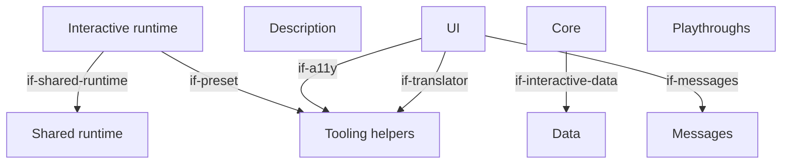

# Building Blocks

The interactive archetype's extension of the generic architecture (`docs/arc42/` at the root of
`lernapps/app-templates`): an app whose doing is the content, with a static start page, one app page on which the
shell runs the app's deterministic core and shows its state with the app's Vue components, and hash routes for modes
and levels. The runtime `runtime/interactive/` ships the build step, the pages, the shell and the end-to-end tests; the
creator writes the description, the core, the UI, the data, the messages and the playthroughs, and `src/main.ts`, which
calls `startInteractive`. It reuses the explainer's component rules; the tutor handoff, task numbers, exercise contract
and the examples check are not built for it (its playthroughs take the examples' role). Only the start page reads
without JavaScript. An interactive app adds its own blocks below `bb-interactive-core`, `bb-interactive-ui` and
`bb-interactive-data`, in an architecture part of its own. The creator's assistant follows the skill
`lernapps-interactive` (`if-skills`).

## Level 1 (interactive app)

```arc42
:::diagram
id: building-blocks-interactive-level-1
view: building-block
notation: mermaid
:::
```



## Level 2: the interactive runtime

```arc42
:::diagram
id: building-blocks-interactive-runtime
view: building-block
notation: mermaid
:::
```



```mermaid
flowchart TB
    subgraph bb-archetype-runtime["Interactive runtime"]
        bb-build["Build step"]
        bb-validation["Description validation"]
        bb-render["Page rendering"]
        bb-shell["Shell"]
        bb-e2e["End-to-end tests"]
        bb-runtime-texts["Runtime texts"]
        bb-component-rules["Component rules"]
    end
    bb-interactive-description["Description"]
    bb-interactive-core["Core"]
    bb-interactive-ui["UI"]
    bb-interactive-playthroughs["Playthroughs"]
    bb-tooling["Tooling helpers"]
    bb-build -->|"if-archetype-content"| bb-interactive-description
    bb-build -->|"if-playthrough-format"| bb-interactive-playthroughs
    bb-build -->|"if-core-contract"| bb-interactive-core
    bb-build -->|"if-component-rules"| bb-component-rules
    bb-validation -->|"if-archetype-content"| bb-interactive-description
    bb-validation -->|"if-playthrough-format"| bb-interactive-playthroughs
    bb-validation -->|"if-runtime-texts"| bb-runtime-texts
    bb-render -->|"if-archetype-content"| bb-interactive-description
    bb-render -->|"if-runtime-texts"| bb-runtime-texts
    bb-shell -->|"if-core-contract"| bb-interactive-core
    bb-shell -->|"if-root-component"| bb-interactive-ui
    bb-e2e -->|"if-archetype-content"| bb-interactive-description
    bb-e2e -->|"if-playthrough-format"| bb-interactive-playthroughs
    bb-e2e -->|"if-state-property"| bb-shell
    bb-e2e -->|"if-test-clock"| bb-shell
    bb-e2e -->|"if-runtime-texts"| bb-runtime-texts
    bb-e2e -->|"if-a11y"| bb-tooling
```

## Interactive runtime

Built. The runtime of every interactive app, which the app does not change: it builds the pages, runs the build
checks, starts the app's core and UI in the browser and brings the end-to-end tests.

```arc42
:::building-block
id: bb-archetype-runtime
title: Interactive runtime
path: runtime/interactive
technology: TypeScript, Vite plugin, Vue
requires: if-shared-runtime, if-preset
implements: concept-archetype-extension
:::
```

### Build step

Built. The plugin `interactive()` reads `src/app.yaml` and the playthroughs, runs the component rules on the UI, loads
the core in a Vite server of its own and checks its exports and that every route starts, plays every playthrough
against the core twice, each step's inputs through `step` and then its ticks through `tick(state, 20)`, and fails when
the two plays differ or a state differs from the expected one, and only then writes the start page, the app page and
the 404 page. No time passes but the ticks a step names. An app's code has no size limit (`dec-no-size-limit`).

```arc42
:::building-block
id: bb-build
title: Build step
parent: bb-archetype-runtime
path: runtime/interactive/plugin.ts
technology: Vite plugin
requires: if-archetype-content, if-playthrough-format, if-core-contract, if-component-rules
implements: concept-playthroughs, concept-determinism
:::
```

#### Build plugin interface

The app's vite.config.ts adds `interactive()` to the tooling preset; that is the only way the app enters the build.

```arc42
:::interface
id: if-build-plugin
title: interactive() Vite plugin
provider: bb-build
protocol: TypeScript import, @lernapps/app-templates/interactive/plugin
path: runtime/interactive/plugin.ts
:::
```

### Description validation

Built. Validates `src/app.yaml` and every playthrough against their JSON schemas, then German first, complete
languages, unique ids, at least one playthrough, each step expecting something, and known routes; one line per
problem with file and line.

```arc42
:::building-block
id: bb-validation
title: Description validation
parent: bb-archetype-runtime
path: runtime/interactive/load.ts
technology: Ajv, JSON Schema, YAML
requires: if-archetype-content, if-playthrough-format, if-runtime-texts
:::
```

### Page rendering

Built. Renders, in each language, the start page (what the app does, the link into the app, the routes, how to play,
competencies, background sections, a `<noscript>` note and no script) and the app page (title, `<noscript>` note with
a link back, the routes as anchor links, and the element the shell mounts into, carrying the route ids).

```arc42
:::building-block
id: bb-render
title: Page rendering
parent: bb-archetype-runtime
path: runtime/interactive/render.ts
technology: TypeScript, HTML
requires: if-archetype-content, if-runtime-texts
implements: concept-readable-without-js, concept-hash-routes, concept-accessibility
:::
```

#### Pages interface

Learners, teachers and parents read the start page at `lernapps.net/<repo>/` and play at
`app/?seed=<n>#<route>`; the catalog entry's topics link to the routes.

```arc42
:::interface
id: if-pages
title: Start page and app page app/?seed=<n>#<route>
provider: bb-render
protocol: HTML pages over HTTPS (query and hash)
path: runtime/interactive/render.ts
:::
```

### Shell

Built. `startInteractive(core, root)` mounts the root component on the app page and holds the core's state; it takes
the seed from `?seed=<n>` (else a random one) and the route from the hash (else the first route), starts the core
again on a new route, calls `tick(state, 20)` every 20 ms when the core has `tick`, and routes typed inputs to `step`
(`dec-typed-input`): every key typed on the page as a key input, except on links, buttons and form fields or with
Ctrl, Alt or Meta, and every input the root component emits as `input` (an action, or a key it stands for). When the
end-to-end tests' clock is on the page (`if-test-clock`), it starts no interval and steps the ticks the tests ask for.

```arc42
:::building-block
id: bb-shell
title: Shell
parent: bb-archetype-runtime
path: runtime/interactive/interactive.ts
technology: TypeScript, Vue, DOM events
requires: if-core-contract, if-root-component
implements: concept-core-and-shell, concept-hash-routes, concept-determinism
:::
```

#### Start interface

The app's `src/main.ts` imports the runtime's style, the core and the root component and calls `startInteractive`.

```arc42
:::interface
id: if-start
title: startInteractive(core, root)
provider: bb-shell
protocol: TypeScript import, @lernapps/app-templates/interactive
path: runtime/interactive/interactive.ts
:::
```

#### Test clock

Before the client module runs, the end-to-end tests put an object on the page as the global `lernappsClock`; the
shell then starts no interval and gives that object `tick(count)`, which calls the shell's own tick `count` times. No
time passes in the browser but the ticks a playthrough step names, as in the build. Only the tests set it.

```arc42
:::interface
id: if-test-clock
title: lernappsClock, the end-to-end tests' clock
provider: bb-shell
protocol: global object with tick(count)
path: runtime/interactive/contract.ts
:::
```

#### State property

The shell mirrors the state on the app's element as `lernappsState`, which the end-to-end tests read.

```arc42
:::ignore H020 the state property, the test clock and the core contract are all defined in contract.ts, the runtime's one contract module
:::
:::interface
id: if-state-property
title: lernappsState on the app element
provider: bb-shell
protocol: DOM property
path: runtime/interactive/contract.ts
:::
```

### End-to-end tests

Built. `interactiveTests()` checks the start page and the app page without JavaScript in every language and plays
every playthrough's steps in the browser on the test clock (`if-test-clock`): a key input pressed on the keyboard, an
action emitted as `input` by the root component, as the component itself does, then the step's ticks; after each step
it compares the state and the polite announcement, at desktop width and 360 px.

```arc42
:::building-block
id: bb-e2e
title: End-to-end tests
parent: bb-archetype-runtime
path: runtime/interactive/e2e.ts
technology: Playwright
requires: if-archetype-content, if-playthrough-format, if-state-property, if-test-clock, if-runtime-texts, if-a11y
implements: concept-playthroughs
:::
```

#### Tests interface

The app's `e2e/interactive.e2e.ts` only calls `interactiveTests()`.

```arc42
:::interface
id: if-e2e-tests
title: interactiveTests()
provider: bb-e2e
protocol: TypeScript import, @lernapps/app-templates/interactive/e2e
path: runtime/interactive/e2e.ts
:::
```

### Runtime texts

Built. The runtime's own learner texts in German and English; an app may declare only these languages.

```arc42
:::building-block
id: bb-runtime-texts
title: Runtime texts
parent: bb-archetype-runtime
path: runtime/interactive/messages.ts
technology: JSON per language
implements: concept-languages
:::
```

#### Runtime texts interface

The pages, the validation and the tests take the runtime's texts by key and language.

```arc42
:::interface
id: if-runtime-texts
title: Runtime texts by language
provider: bb-runtime-texts
protocol: TypeScript import, JSON
path: runtime/interactive/messages
:::
```

### Component rules

Built in the explainer's runtime and reused here: code checks on the SFC compiler's output of the UI's components and
the modules they import (no network, no `eval`, `innerHTML` or `v-html`, imports only from Vue, the runtime, the
storage, i18n and a11y helpers, the app's own files and the libraries in the dependencies of its package.json, never
from a URL, browser globals only once mounted; `dec-libraries`).

```arc42
:::building-block
id: bb-component-rules
title: Component rules
parent: bb-archetype-runtime
path: runtime/explainer/components.ts
technology: TypeScript, Vue SFC compiler
implements: concept-component-rules
:::
```

#### Component rules interface

The build step runs the checks on every single-file component in `src/` and the app's modules they import.

```arc42
:::interface
id: if-component-rules
title: Component checks on the SFC compiler's output
provider: bb-component-rules
protocol: TypeScript function call at build
path: runtime/explainer/components.ts
:::
```

## Description

Built in the template: `src/app.yaml` says what the start page shows, the languages and the routes.

```arc42
:::ignore H014 the template is copied into each app; this block's path is the app's own and is set in the app's architecture
:::
:::building-block
id: bb-interactive-description
title: Description
technology: YAML
:::
```

### App description interface

The interactive archetype's content: the build, the validation, the pages and the tests read the app's description
only through this schema.

```arc42
:::interface
id: if-archetype-content
title: app.yaml (interactive.v1 schema)
provider: bb-interactive-description
protocol: YAML, JSON Schema
path: runtime/interactive/interactive.v1.schema.json
:::
```

## Core

Built in the template. The app's logic, pure TypeScript without DOM, deterministic by its seed, its state plain JSON,
so that it can be played and tested in Node and in the browser alike; it reads the app's data.

```arc42
:::ignore H014 the template is copied into each app; this block's path is the app's own and is set in the app's architecture
:::
:::building-block
id: bb-interactive-core
title: Core
technology: TypeScript
requires: if-interactive-data
implements: concept-core-and-shell, concept-determinism
:::
```

### Core contract

The core exports `start(seed, route)`, `step(state, input)` and, when the app moves on its own, `tick(state, dt)`.
The input is typed and extensible (`dec-typed-input`): `{ kind: "key", key }` with the key as `KeyboardEvent.key`, or
`{ kind: "action", name, value? }` for what the learner does with the pointer or by touch; a core handles the kinds it
knows and returns the state unchanged for any other, so new kinds can come.

```arc42
:::ignore H020 the core contract, the state property and the test clock are all defined in contract.ts, the runtime's one contract module
:::
:::interface
id: if-core-contract
title: Core contract start, step, tick
provider: bb-interactive-core
protocol: TypeScript module exports
path: runtime/interactive/contract.ts
:::
```

## UI

Built in the template. Vue components that show the state and translate the device's input (keys, pointer, touch, …)
into inputs; free in how they render (DOM, SVG, canvas). They may remember something through the small storage; the
template does not.

```arc42
:::ignore H014 the template is copied into each app; this block's path is the app's own and is set in the app's architecture
:::
:::building-block
id: bb-interactive-ui
title: UI
technology: Vue single-file components
requires: if-a11y, if-translator, if-messages
implements: concept-component-rules, concept-accessibility
:::
```

### Root component

The root component takes the props `state` and `lang` and emits `input` with an input (an action, or a key).

```arc42
:::ignore H014 the contract has no file of its own: its props are set in runtime/interactive/interactive.ts (if-start's file), the component is the app's
:::
:::interface
id: if-root-component
title: Root component (state, lang, input)
provider: bb-interactive-ui
protocol: Vue props and events
:::
```

## Data

Built in the template. The app's content as data in its own format (lessons, texts with their faulty versions).

```arc42
:::ignore H014 the template is copied into each app; this block's path is the app's own and is set in the app's architecture
:::
:::building-block
id: bb-interactive-data
title: Data
technology: JSON
:::
```

### App data

The core imports the data files as JSON modules, so they are bundled and checked with the core.

```arc42
:::ignore H014 the template is copied into each app; this interface's path is the app's own and is set in the app's architecture
:::
:::interface
id: if-interactive-data
title: Data files (JSON imports)
provider: bb-interactive-data
protocol: JSON module import
:::
```

## Messages

Built in the template. The app's learner texts by language, read through the translator.

```arc42
:::ignore H014 the template is copied into each app; this block's path is the app's own and is set in the app's architecture
:::
:::building-block
id: bb-interactive-messages
title: Messages
technology: JSON
implements: concept-languages
:::
```

### Message files

The UI imports one message file per language and hands it to the translator.

```arc42
:::ignore H014 the template is copied into each app; this interface's path is the app's own and is set in the app's architecture
:::
:::interface
id: if-messages
title: Message files by language
provider: bb-interactive-messages
protocol: JSON module import
:::
```

## Playthroughs

Built in the template. Playthroughs as data: a seed, a route and steps of inputs (`keys` as the short form of key
inputs, or `inputs`) and ticks that pass after them, with the state or announcement expected after each step. The
template's playthrough lets a letter go late and starts a round with the action `again`.

```arc42
:::ignore H014 the template is copied into each app; this block's path is the app's own and is set in the app's architecture
:::
:::building-block
id: bb-interactive-playthroughs
title: Playthroughs
technology: YAML
implements: concept-playthroughs
:::
```

### Playthrough format

The build and the end-to-end tests read playthroughs in this format.

```arc42
:::interface
id: if-playthrough-format
title: Playthrough (playthrough.v1 schema)
provider: bb-interactive-playthroughs
protocol: YAML, JSON Schema
path: runtime/interactive/playthrough.v1.schema.json
:::
```
