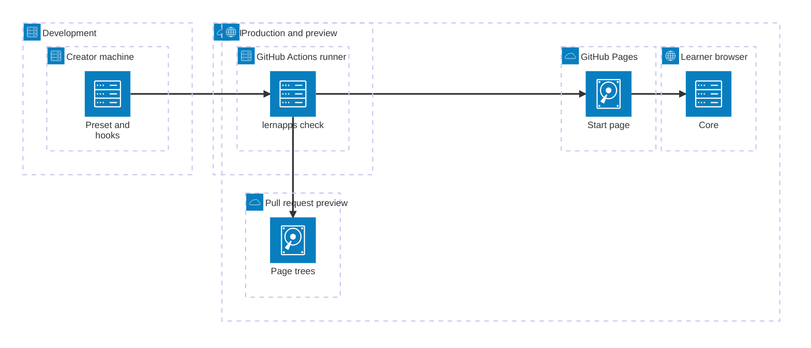

# Deployment View

## Deployment overview

An interactive app is static files: it is built and checked on the creator's machine and again in CI, published to its
repo's GitHub Pages and run entirely in the learner's browser. There is no server of the app's own; what the app
remembers stays in the browser's `localStorage`. A pull request gets a preview of the same files.

An interactive app gets the same generated Pages workflow (app check, publish, preview) as the other archetypes, in
step 2 of the plan. It is built for the explainer and quiz archetypes only; the tooling does not have the interactive
archetype yet, so an interactive app has no generated workflow today. The template app itself is checked by the CI of
`lernapps/app-templates`. The diagram shows one representative block per node; each node's section lists all it hosts.

```arc42
:::diagram
id: deployment-overview
view: deployment
notation: mermaid-architecture
:::
```



## Development

The creator's machine, where the creator's AI assistant writes the app.

```arc42
:::deployment-node
id: env-development
title: Development
type: environment
:::
```

## Creator's machine

`vp dev` serves the pages, rendered on each request. The git hooks the preset installs run the checks before a commit
(format, lint, type check) and before a push (unit tests, build, checks of the built app, end-to-end tests, in
Chromium). A template folder inside `lernapps/app-templates` gets no hooks of its own.

```arc42
:::deployment-node
id: dn-creator-machine
title: Creator's machine
type: device
parent: env-development
hosts: bb-preset, bb-lint-rules, bb-lernapps-check, bb-playwright-config, bb-app-validation, bb-component-rules, bb-core-check, bb-build-playthroughs, bb-start-page, bb-app-page, bb-page-tree, bb-not-found-page, bb-browser-playthroughs, bb-description, bb-main, bb-core, bb-ui, bb-data, bb-messages, bb-playthroughs
:::
```

## CI

GitHub Actions of the app's repo, on every push and pull request.

```arc42
:::deployment-node
id: env-ci
title: CI
type: environment
:::
```

## GitHub Actions runner

The job `app` runs `lernapps check`, the same command as the hooks, and keeps the checked bundle; on `main` the job
`deploy` publishes it, on a pull request from the repo the job `preview` publishes it as a preview. A change of only
the plan or only docs checks and publishes nothing.

```arc42
:::deployment-node
id: dn-ci-runner
title: GitHub Actions runner
type: server
parent: env-ci
hosts: bb-preset, bb-lint-rules, bb-lernapps-check, bb-playwright-config, bb-app-validation, bb-component-rules, bb-core-check, bb-build-playthroughs, bb-start-page, bb-app-page, bb-page-tree, bb-not-found-page, bb-browser-playthroughs, bb-description, bb-main, bb-core, bb-ui, bb-data, bb-messages, bb-playthroughs
:::
```

## Production and preview

lernapps.net as learners reach it.

```arc42
:::deployment-node
id: env-production
title: Production and preview
type: environment
:::
```

## GitHub Pages

The `gh-pages` branch of the app's repo, served from its root at `lernapps.net/<repo>/` (only a repo of the lernapps
organisation is served there; any other at its own Pages address). It serves the rendered pages in every language,
the 404 page and the bundle; the preset builds with relative URLs, so the app works under any path.

```arc42
:::deployment-node
id: dn-github-pages
title: GitHub Pages
type: server
parent: env-production
hosts: bb-start-page, bb-app-page, bb-page-tree, bb-not-found-page
:::
```

## Pull request preview

The same files below `pr-preview/pr-<number>/` of the app's address, not indexed by search engines, removed when the
pull request is closed.

```arc42
:::deployment-node
id: dn-pr-preview
title: Pull request preview
type: server
parent: env-production
hosts: bb-start-page, bb-app-page, bb-page-tree, bb-not-found-page
:::
```

## Learner's browser

Runs the app page's client module: the shell, the core and the UI with the tooling's helpers. `localStorage` of the
one origin lernapps.net holds what the app remembers, under the app's prefix; nothing leaves the device.

```arc42
:::deployment-node
id: dn-learner-browser
title: Learner's browser
type: device
parent: env-production
hosts: bb-main, bb-input-router, bb-clock, bb-hash-router, bb-seed, bb-core, bb-ui, bb-data, bb-messages, bb-i18n, bb-a11y, bb-small-storage
:::
```
