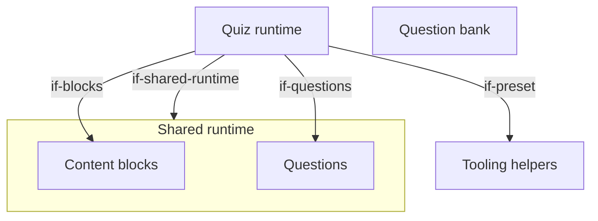
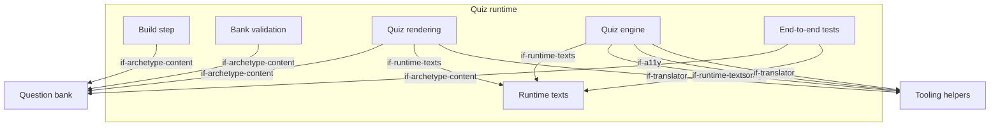

# Building Blocks

The quiz's extension of the generic architecture (`docs/arc42/` at the root of `lernapps/app-templates`).
A quiz asks about things to know. The runtime ships the build step, rendering, validation, engine and tests.
The creator writes only the question bank `src/quiz.json` and keeps `src/main.ts` as generated.
The quiz has no components, no tutor handoff, no task numbers and no exercise contract.
Its question types and content blocks come from the shared runtime, which the explainer uses too.
The creator's assistant follows the skill `lernapps-quiz` (`if-skills`).
A quiz app writes no architecture of its own: the bank's schema fixes its structure.

## Level 1 (quiz)

```arc42
:::diagram
id: building-blocks-quiz-level-1
view: building-block
notation: mermaid
:::
```



## Level 2: the quiz runtime

```arc42
:::diagram
id: building-blocks-quiz-runtime
view: building-block
notation: mermaid
:::
```



## Quiz runtime

Built. The runtime of every quiz; the app does not change it.
It validates and renders the bank, runs the quiz in the browser and brings the end-to-end tests.

```arc42
:::building-block
id: bb-archetype-runtime
title: Quiz runtime
path: runtime/quiz
technology: TypeScript, Vite plugin, DOM
requires: if-shared-runtime, if-preset, if-questions, if-blocks
implements: concept-archetype-extension
:::
```

### Build step

Built. Reads and validates the bank and writes the quiz page in every language and the 404 page.
The development server serves the same pages.

```arc42
:::building-block
id: bb-build
title: Build step
parent: bb-archetype-runtime
path: runtime/quiz/plugin.ts
technology: Vite plugin
requires: if-archetype-content
:::
```

#### Build plugin interface

The app's Vite configuration adds the plugin to the tooling preset.

```arc42
:::interface
id: if-build-plugin
title: quiz() Vite plugin
provider: bb-build
protocol: TypeScript import, @lernapps/app-templates/quiz/plugin
path: runtime/quiz/plugin.ts
:::
```

### Bank validation

Built. Checks the bank against its schema and what a schema cannot say, such as unique ids and complete languages.
It reports one line per problem and names the question.

```arc42
:::building-block
id: bb-validation
title: Bank validation
parent: bb-archetype-runtime
path: runtime/quiz/validate.ts
technology: Ajv, JSON Schema
requires: if-archetype-content
:::
```

### Quiz rendering

Built. Renders every question with its solution, background and sources into one page per language.
Without JavaScript the page reads as a worksheet with its answer key.
The quiz's own tests check this, not `lernapps check`.

```arc42
:::building-block
id: bb-render
title: Quiz rendering
parent: bb-archetype-runtime
path: runtime/quiz/render.ts
technology: TypeScript, HTML
requires: if-archetype-content, if-runtime-texts, if-translator
implements: concept-readable-without-js
:::
```

#### Pages interface

Learners, teachers and parents open the quiz at `lernapps.net/<repo>/`, one path per language.
A seed in the address fixes the order, and a deep link opens one question. The catalog entry links there.

```arc42
:::interface
id: if-pages
title: Quiz page at lernapps.net/<repo>/
provider: bb-render
protocol: HTML pages over HTTPS
path: runtime/quiz/render.ts
:::
```

### Quiz engine

Built. Turns the rendered page into a quiz with one question at a time, in the order of the seed.
It checks each answer, gives feedback, and shows the score and the solutions at the end.
It stores only the last result, and only when the bank asks for it.

```arc42
:::building-block
id: bb-shell
title: Quiz engine
parent: bb-archetype-runtime
path: runtime/quiz/engine.ts
technology: TypeScript, DOM
requires: if-runtime-texts, if-device-storage, if-a11y, if-translator
implements: concept-determinism, concept-accessibility
:::
```

#### Start interface

The app's `src/main.ts` imports the quiz's style and starts the quiz.

```arc42
:::interface
id: if-start
title: startQuiz()
provider: bb-shell
protocol: TypeScript import, @lernapps/app-templates/quiz
path: runtime/quiz/engine.ts
:::
```

### End-to-end tests

Built, in two parts. The app's tests check its content: each deep link, the worksheet without JavaScript and every
language. The runtime's tests check behaviour that is the same in every app, such as feedback, order and score.
Only this repo runs the runtime's tests, on the template. They take longer with a bigger bank and test nothing an app
writes.

```arc42
:::building-block
id: bb-e2e
title: End-to-end tests
parent: bb-archetype-runtime
path: runtime/quiz/e2e.ts
technology: Playwright
requires: if-archetype-content, if-runtime-texts
:::
```

#### Tests interface

The app's end-to-end test file, part of the scaffold, only calls the app's tests.

```arc42
:::interface
id: if-e2e-tests
title: quizTests()
provider: bb-e2e
protocol: TypeScript import, @lernapps/app-templates/quiz/e2e
path: runtime/quiz/e2e.ts
:::
```

### Runtime texts

Built. The quiz's own learner texts in German and English; a bank may declare only these languages.

```arc42
:::building-block
id: bb-runtime-texts
title: Runtime texts
parent: bb-archetype-runtime
path: runtime/quiz/messages
technology: JSON per language
implements: concept-languages
:::
```

#### Runtime texts interface

The rendering, the engine and the tests read the quiz's texts by language.

```arc42
:::interface
id: if-runtime-texts
title: Quiz texts by language
provider: bb-runtime-texts
protocol: JSON module import
path: runtime/quiz/messages
:::
```

## Question bank

Built in the template, written by the creator: title, intro, languages, sources, the storage choice and the
questions. It is the only file of a quiz the creator changes.

```arc42
:::building-block
id: bb-quiz-bank
title: Question bank
technology: JSON
implements: concept-languages
path: quiz/src/quiz.json
:::
```

### Question bank interface

The quiz's content. Rendering, validation, build and tests read the bank only through its schema.

```arc42
:::interface
id: if-archetype-content
title: src/quiz.json (quiz.v1 schema)
provider: bb-quiz-bank
protocol: JSON, JSON Schema
path: runtime/quiz/quiz.v1.schema.json
:::
```
