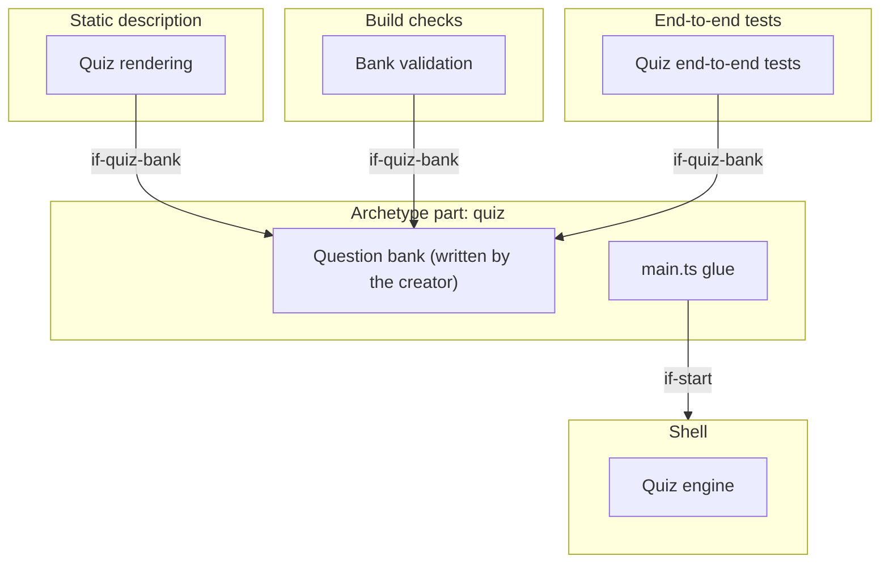

# Building Blocks

The quiz's extension of the generic architecture (`docs/arc42/` at the root of `lernapps/app-templates`): a quiz
about things to know, whose engine, rendering, validation and tests the runtime `quiz/` ships, and whose creator
writes only the question bank `src/quiz.json` (`quiz-only-data`). Of the optional generic blocks the quiz realises
the examples check and the question types; it has no components, no tutor handoff, no task numbers and no exercise
contract. A quiz app writes no architecture of its own: the bank's schema fixes its structure.

```arc42
:::diagram
id: building-blocks-quiz
view: building-block
notation: mermaid
:::
```



### Quiz rendering

Built. The plugin `quiz()` renders every question into the page with its controls, the hidden background,
explanation and further reading, the solutions and the sources, a page per language. Without JavaScript the page
reads as a worksheet with its answer key; the quiz is readable without JavaScript as far as a quiz can be, and its
own tests check it, not `lernapps check`.

```arc42
:::ignore W026 the parent is a block of the generic architecture, documented in its own file
:::
:::building-block
id: bb-quiz-rendering
title: Quiz rendering
parent: bb-static-description
technology: TypeScript (runtime/quiz/plugin.ts, render.ts)
requires: if-quiz-bank, if-question-exports, if-translator
implements: concept-readable-without-js
:::
```

### Bank validation

Built. Validates the bank against its schema, then what a schema cannot say (one correct option in a single choice,
unique ids, complete languages, the examples through the checker), one line per problem naming the question.

```arc42
:::ignore W026 the parent is a block of the generic architecture, documented in its own file
:::
:::building-block
id: bb-quiz-validation
title: Bank validation
parent: bb-build-checks
technology: Ajv, JSON Schema (runtime/quiz/validate.ts, quiz.v1.schema.json)
requires: if-quiz-bank, if-question-exports
:::
```

### Quiz engine

Built. Turns the rendered page into a quiz: one question at a time in the order of the seed in the address
(`?seed=<n>`, a deep link `#frage-<id>`), checking each answer with the question types' checker, the feedback after
each answer, the score and the solutions at the end. It stores nothing but the last result, and only when the bank
asks for it (`rememberLastResult`).

```arc42
:::ignore W026 the parent is a block of the generic architecture, documented in its own file
:::
:::building-block
id: bb-quiz-engine
title: Quiz engine
parent: bb-shell
technology: TypeScript, DOM (runtime/quiz/engine.ts; startQuiz)
requires: if-question-exports, if-device-storage, if-a11y, if-translator
implements: concept-determinism, concept-accessibility
:::
```

### Quiz end-to-end tests

Built. `quizTests()` checks every question of the bank in the browser (deep link, right and wrong answer, feedback in
view with the focus), the full score, the page without JavaScript, and each further language.

```arc42
:::ignore W026 the parent is a block of the generic architecture, documented in its own file
:::
:::building-block
id: bb-quiz-tests
title: Quiz end-to-end tests
parent: bb-e2e
technology: Playwright (runtime/quiz/e2e.ts)
requires: if-quiz-bank
:::
```

### Question bank

Built in the template, written by the creator: title, intro, languages, sources, `rememberLastResult` and the
questions; the only file of a quiz the creator changes.

```arc42
:::ignore W026 the parent is a block of the generic architecture, documented in its own file
:::
:::building-block
id: bb-quiz-bank
title: Question bank
parent: bb-archetype
path: src/quiz.json
technology: JSON
implements: concept-languages
:::
```

#### Question bank interface

The quiz's archetype content (`if-archetype-content`): rendering, validation, engine and tests read the bank only
through its schema.

```arc42
:::interface
id: if-quiz-bank
title: src/quiz.json (quiz.v1 schema)
provider: bb-quiz-bank
protocol: JSON, JSON Schema
path: src/quiz.json
:::
```

### Quiz main.ts glue

Built in the template, kept as generated: imports the quiz's style and calls `startQuiz()`.

```arc42
:::ignore W026 the parent is a block of the generic architecture, documented in its own file
:::
:::building-block
id: bb-quiz-main
title: Quiz main.ts glue
parent: bb-archetype
path: src/main.ts
technology: TypeScript
requires: if-start
:::
```

### Skill lernapps-quiz

Built: how the quiz works and how to write its questions, options, background and links; also for an explainer's
quiz-type exercises.

```arc42
:::ignore W026 the parent is a block of the generic architecture, documented in its own file
:::
:::building-block
id: bb-skill-quiz
title: Skill lernapps-quiz
parent: bb-tooling
technology: Markdown skill (skills/lernapps-quiz)
:::
```

#### Skill text of lernapps-quiz

The creator's assistant loads it before it writes questions.

```arc42
:::interface
id: if-skill-quiz
title: Skill text of lernapps-quiz
provider: bb-skill-quiz
protocol: Markdown (SKILL.md) loaded by the assistant
:::
```
