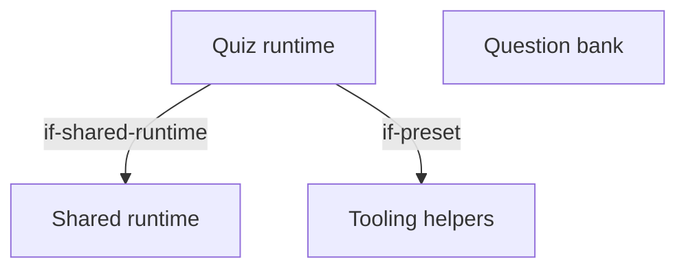
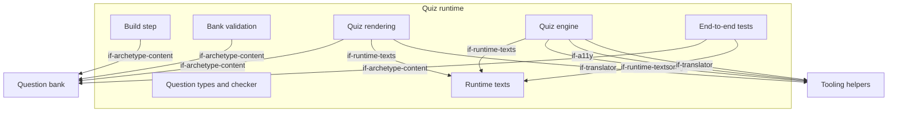

# Building Blocks

The quiz's extension of the generic architecture (`docs/arc42/` at the root of `lernapps/app-templates`): a quiz
about things to know, whose build step, rendering, validation, engine and tests the runtime `runtime/quiz/` ships, and
whose creator writes only the question bank `src/quiz.json` (`quiz-only-data`) and keeps `src/main.ts` as generated.
The quiz has no components, no tutor handoff, no task numbers and no exercise contract; its question types are reused
by the explainer. The creator's assistant follows the skill `lernapps-quiz` (`if-skills`). A quiz app writes no
architecture of its own: the bank's schema fixes its structure.

## Level 1 (quiz)

```arc42
:::diagram
id: building-blocks-quiz-level-1
view: building-block
notation: mermaid
:::
```



## Level 2: the quiz runtime

```arc42
:::diagram
id: building-blocks-quiz-runtime
view: building-block
notation: mermaid
:::
```



## Quiz runtime

Built. The runtime of every quiz, which the app does not change: it renders the bank into the page, validates it,
turns the page into a quiz in the browser and brings the end-to-end tests.

```arc42
:::building-block
id: bb-archetype-runtime
title: Quiz runtime
path: runtime/quiz
technology: TypeScript, Vite plugin, DOM
requires: if-shared-runtime, if-preset
implements: concept-archetype-extension
:::
```

### Build step

Built. The plugin `quiz()` reads and validates the bank and writes the quiz page in every language and the 404 page;
`vp dev` serves the same pages.

```arc42
:::building-block
id: bb-build
title: Build step
parent: bb-archetype-runtime
path: runtime/quiz/plugin.ts
technology: Vite plugin
requires: if-archetype-content
:::
```

#### Build plugin interface

The app's vite.config.ts adds `quiz()` to the tooling preset.

```arc42
:::interface
id: if-build-plugin
title: quiz() Vite plugin
provider: bb-build
protocol: TypeScript import, @lernapps/app-templates/quiz/plugin
path: runtime/quiz/plugin.ts
:::
```

### Bank validation

Built. Validates the bank against its schema, then what a schema cannot say (one correct option in a single choice,
unique ids, complete languages, the examples through the checker), one line per problem naming the question.

```arc42
:::building-block
id: bb-validation
title: Bank validation
parent: bb-archetype-runtime
path: runtime/quiz/validate.ts
technology: Ajv, JSON Schema
requires: if-archetype-content
:::
```

### Quiz rendering

Built. Renders every question into the page with its controls, the hidden background, explanation and further
reading, the solutions and the sources, a page per language. Without JavaScript the page reads as a worksheet with its
answer key; the quiz's own tests check it, not `lernapps check`.

```arc42
:::building-block
id: bb-render
title: Quiz rendering
parent: bb-archetype-runtime
path: runtime/quiz/render.ts
technology: TypeScript, HTML
requires: if-archetype-content, if-runtime-texts, if-translator
implements: concept-readable-without-js
:::
```

#### Pages interface

Learners, teachers and parents read the quiz at `lernapps.net/<repo>/` (and `/<language>/`), with `?seed=<n>` and the
deep link `#frage-<id>`; the catalog entry links there.

```arc42
:::interface
id: if-pages
title: Quiz page at lernapps.net/<repo>/
provider: bb-render
protocol: HTML pages over HTTPS
path: runtime/quiz/render.ts
:::
```

### Quiz engine

Built. Turns the rendered page into a quiz: one question at a time in the order of the seed in the address, each
answer checked with the question types' checker, the feedback after each answer, the score and the solutions at the
end. It stores nothing but the last result, and only when the bank asks for it (`rememberLastResult`).

```arc42
:::building-block
id: bb-shell
title: Quiz engine
parent: bb-archetype-runtime
path: runtime/quiz/engine.ts
technology: TypeScript, DOM
requires: if-runtime-texts, if-device-storage, if-a11y, if-translator
implements: concept-determinism, concept-accessibility
:::
```

#### Start interface

The app's `src/main.ts` imports the quiz's style and calls `startQuiz()`.

```arc42
:::interface
id: if-start
title: startQuiz()
provider: bb-shell
protocol: TypeScript import, @lernapps/app-templates/quiz
path: runtime/quiz/engine.ts
:::
```

### End-to-end tests

Built. `quizTests()` checks every question of the bank in the browser (deep link, right and wrong answer, feedback in
view with the focus), the full score, the page without JavaScript, and each further language.

```arc42
:::building-block
id: bb-e2e
title: End-to-end tests
parent: bb-archetype-runtime
path: runtime/quiz/e2e.ts
technology: Playwright
requires: if-archetype-content, if-runtime-texts
:::
```

#### Tests interface

The app's `e2e/quiz.e2e.ts` only calls `quizTests()`.

```arc42
:::interface
id: if-e2e-tests
title: quizTests()
provider: bb-e2e
protocol: TypeScript import, @lernapps/app-templates/quiz/e2e
path: runtime/quiz/e2e.ts
:::
```

### Question types and checker

Built: the six question types and what counts as a right answer, at build, in the browser and in the tests alike;
reused by the explainer's quiz-type exercises.

```arc42
:::building-block
id: bb-question-types
title: Question types and checker
parent: bb-archetype-runtime
path: runtime/quiz/quiz.ts
technology: TypeScript
:::
```

#### Question exports

One question's schema, validation, rendering, checker and messages, and `startQuestion` in the browser, for a page of
another archetype.

```arc42
:::interface
id: if-question-exports
title: One question (renderQuestion, validateQuestion, checker, startQuestion)
provider: bb-question-types
protocol: TypeScript import, @lernapps/app-templates/quiz/question
path: runtime/quiz/question.ts
:::
```

### Runtime texts

Built. The quiz's own learner texts in German and English; a bank may declare only these languages.

```arc42
:::building-block
id: bb-runtime-texts
title: Runtime texts
parent: bb-archetype-runtime
path: runtime/quiz/messages
technology: JSON per language
implements: concept-languages
:::
```

#### Runtime texts interface

The rendering, the engine and the tests take the quiz's texts by language.

```arc42
:::interface
id: if-runtime-texts
title: Quiz texts by language
provider: bb-runtime-texts
protocol: JSON module import
path: runtime/quiz/messages
:::
```

## Question bank

Built in the template, written by the creator: title, intro, languages, sources, `rememberLastResult` and the
questions; the only file of a quiz the creator changes.

```arc42
:::building-block
id: bb-quiz-bank
title: Question bank
technology: JSON
implements: concept-languages
path: quiz/src/quiz.json
:::
```

### Question bank interface

The quiz's content: rendering, validation, build and tests read the bank only through its schema.

```arc42
:::interface
id: if-archetype-content
title: src/quiz.json (quiz.v1 schema)
provider: bb-quiz-bank
protocol: JSON, JSON Schema
path: runtime/quiz/quiz.v1.schema.json
:::
```
